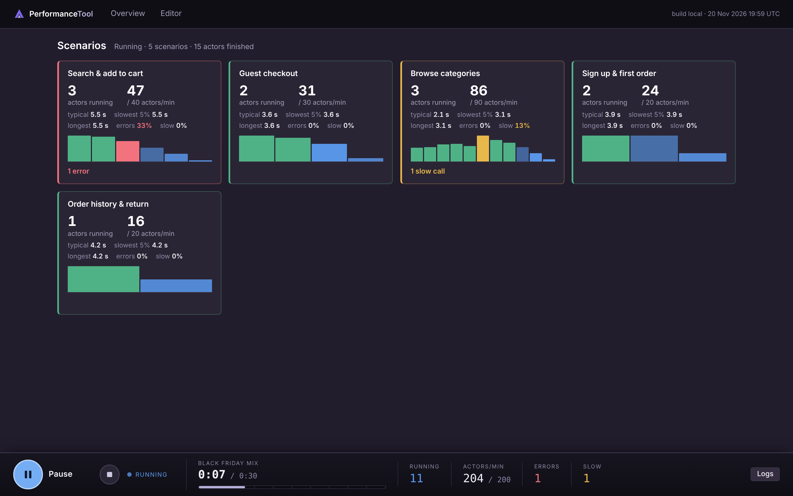
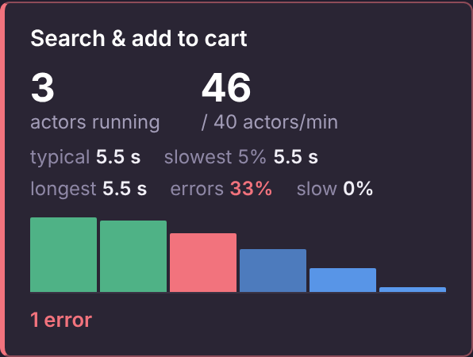
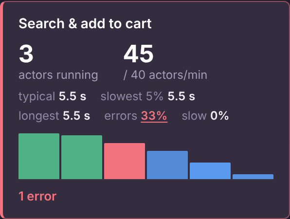
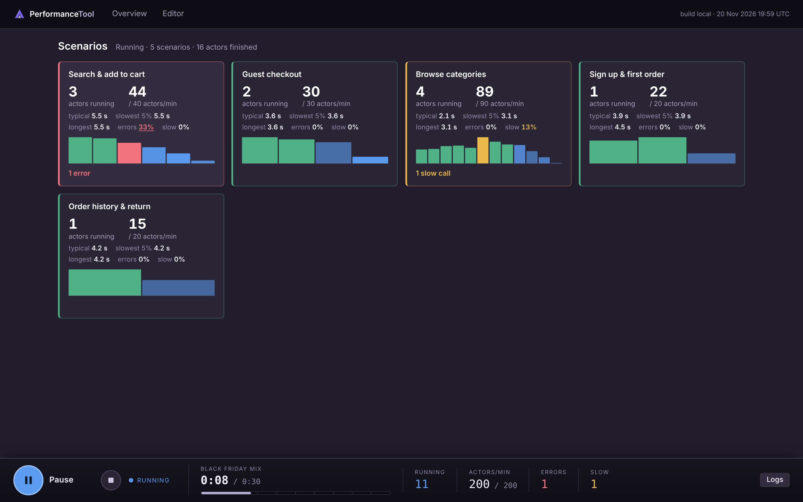
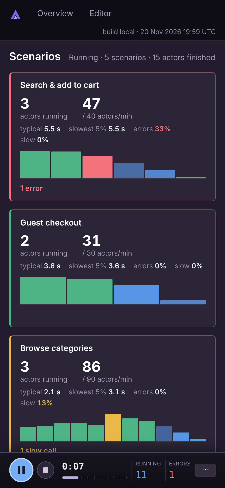
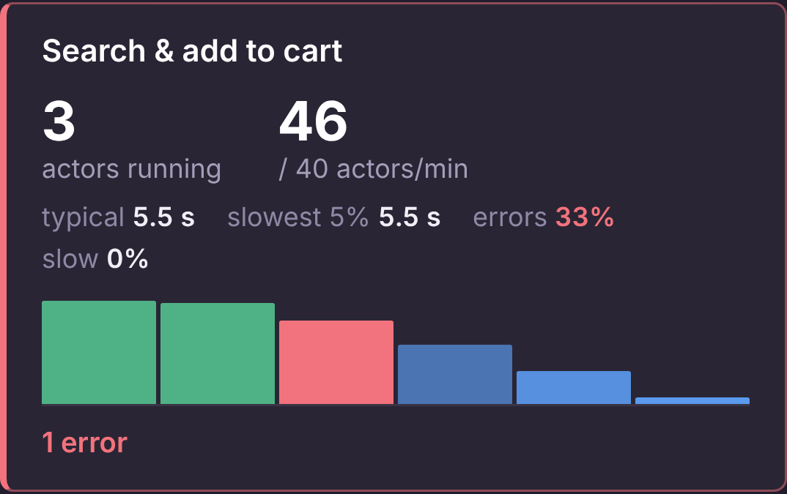
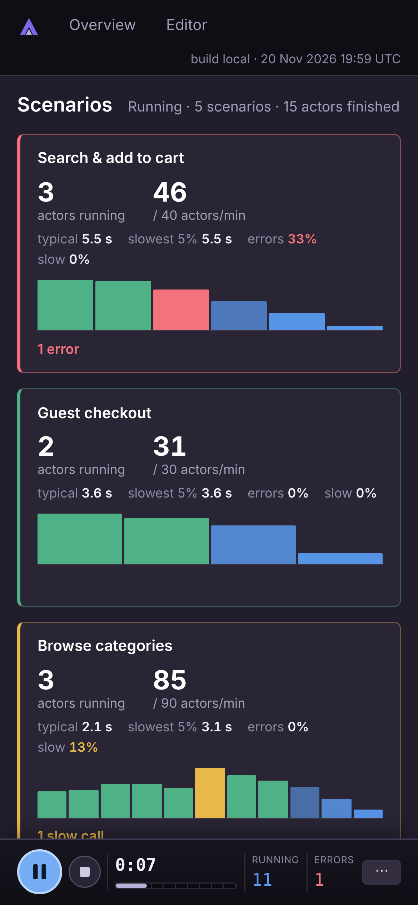

# Screenshots: 2026-11-20-card-outline

Fake data. One image per section; GitHub renders them inline on this page.

## cardoutline-desktop-1-running

## cardoutline-desktop-2-card-closeup

## cardoutline-desktop-3-hover

## cardoutline-desktop-4-finished

## cardoutline-phone-1-running

## cardoutline-phone-2-card-closeup

## cardoutline-phone-4-finished

