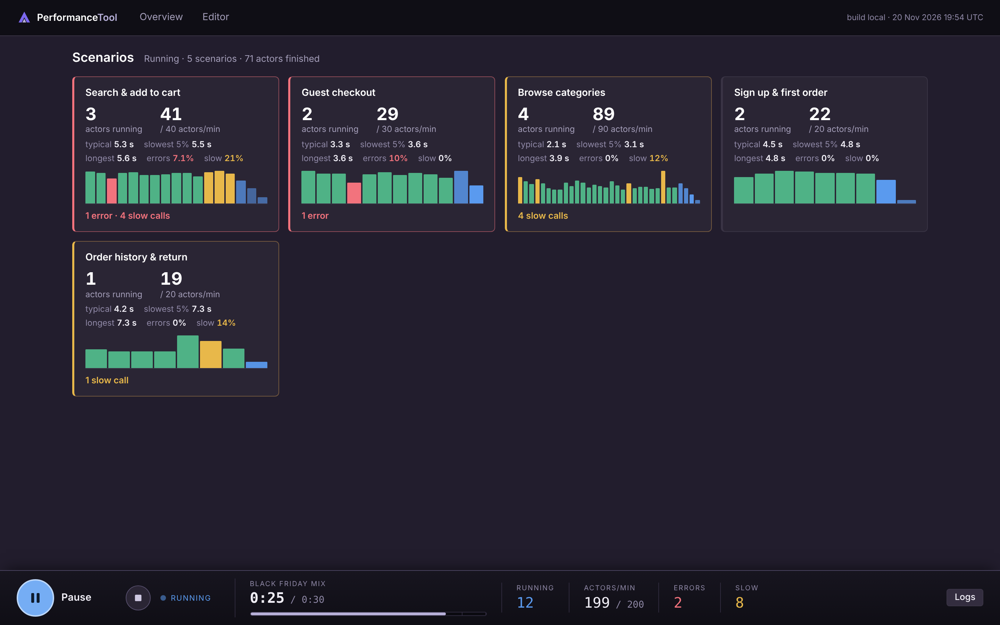
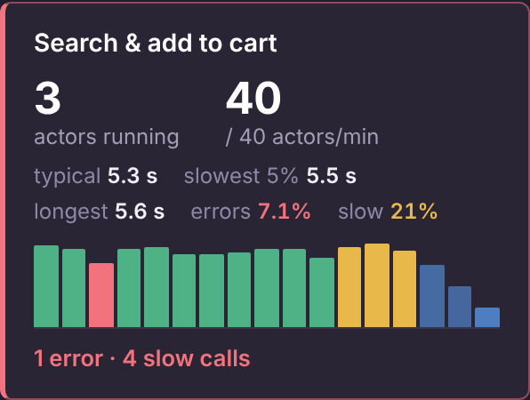
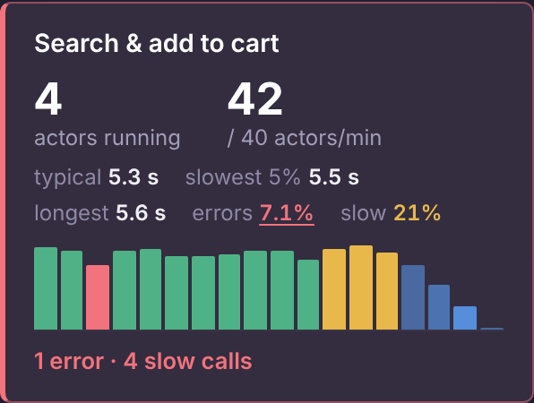
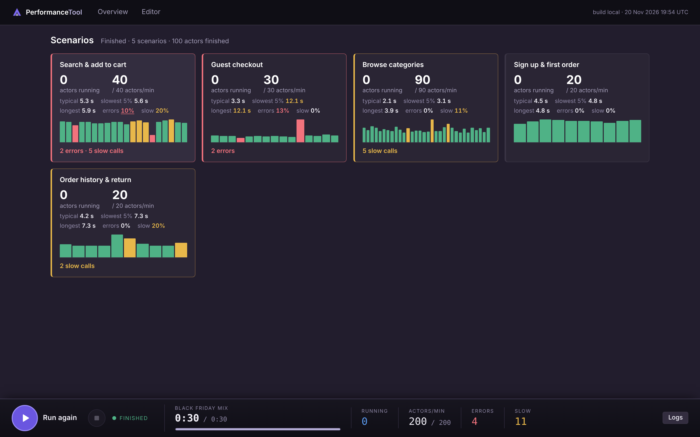
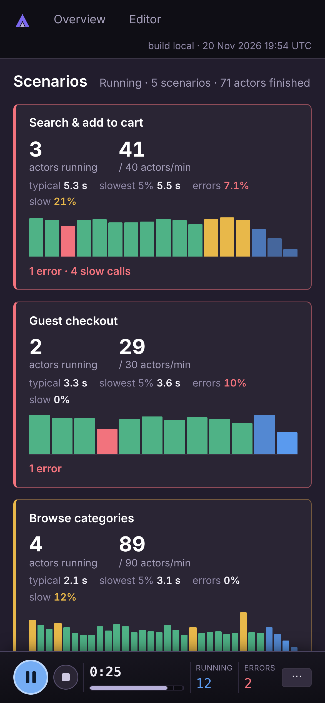
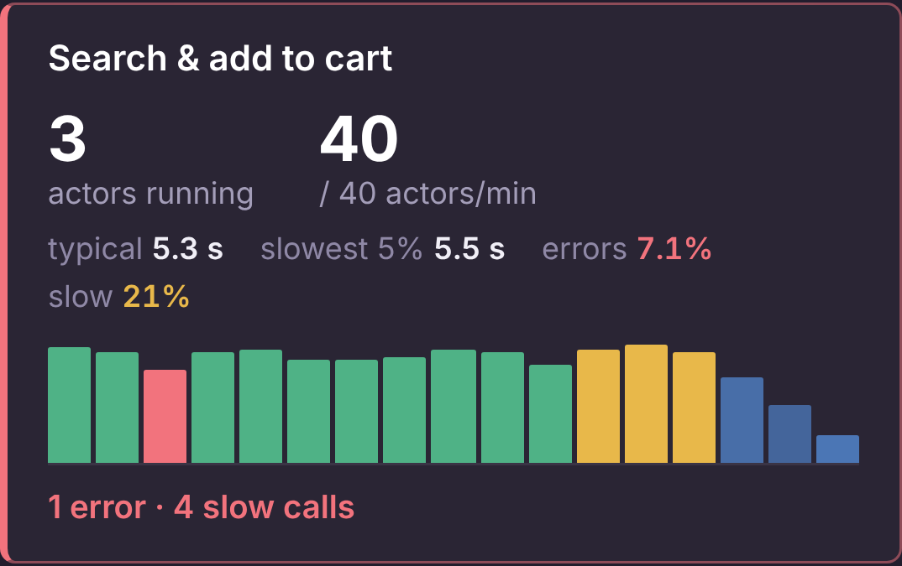
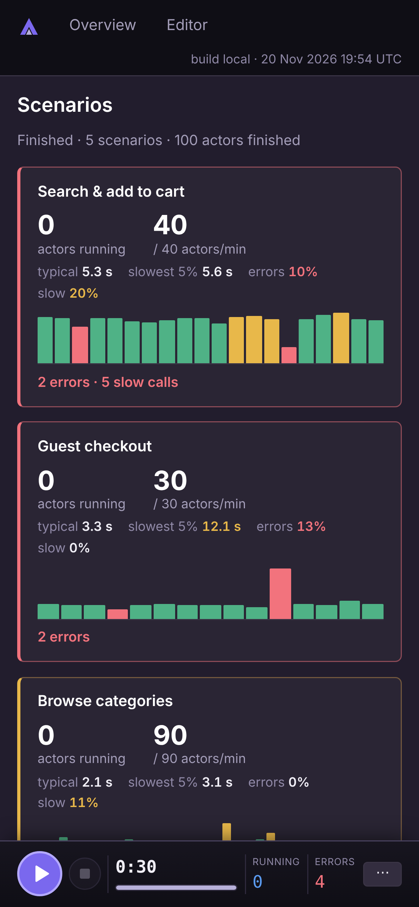

# Screenshots: 2026-11-20-card-stats

Fake data. One image per section; GitHub renders them inline on this page.

## cardstats-desktop-1-running

## cardstats-desktop-2-card-closeup

## cardstats-desktop-3-hover

## cardstats-desktop-4-finished

## cardstats-phone-1-running

## cardstats-phone-2-card-closeup

## cardstats-phone-4-finished

