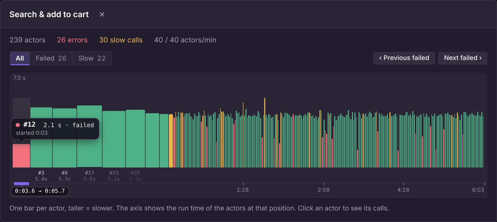
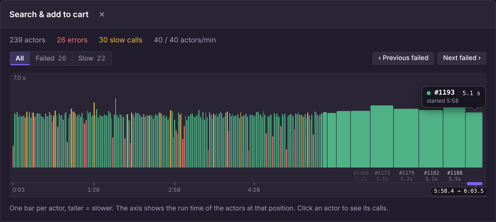
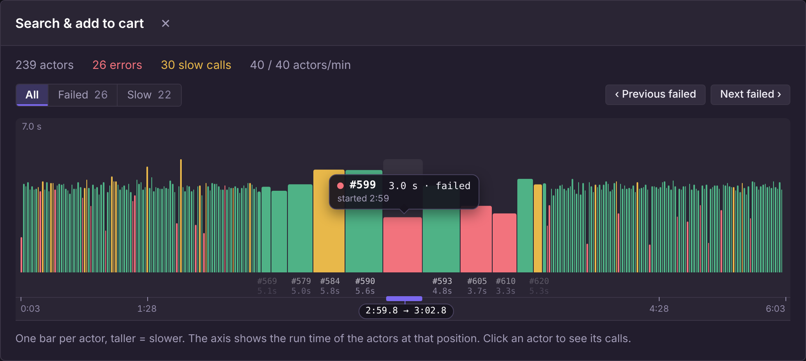
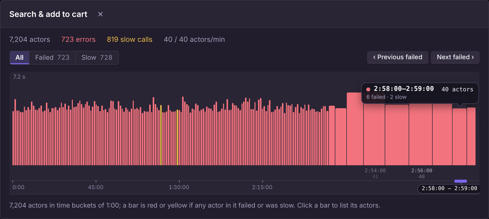
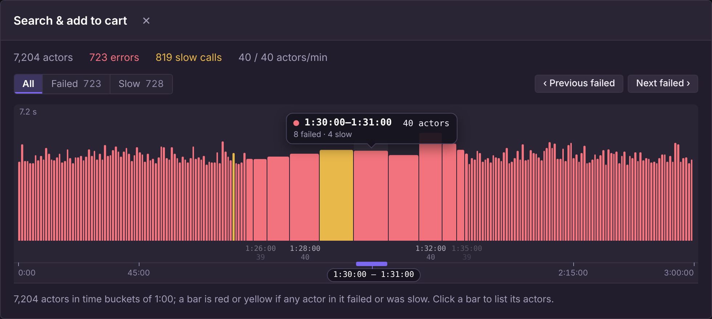
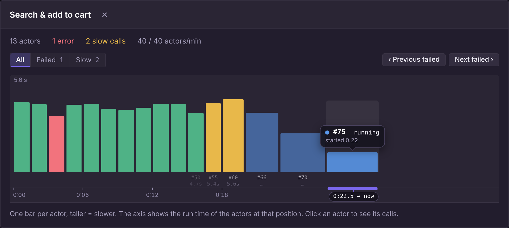
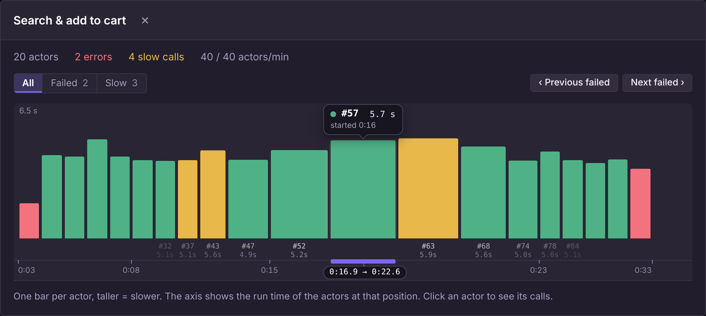
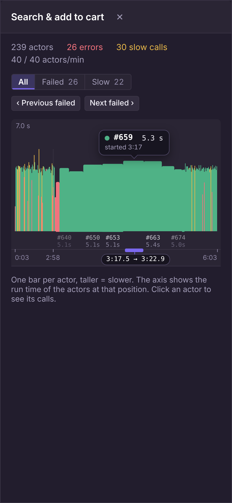
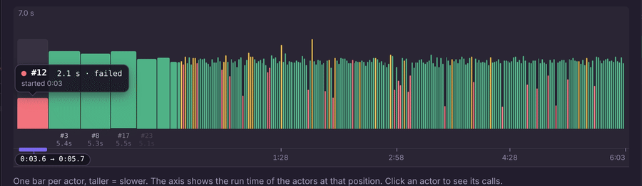

# Screenshots: 2026-11-20-chart-polish

Fake data. One image per section; GitHub renders them inline on this page.

## chartpolish-desktop-240-edge-left

## chartpolish-desktop-240-edge-right

## chartpolish-desktop-240-hover-mid

## chartpolish-desktop-bucketed-3h-edge-right

## chartpolish-desktop-bucketed-3h-hover

## chartpolish-desktop-running-bar

## chartpolish-desktop-short-run-wide-bars

## chartpolish-phone-240-drag

## chartpolish-sweep-240

