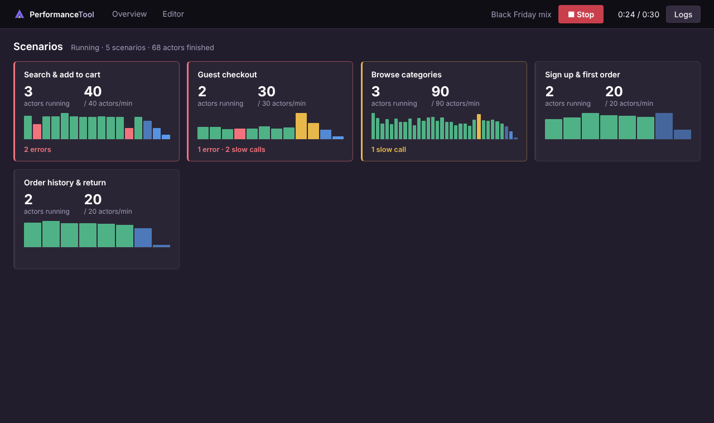
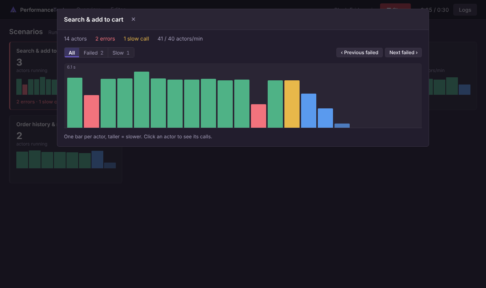
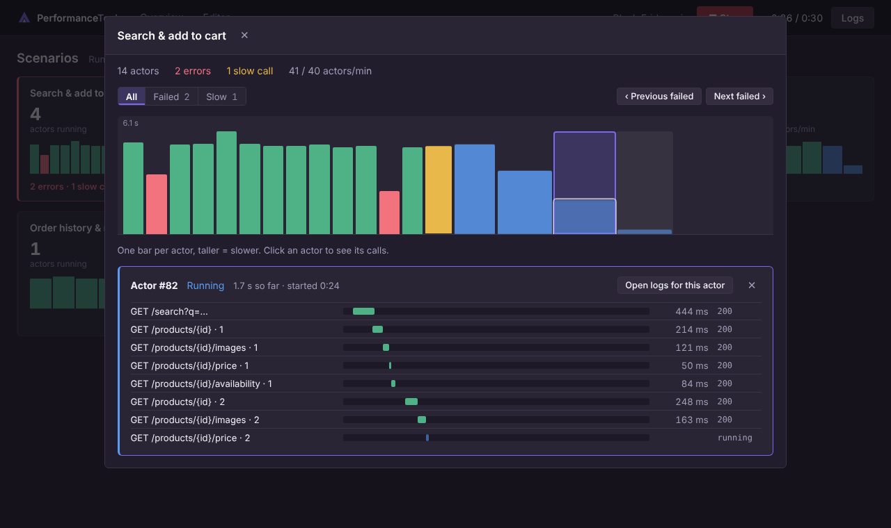
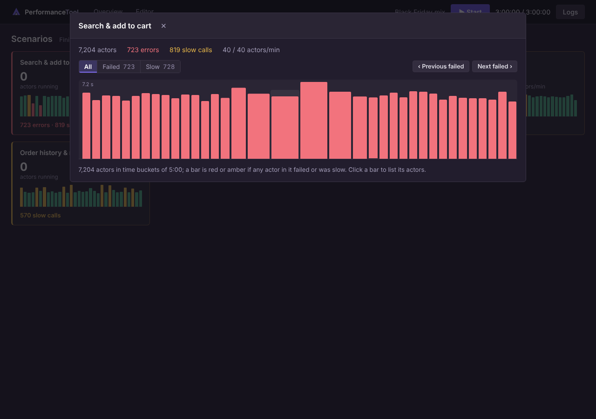
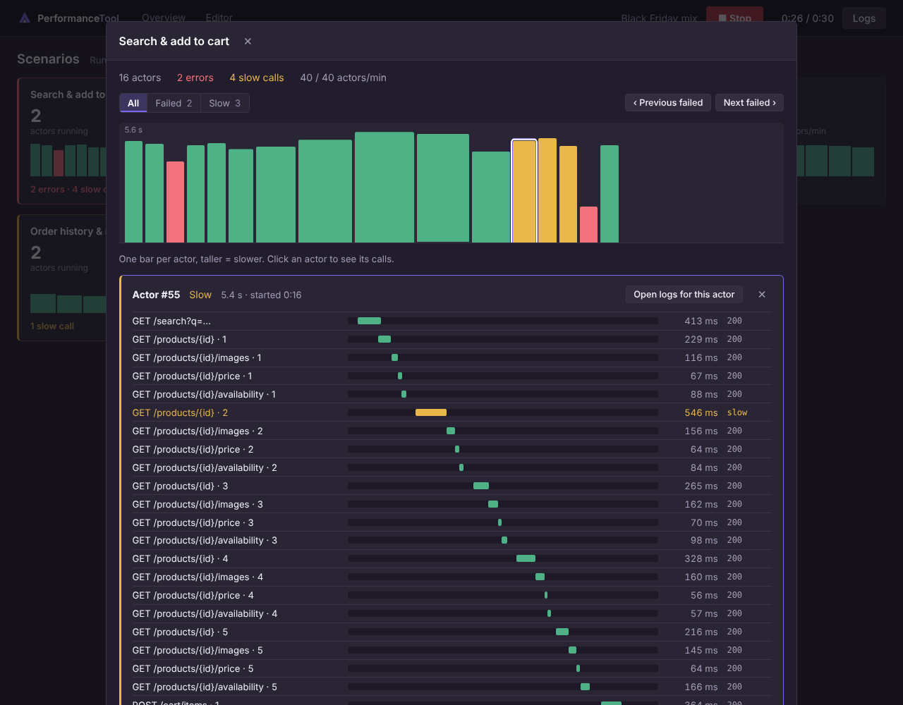
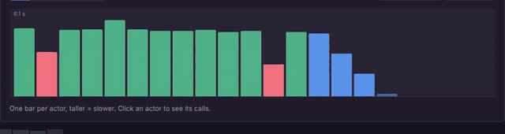

# Screenshots: 2026-11-20-dock-colours-running

Fake data. One image per section; GitHub renders them inline on this page.

## dock-colours-01-overview-running-actors

## dock-colours-02-popup-running-bars

## dock-colours-03-running-actor-selected

## dock-colours-04-magnified-3h-run

## dock-colours-05-call-waterfall-colours

## dock-colours-06-running-bars

