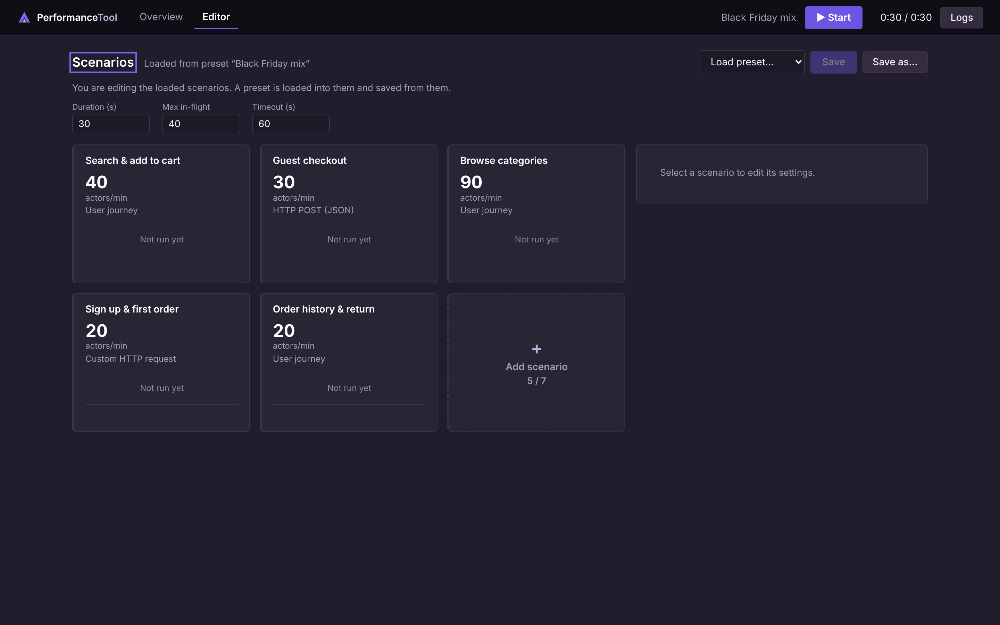
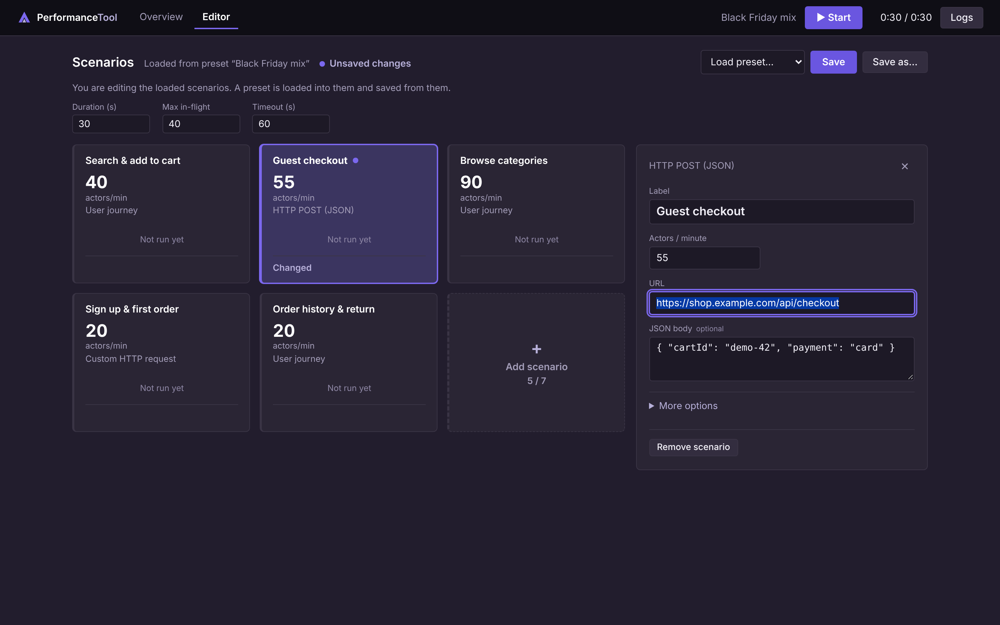
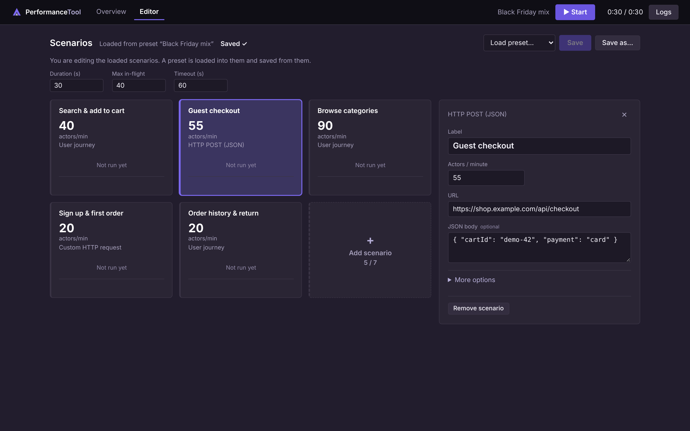
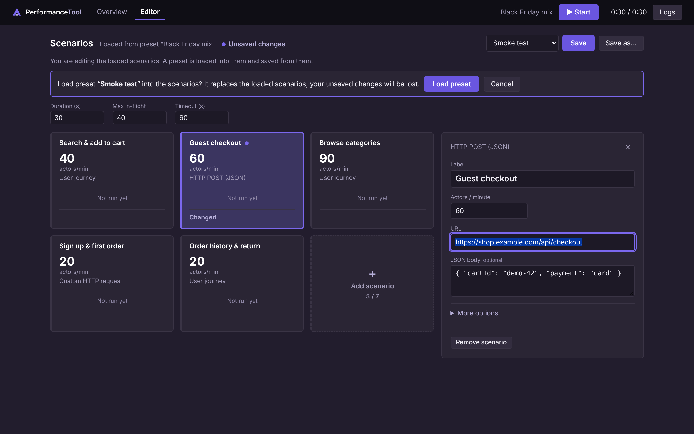
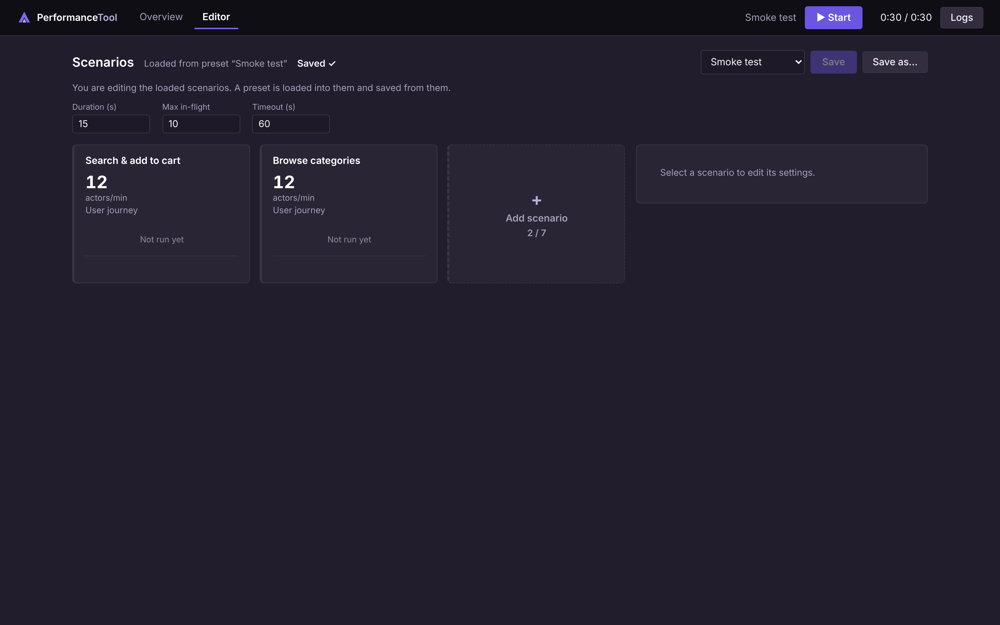
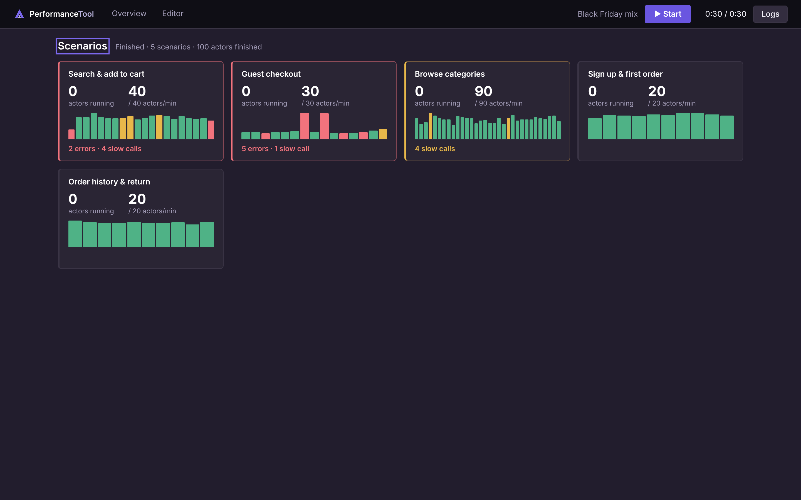
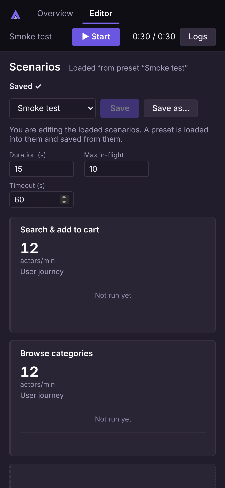
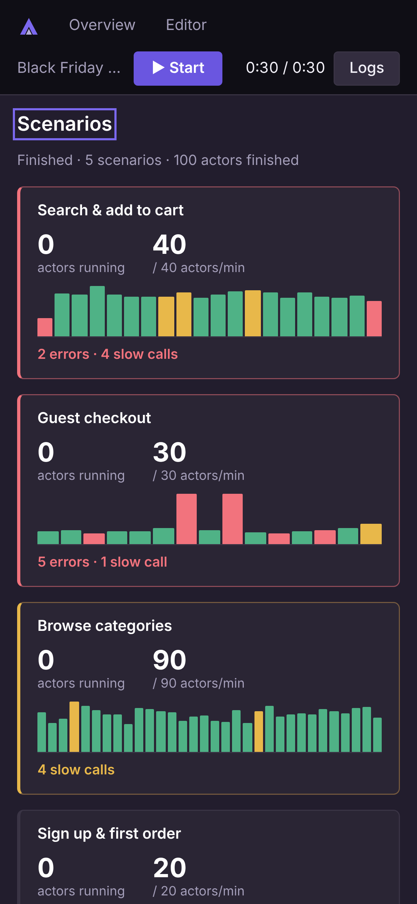

# Screenshots: 2026-11-20-editor-cards

Fake data. One image per section; GitHub renders them inline on this page.

## editorcards-desktop-1-editor-cards

## editorcards-desktop-2-card-selected-settings

## editorcards-desktop-3-unsaved-card-marker

## editorcards-desktop-3b-after-close

## editorcards-desktop-4-saved

## editorcards-desktop-5a-load-preset-confirm

## editorcards-desktop-5b-preset-loaded

## editorcards-desktop-6-overview

## editorcards-phone-1-editor-cards

## editorcards-phone-2-card-selected-settings

## editorcards-phone-3-unsaved-card-marker

## editorcards-phone-3b-after-close

## editorcards-phone-4-saved

## editorcards-phone-5a-load-preset-confirm

## editorcards-phone-5b-preset-loaded

## editorcards-phone-6-overview

