# Screenshots: 2026-11-20-editor-fixes

Fake data. One image per section; GitHub renders them inline on this page.

## editorfix-desktop-1-long-settings-top

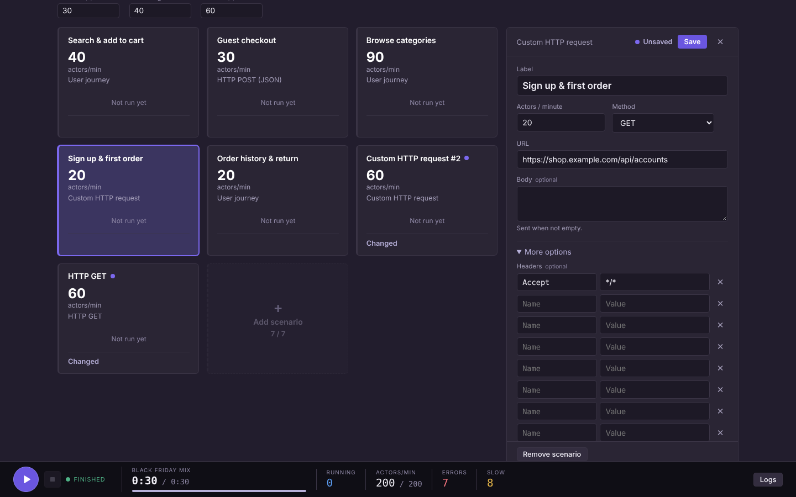

## editorfix-desktop-2-long-settings-scrolled-bottom

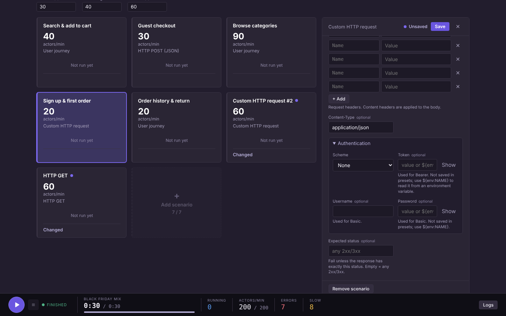

## editorfix-desktop-3-many-cards-bottom

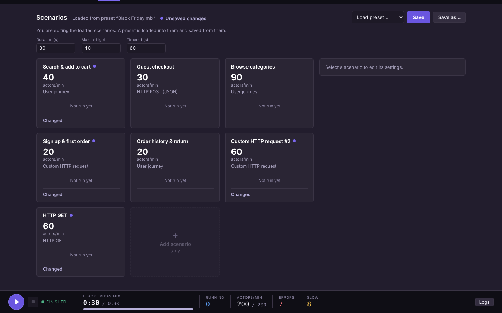

## editorfix-desktop-typing-save-enabled

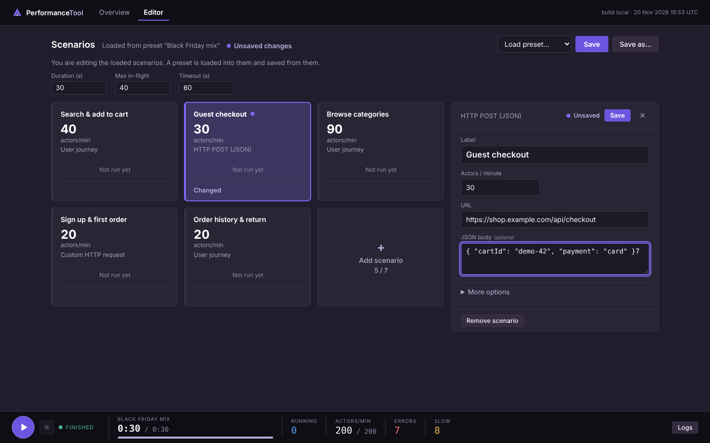

## editorfix-phone-1-long-settings-top

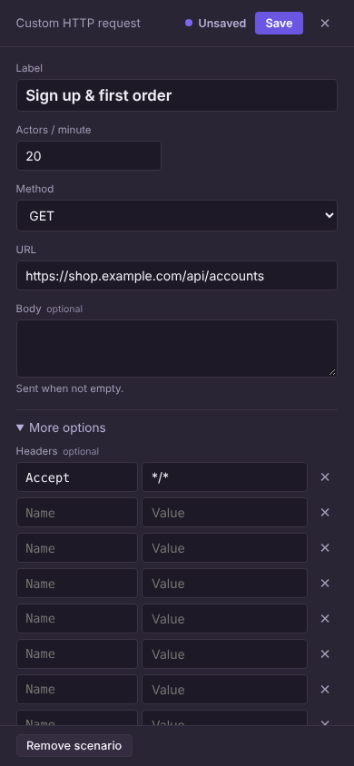

## editorfix-phone-2-long-settings-scrolled-bottom

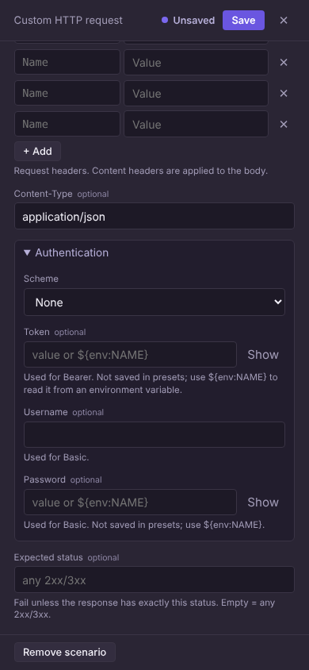

## editorfix-phone-3-many-cards-bottom

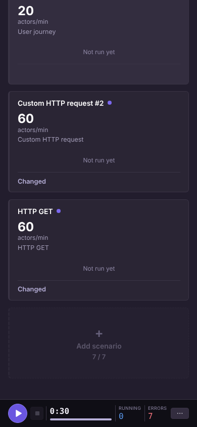

## editorfix-phone-4-preset-area

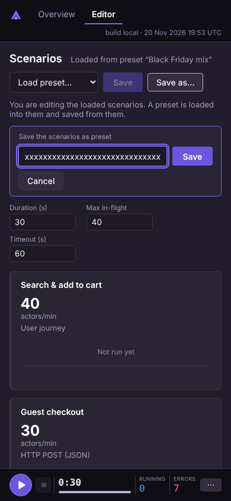

## editorfix-short-1-long-settings-top

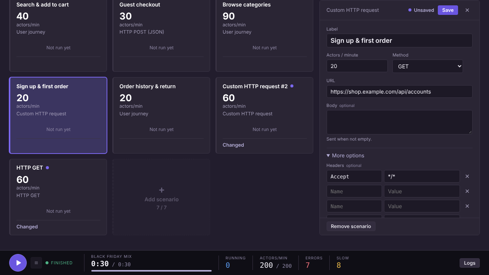

## editorfix-short-2-long-settings-scrolled-bottom

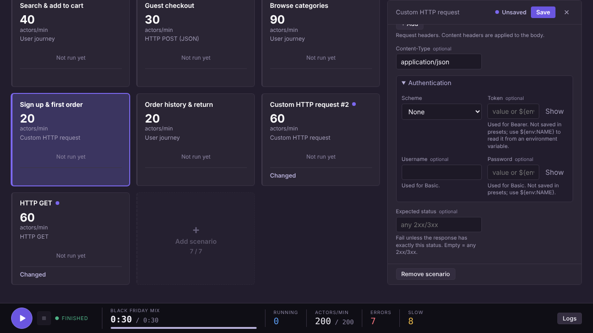

## editorfix-short-3-many-cards-bottom

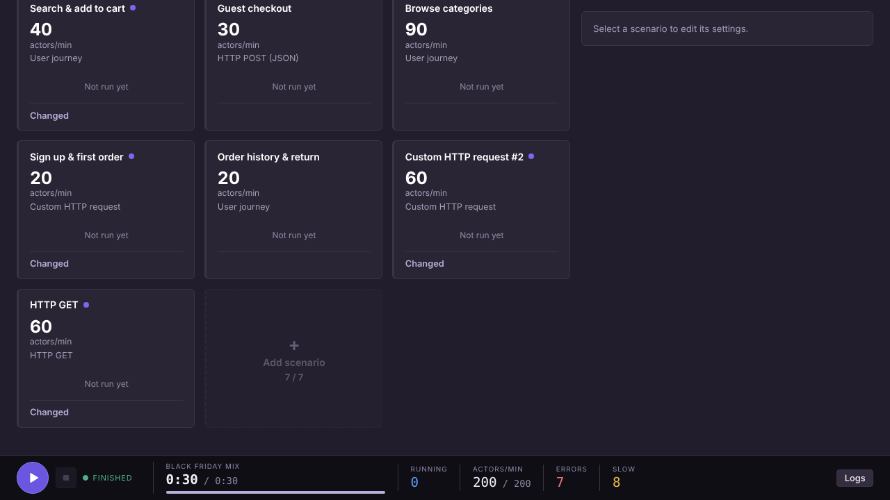
