# Screenshots: 2026-11-20-logs-wordwrap

Fake data. One image per section; GitHub renders them inline on this page.

## logswrap-desktop-1-all-levels

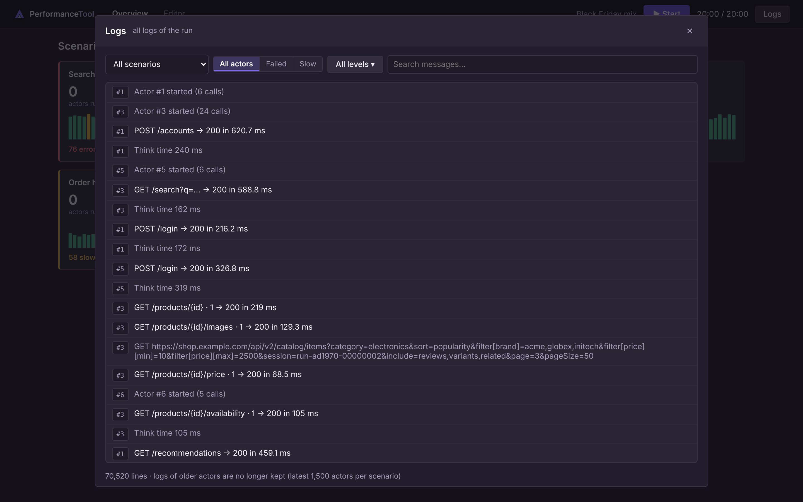

## logswrap-desktop-2-long-urls

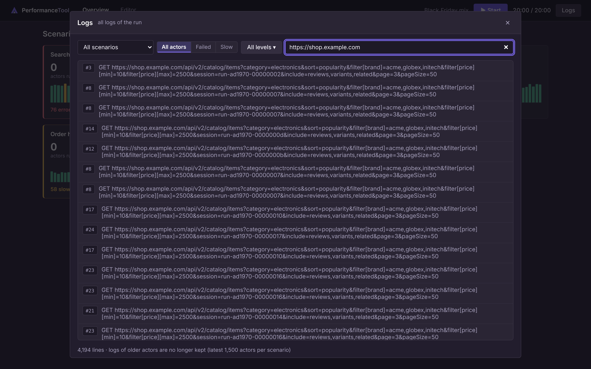

## logswrap-desktop-3-json-payloads

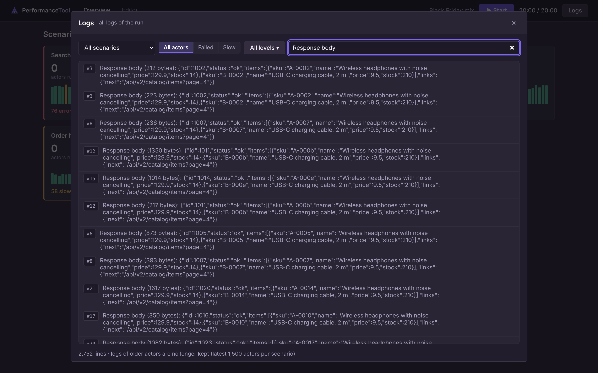

## logswrap-desktop-4-multiline-timeout

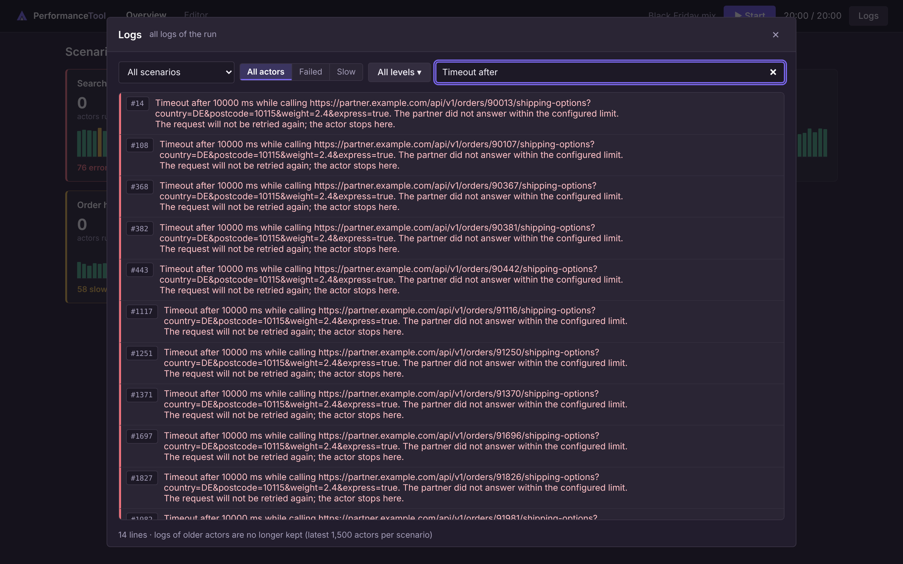

## logswrap-desktop-5-row-details

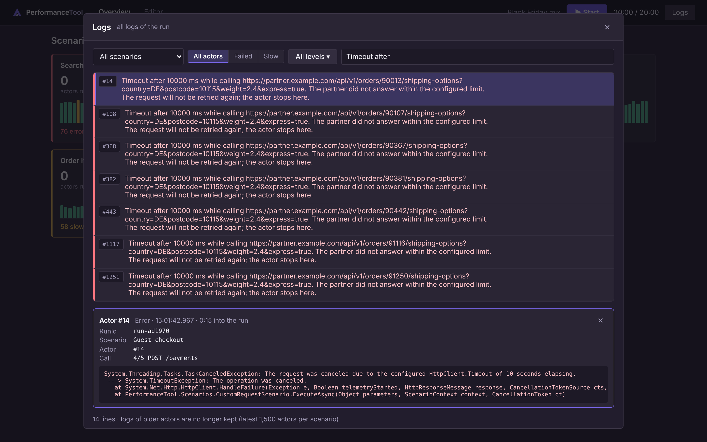

## logswrap-desktop-6-sim3h-bottom

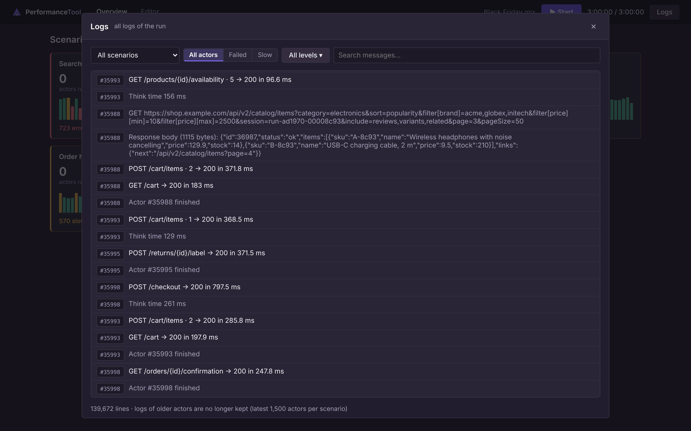

## logswrap-phone-1-all-levels

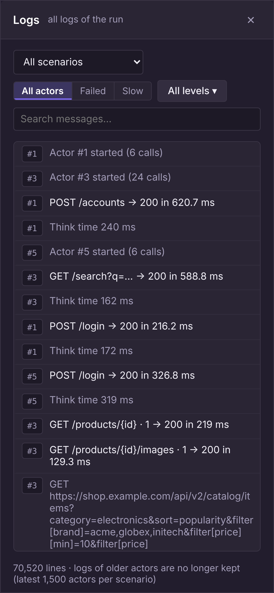

## logswrap-phone-2-long-urls

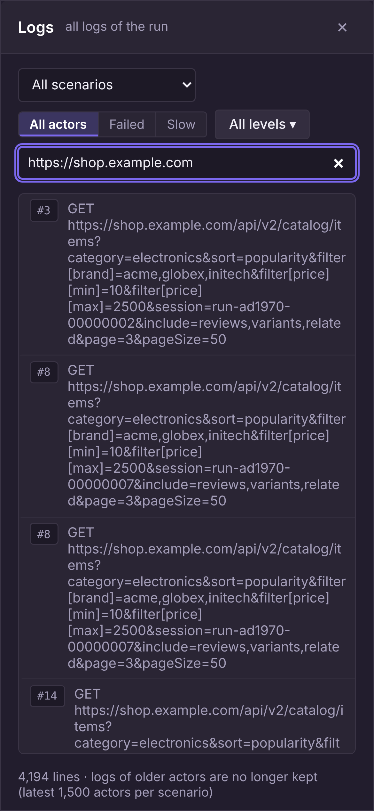

## logswrap-phone-3-json-payloads

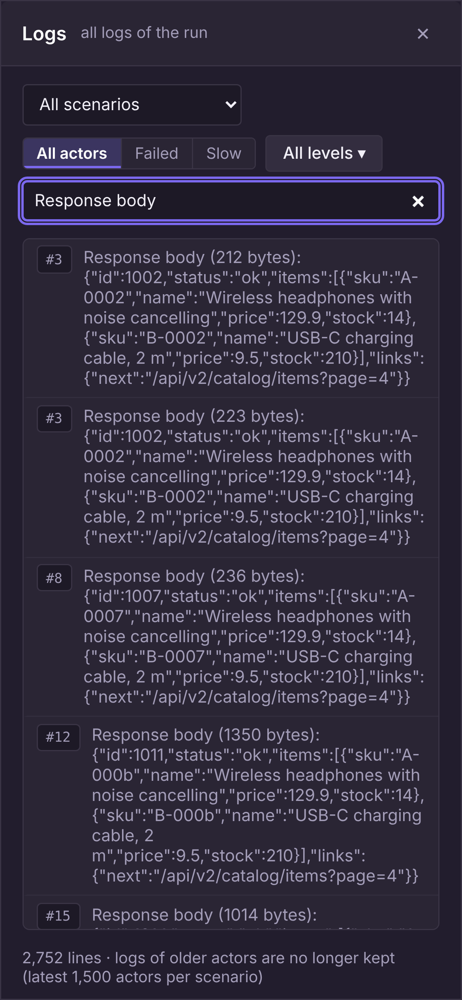

## logswrap-phone-4-multiline-timeout

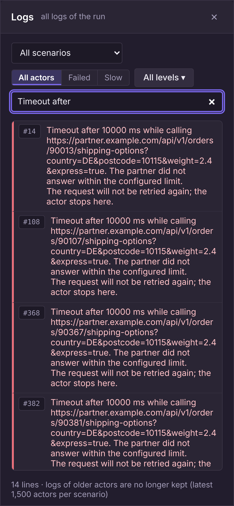

## logswrap-phone-5-row-details

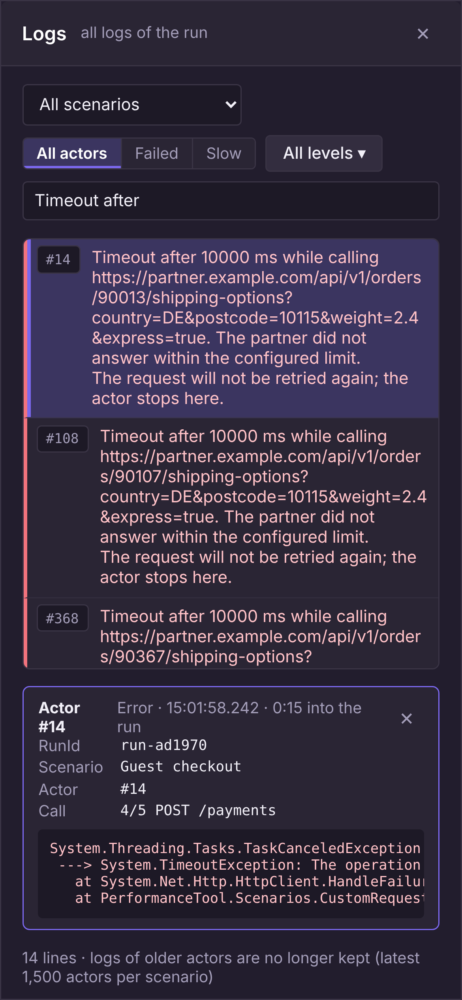
