# Screenshots: 2026-11-20-popup-sidelist-brush

Fake data. One image per section; GitHub renders them inline on this page.

## brush-desktop-0-figures

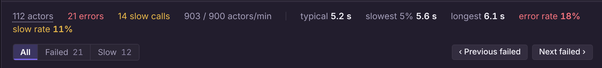

## brush-desktop-1-sidelist

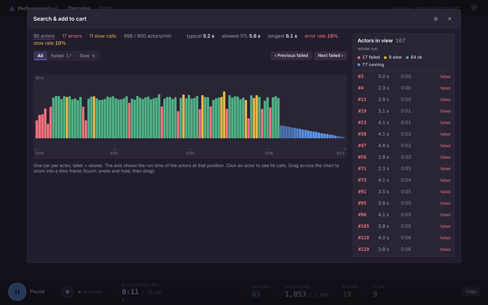

## brush-desktop-2-running-finished-while-hover

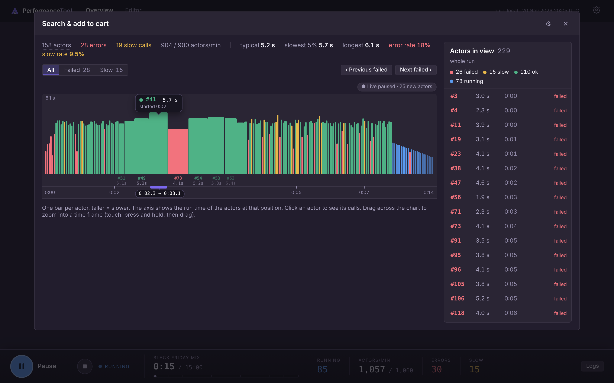

## brush-desktop-3-brushing

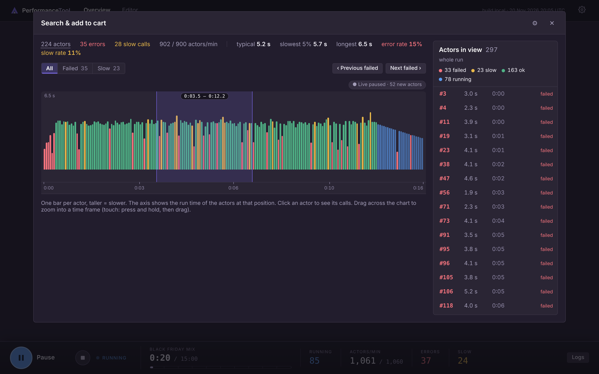

## brush-desktop-4-zoomed

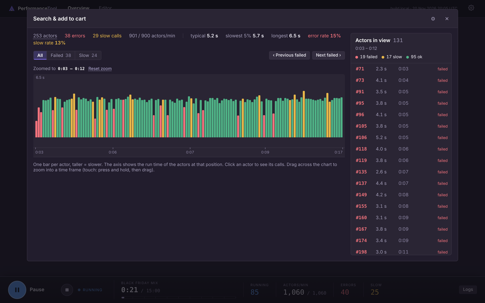

## brush-desktop-5-settings

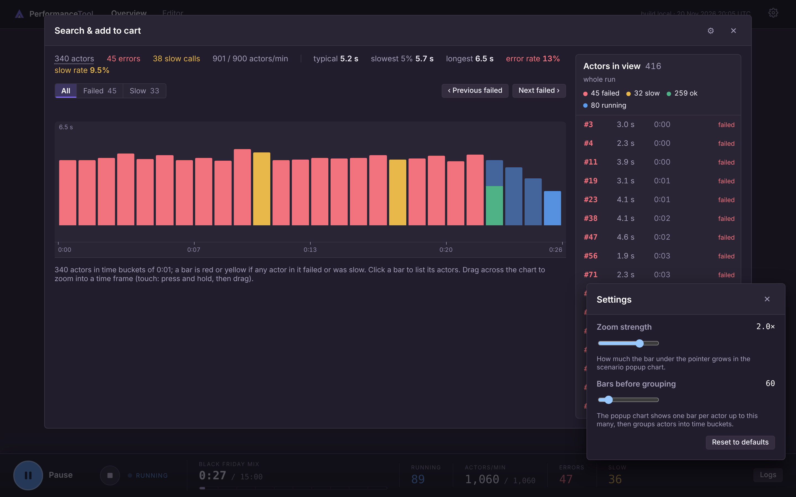

## brush-desktop-6-group-hover-counts

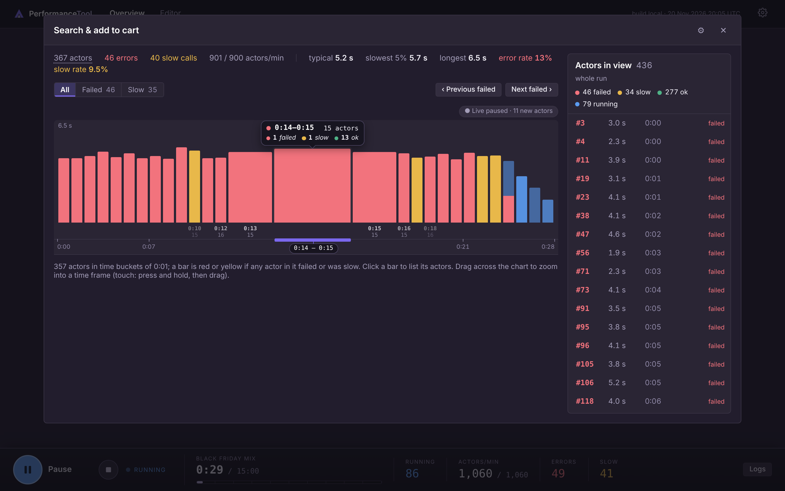

## brush-desktop-7-bucket-selected

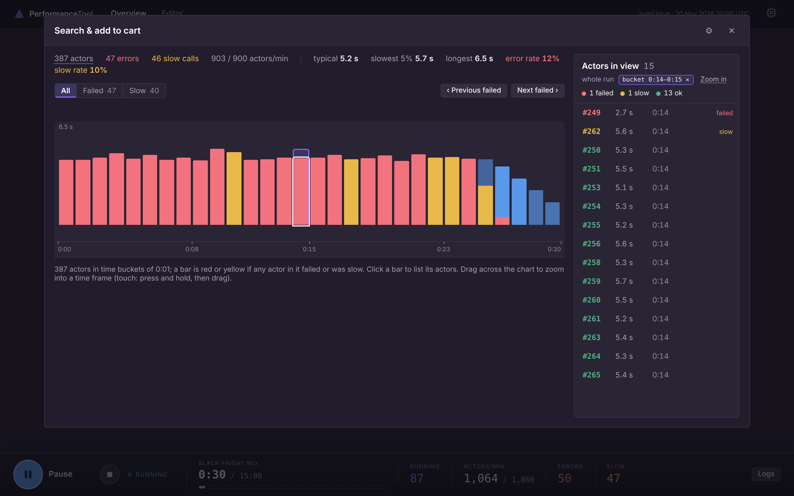

## brush-desktop-8-logs-coloured

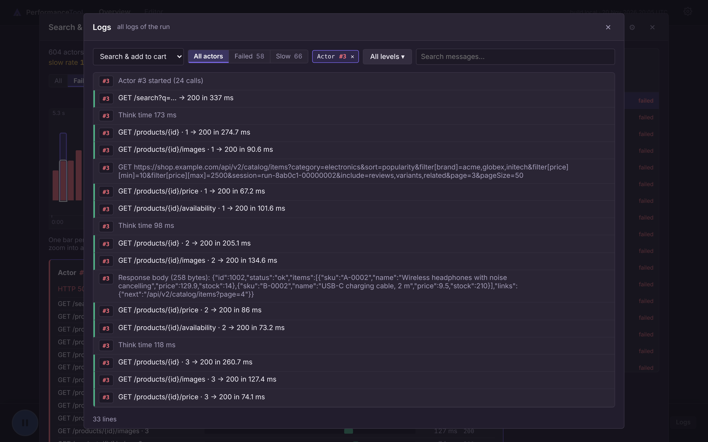

## brush-desktop-9-logs-all

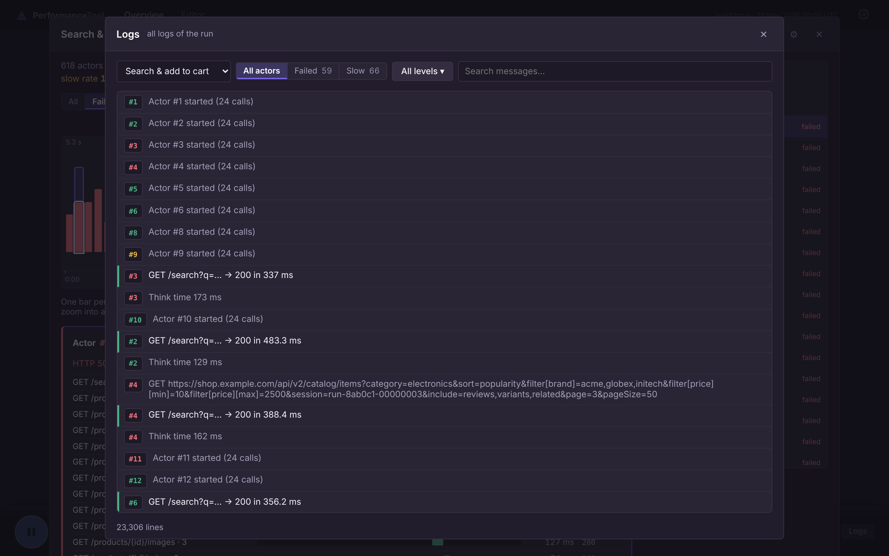

## brush-phone-1-popup

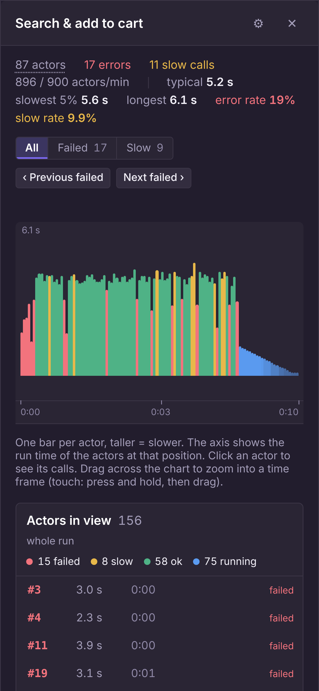

## brush-phone-2-list

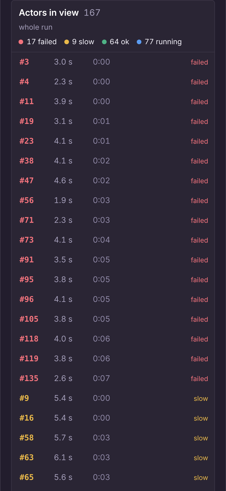

## brush-phone-3-brushing

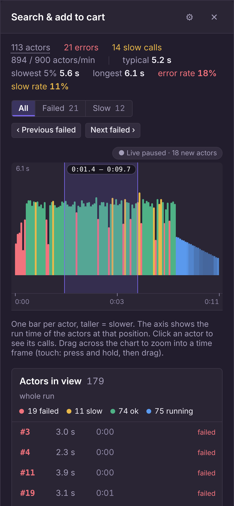

## brush-phone-4-zoomed

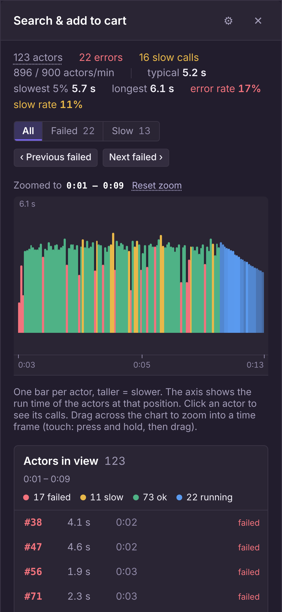

## brush-zoom-and-reset

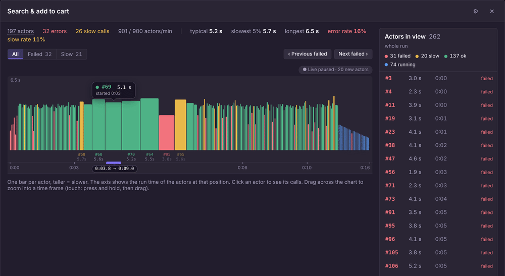
