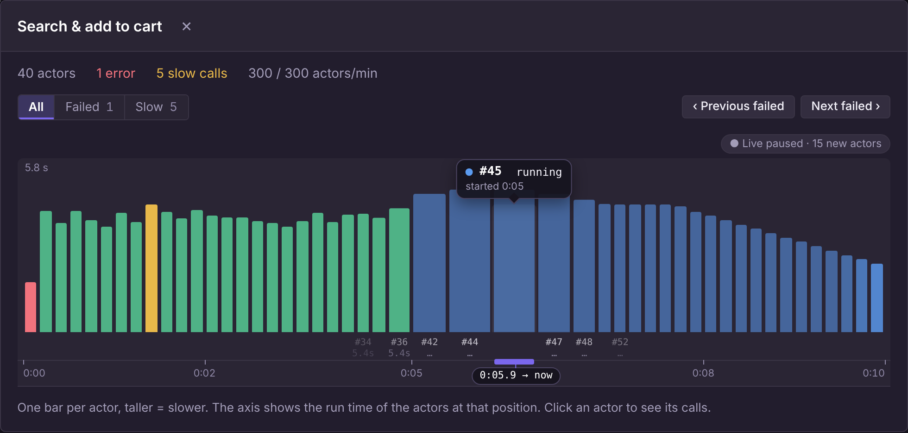
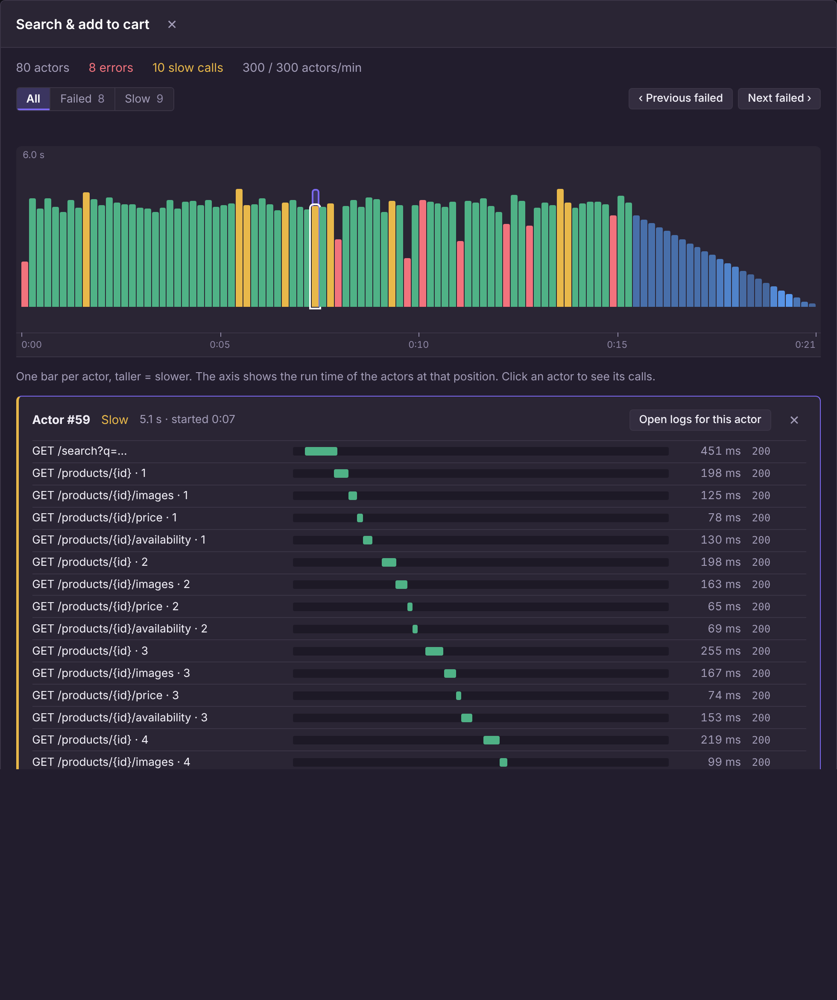
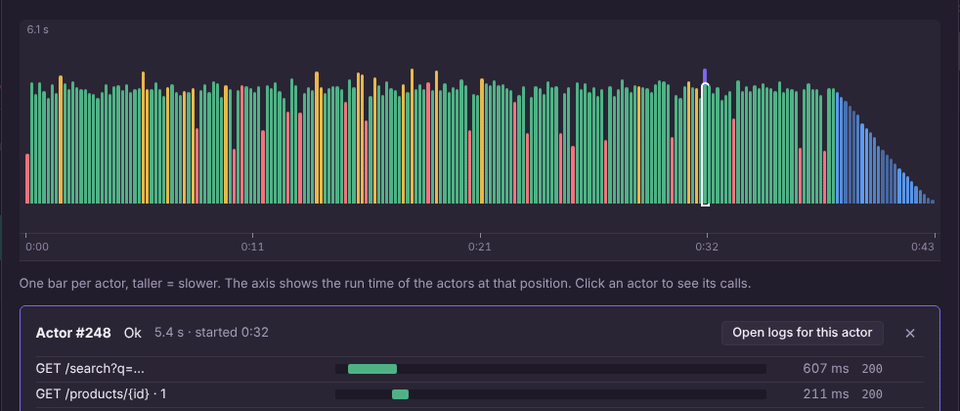
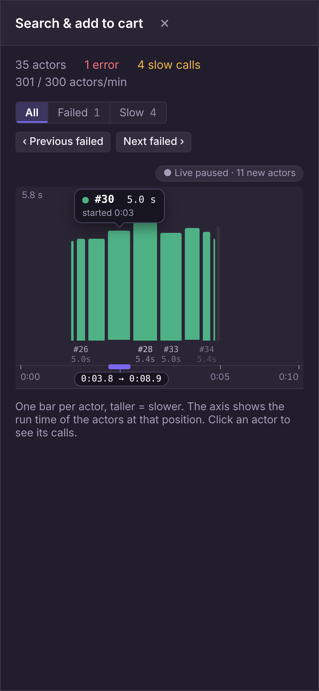
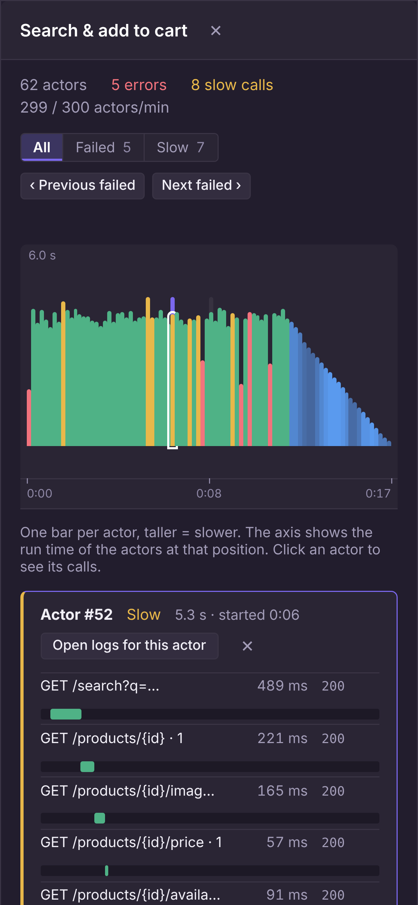

# Screenshots: 2026-11-20-stable-click

Fake data. One image per section; GitHub renders them inline on this page.

## stableclick-desktop-paused-badge

## stableclick-desktop-selected-after-catchup

## stableclick-hover-pause-click-resume

## stableclick-phone-finger-down

## stableclick-phone-selected-after-catchup

