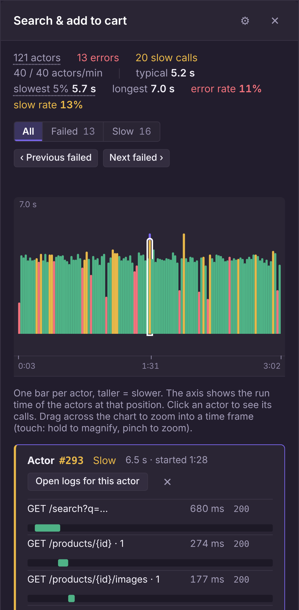
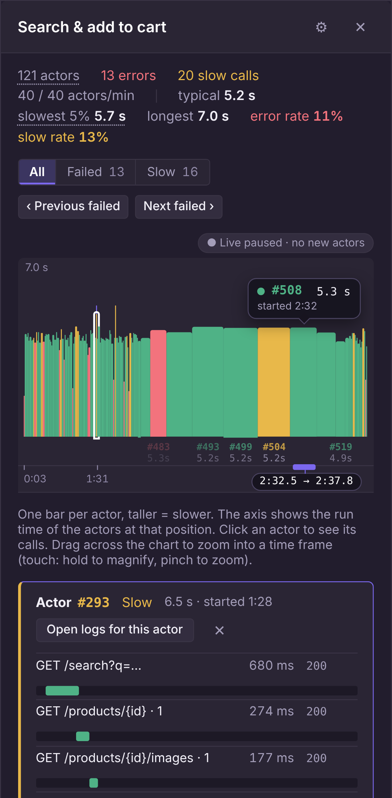
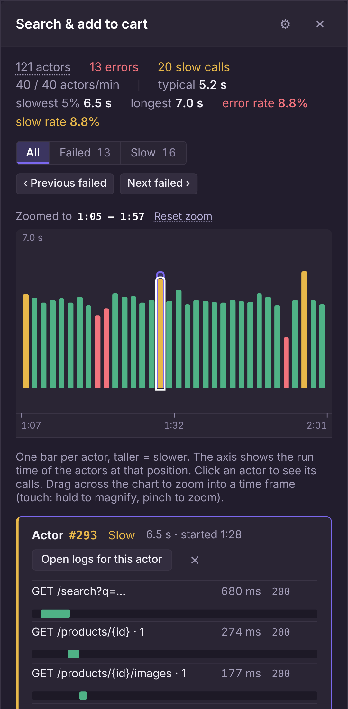

# Touch gestures on the popup chart (brain 0031)

Phone emulation (Pixel 7), fake data, published Release build.

**Tap** selects a bar (outline), no magnification:

**Tap and hold, then drag** moves the magnifier along the bars:

**Pinch** zooms the time range (same zoom as the desktop brush, "Reset zoom" undoes it):

