# AI assistant (brain 0047 to 0051)

Live mode against a real run (a small local system under test), the assistant answering from a local OpenAI-compatible stub with scripted tool calls.
Device scale factor 2.

## Chat icon and panel
Fake mode has no chat icon (the GitHub Pages demo has no server):

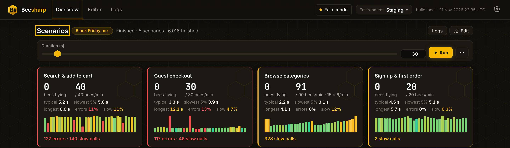

Live mode shows the icon when the server reports the assistant as configured, and the panel pushes the page aside:

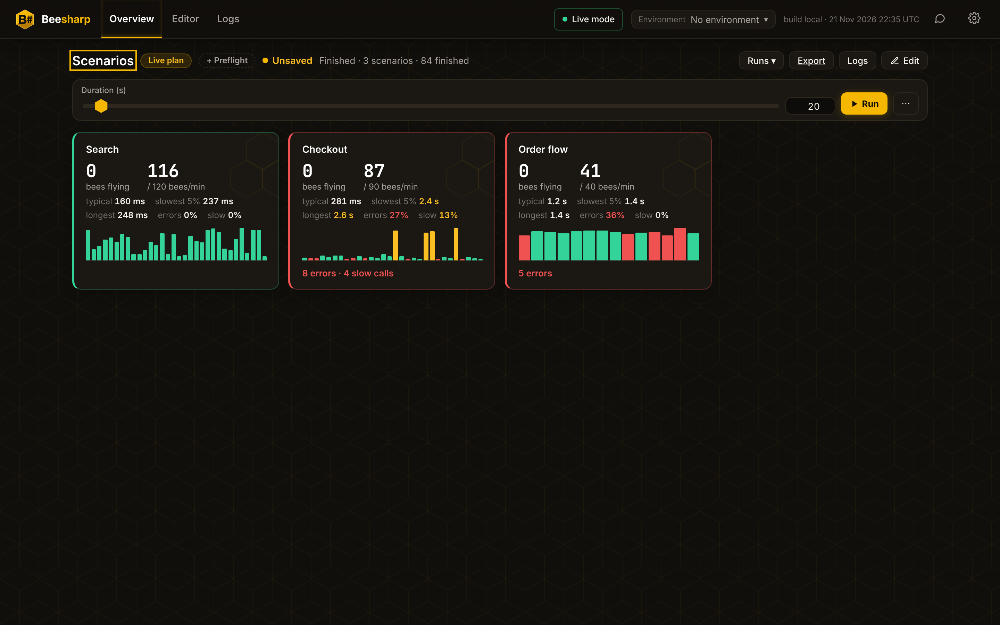
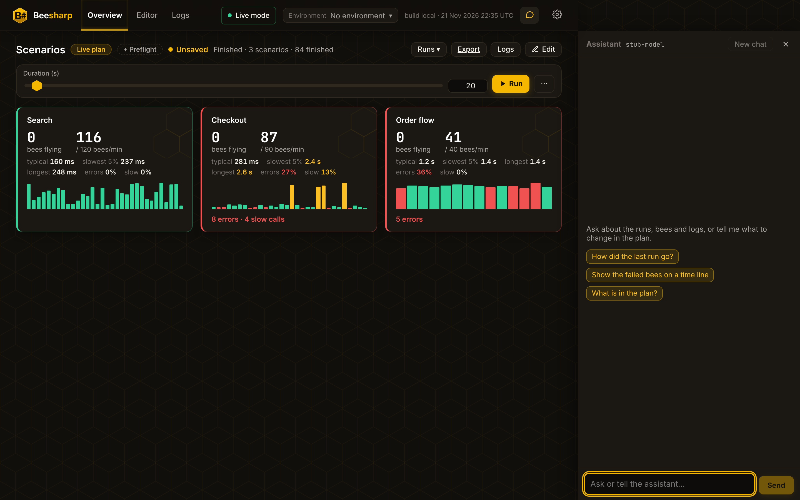

## Activity chips and cards
Reads fold into "1 action"; a click reveals what was sent and returned. The run card has clickable figures (bees, errors, slow, per scenario entry):

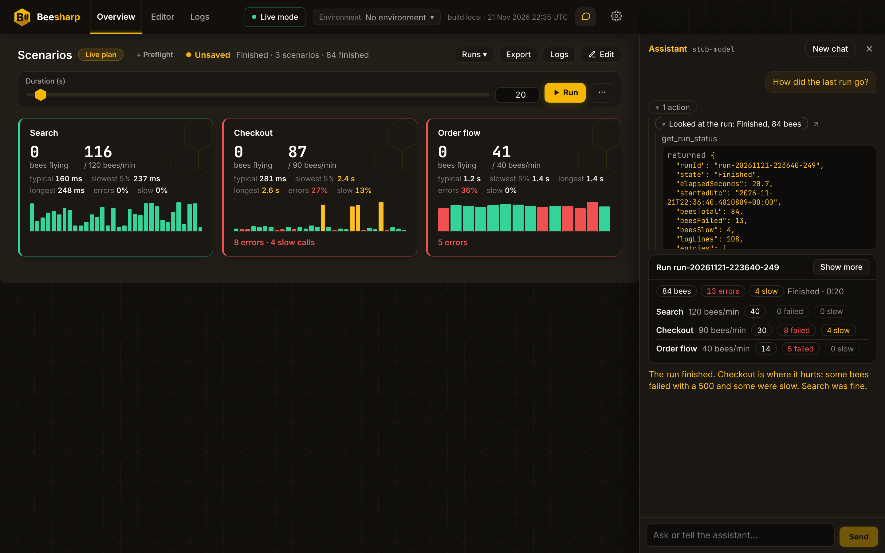

A logs card: a few lines, the total, and Show more:

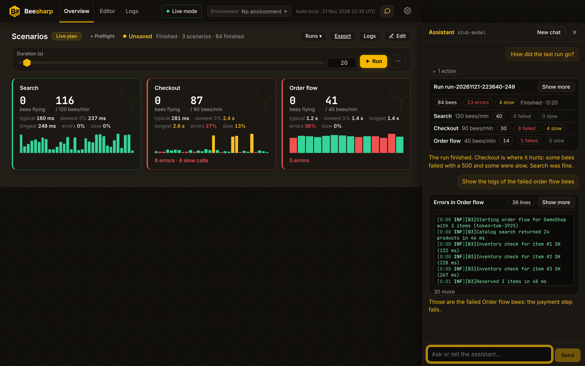

Show more opens the existing Logs popup, pre-filtered (scenario entry, failed bees):

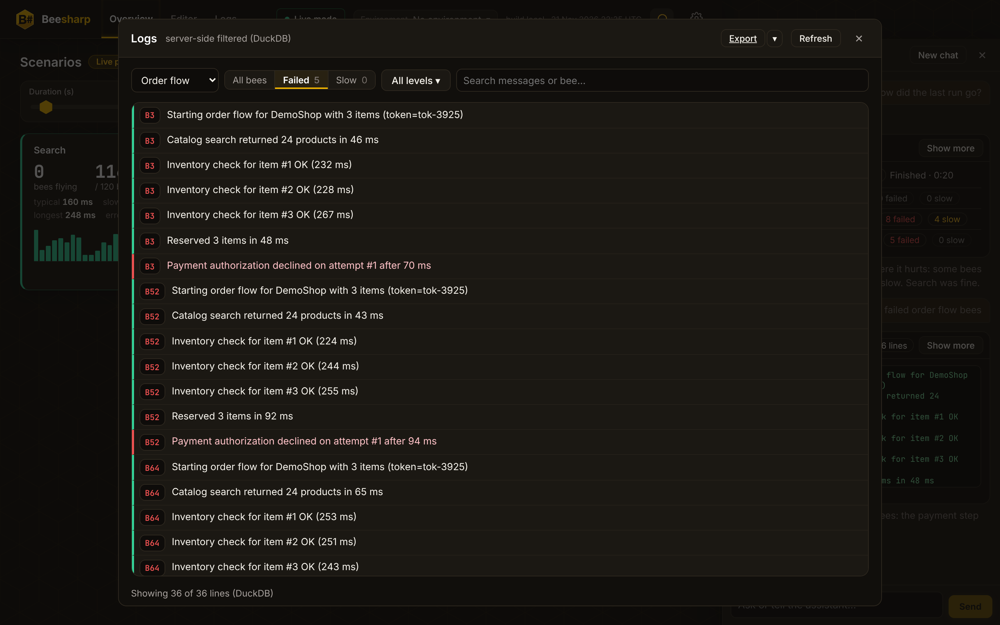

## Bee timeline
Hand-picked bees from two scenario entries on one time line, with the agent's short reason per bee:

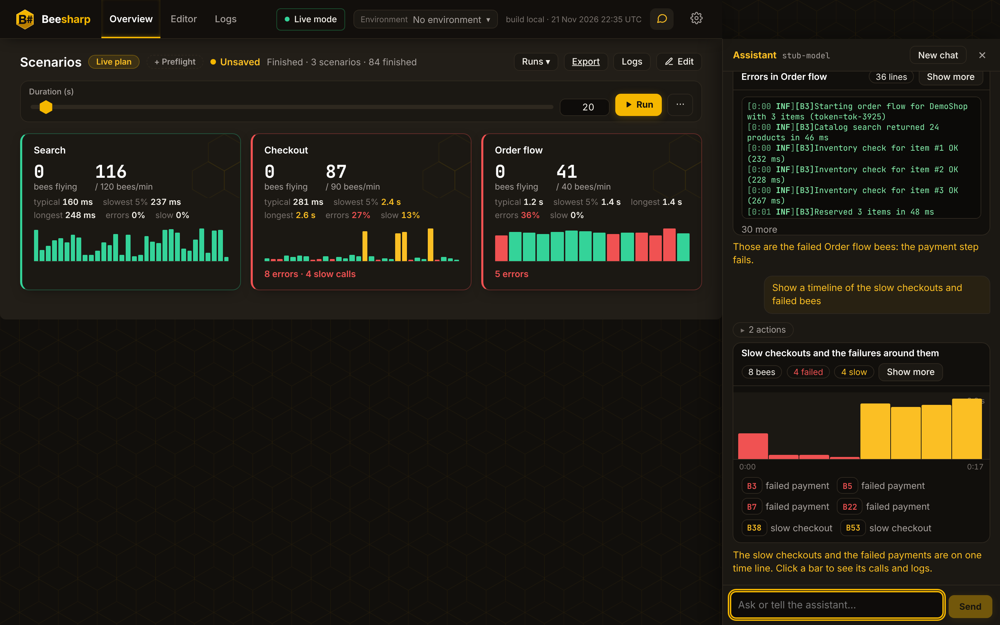

Show more opens the popup chart for exactly these bees: click a bar, calls and logs, zoom, step through failed and slow:

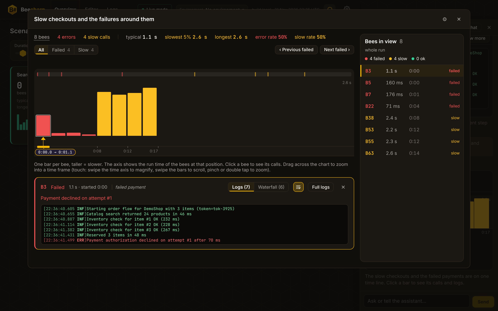
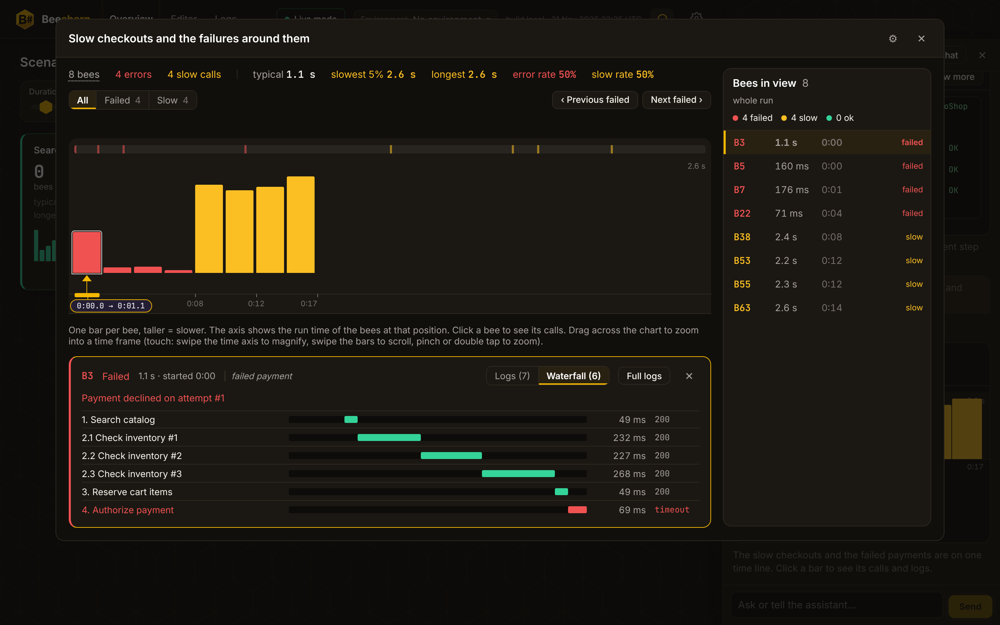

## The agent edits the plan, the editor follows
The editor before, and after the agent changed the rate of Checkout (no reload; the "Changed" marks and 150 bees/min come from the server-owned plan):

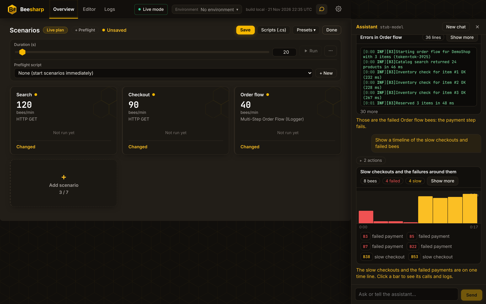
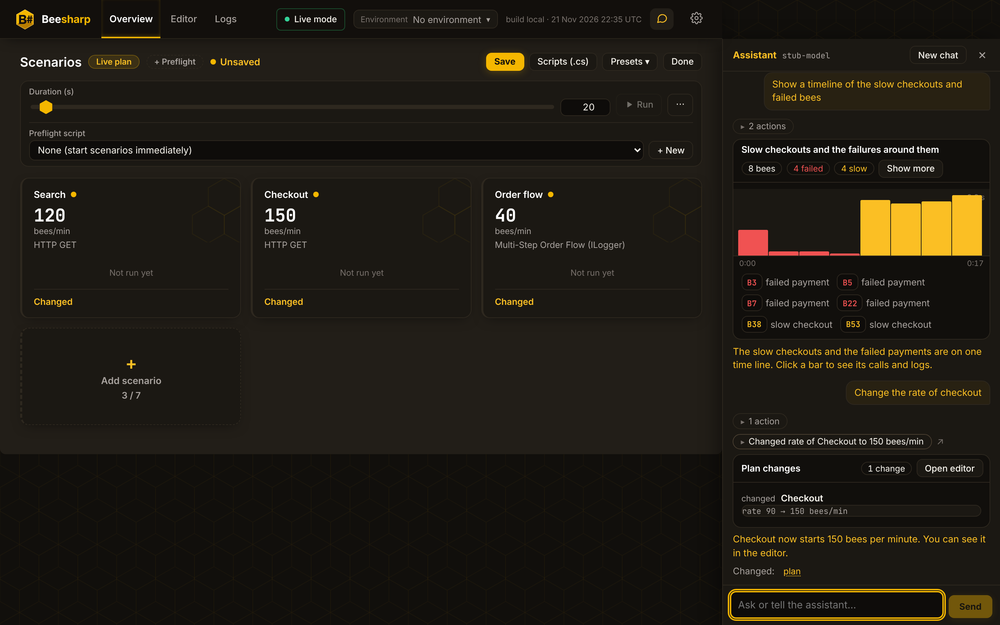

## The agent starts a run directly (no approval, brain 0048)
The activity chip is the record; the run is going in the player bar:

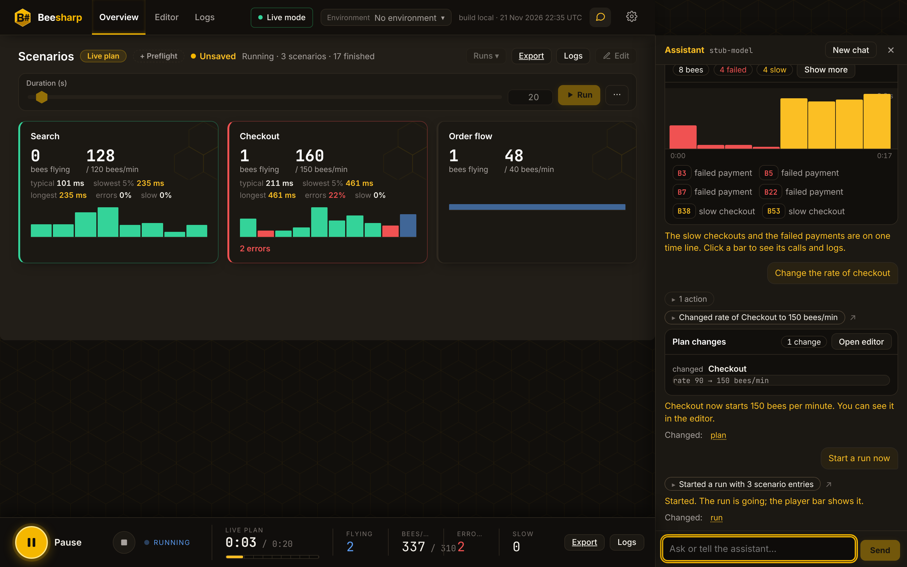

## Mobile
A full-screen sheet below the top bar:

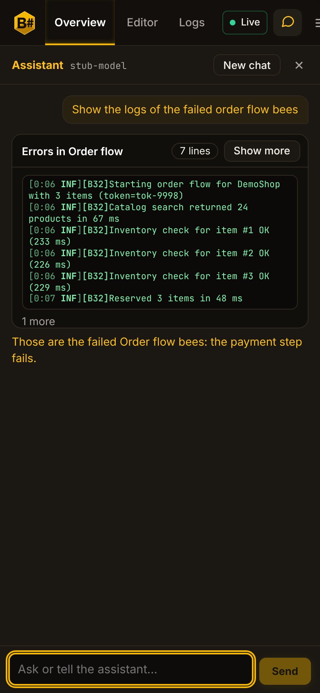

## Published (Release, trimmed) client
The same timeline flow against the trimmed Release publish of the client, no console errors:

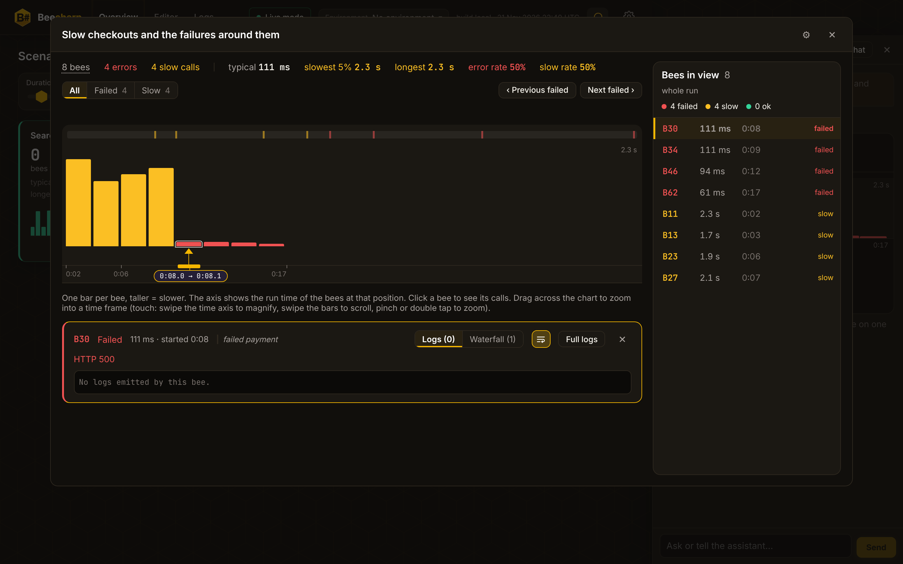
