# Zooming into a burst unfolds it (brain 0038) and the coloured overview strip (brain 0035 update 1)

Published (trimmed) build, the 30 minute seeded run (brain 0039), entry "Browse categories" (15 x 6/min). Desktop at device scale 2, phone is a Pixel 7 emulation.

| Step | Desktop | Phone |
|---|---|---|
| Overview after first load (30 min seeded run) | 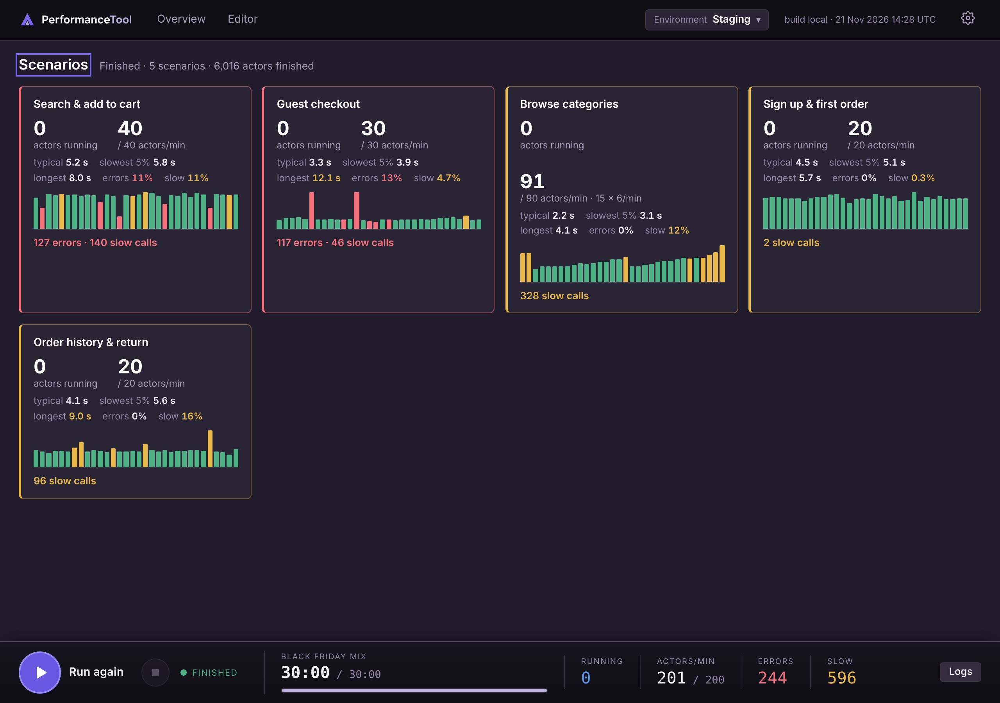 | 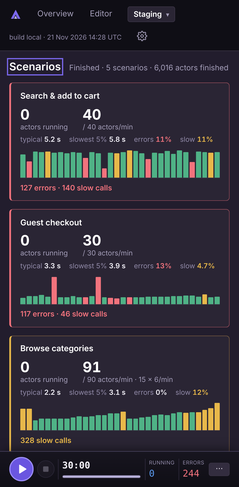 |
| Popup, not zoomed: the overview strip spans the width with muted amber marks for slow actors | 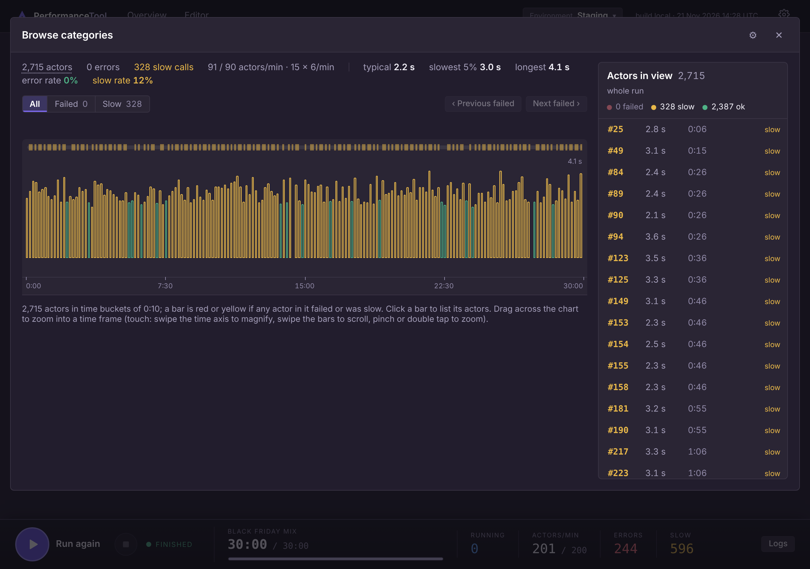 | 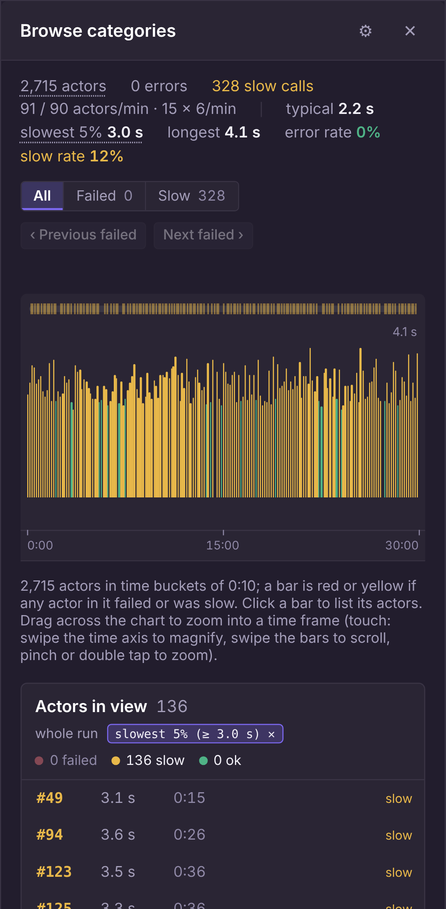 |
| Zoomed in: bursts are still group bars; the lit part of the strip is the view | 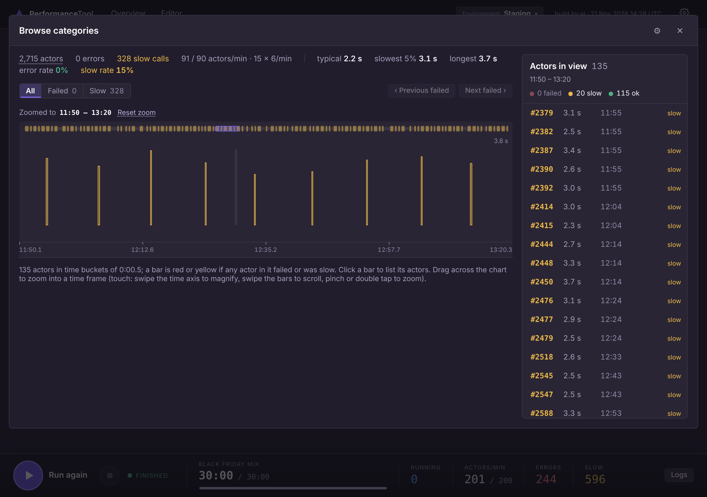 | 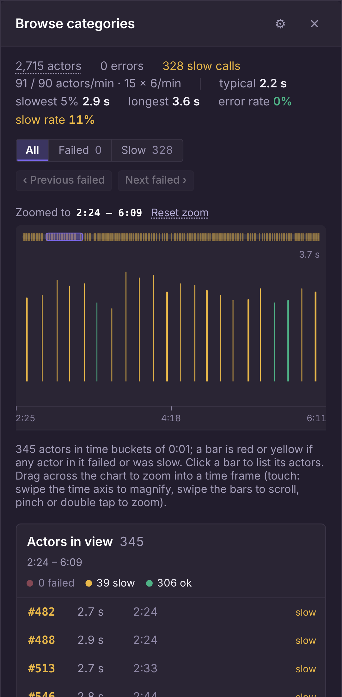 |
| Zoomed into one burst: it unfolded into 15 actor bars, labelled "burst · 15 actors" | 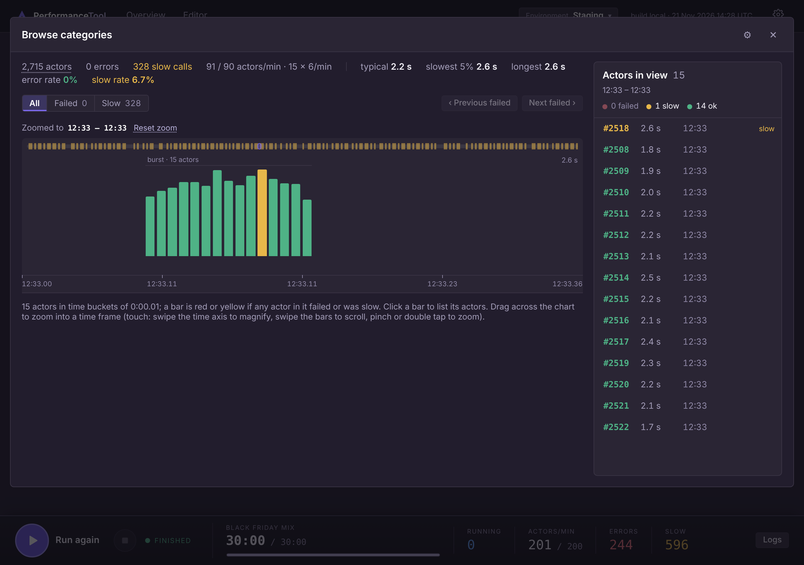 | 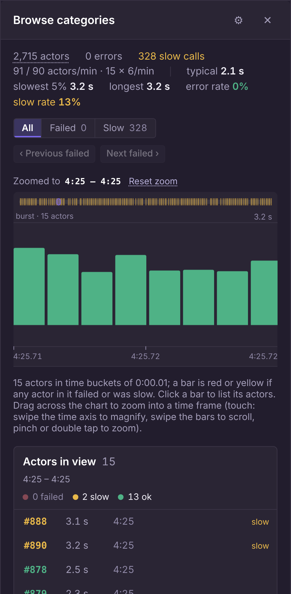 |
| An unfolded actor selected (caret, actor panel) | 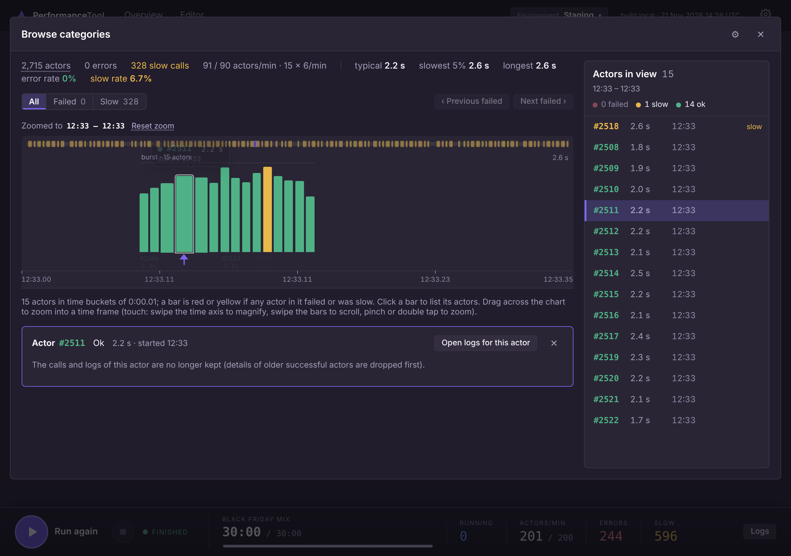 | 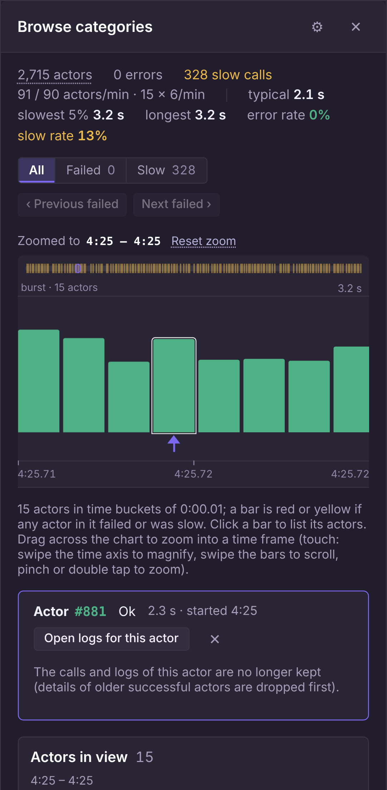 |
| The label clicked: the burst's actors selected as a group | 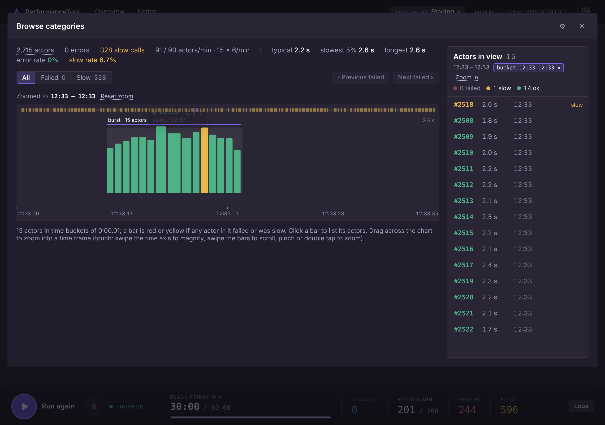 | 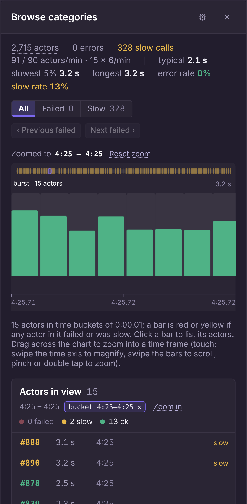 |
| Zoomed out: back to ordinary bars |  | 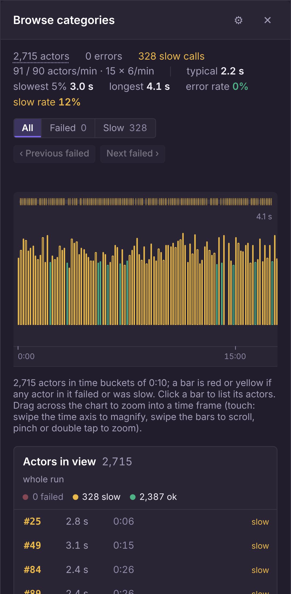 |
