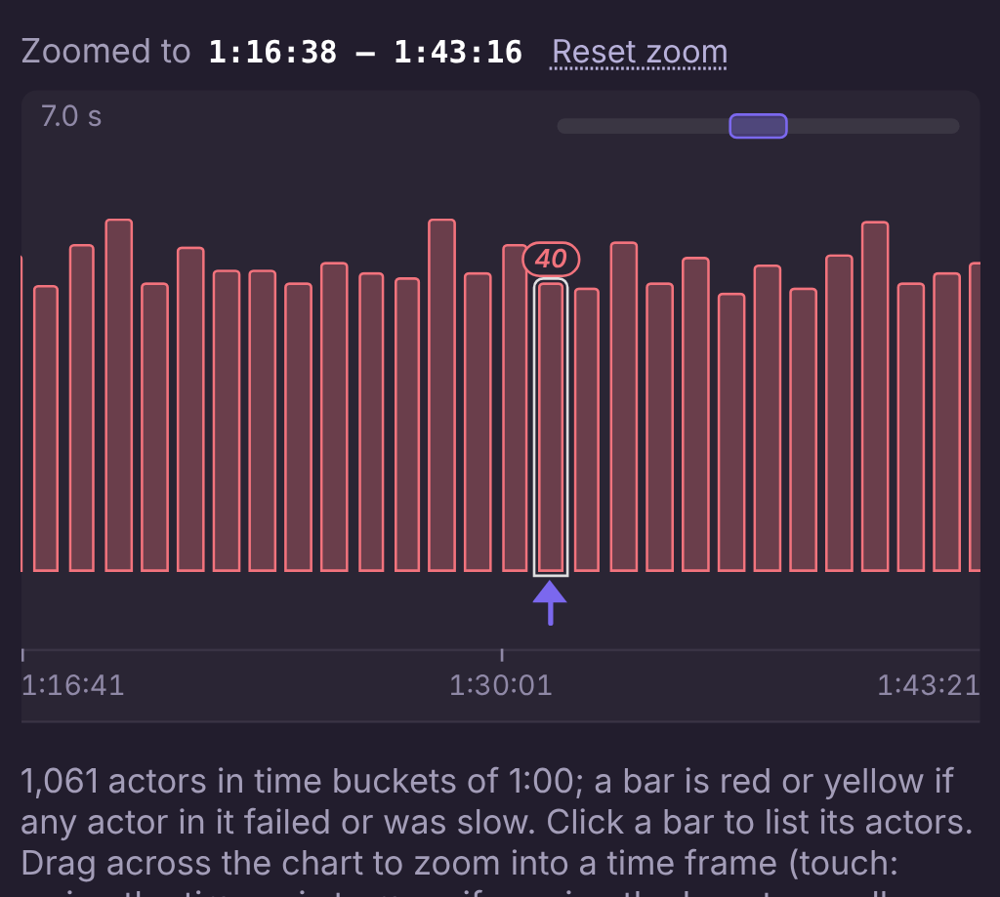
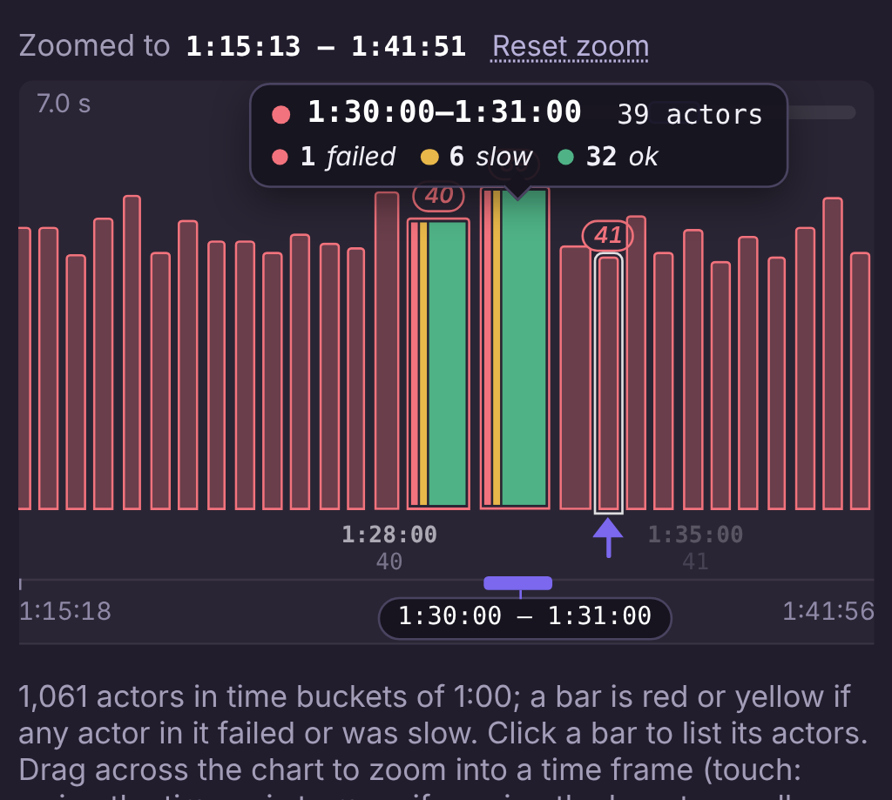
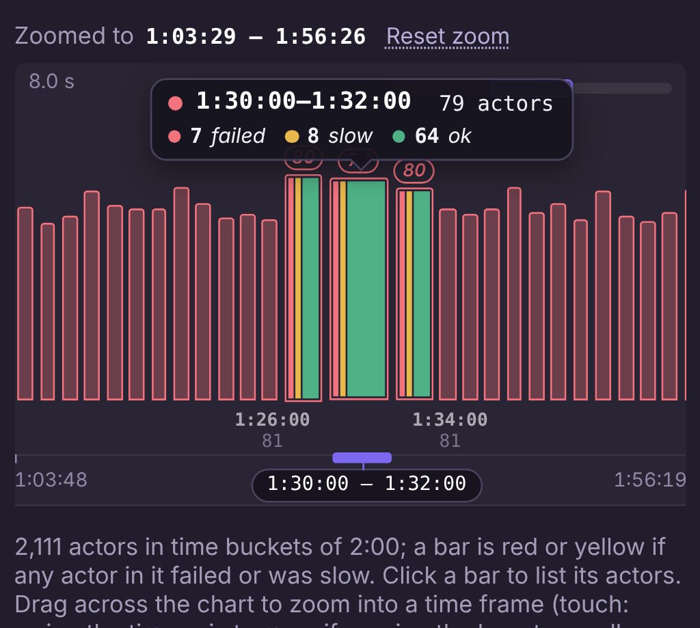
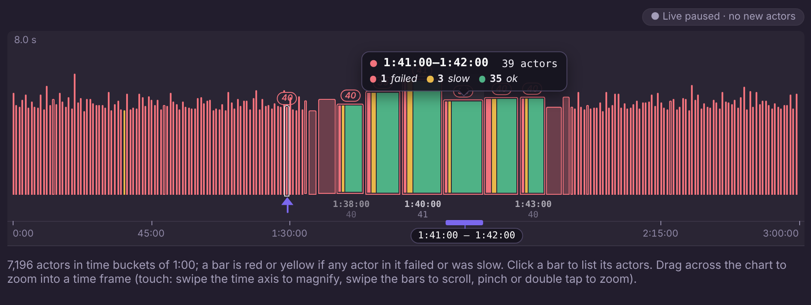

# Popup chart polish (brain 0037)

Published (trimmed) build, `?simulate=3h`, "Search & add to cart". Phone: Pixel 7 emulation, "bars before grouping" set to 30
(as in the user's screenshot), zoomed in with a pinch. Desktop: 1300 px wide, device scale 2, default settings.

**Selection marker:** no purple block above the selected bar any more; an accent caret under it points up from the axis strip.
The selected group keeps a subtle outline and its count badge.

**Axis strip swipe:** a sideways swipe under the bars magnifies (here over 1:30 - 1:31); the caret stays under the selected bar
while the bars around it grow. Magnified groups show their make-up as stripes. Lifting the finger selects the bar under it.
A sideways swipe on the bars themselves scrolls the timeline instead (no magnifier).

**Striped groups:** a magnified group shows failed (red), slow (yellow) and ok (green) actors side by side, widths by count,
with a minimum width so a single failed actor stays visible. Groups that are not highlighted keep the calm outline look.

**Desktop:** hover magnifies with stripes on the hovered groups, the caret marks the selected group; gaps between bars are
the same everywhere (whole device pixels).

