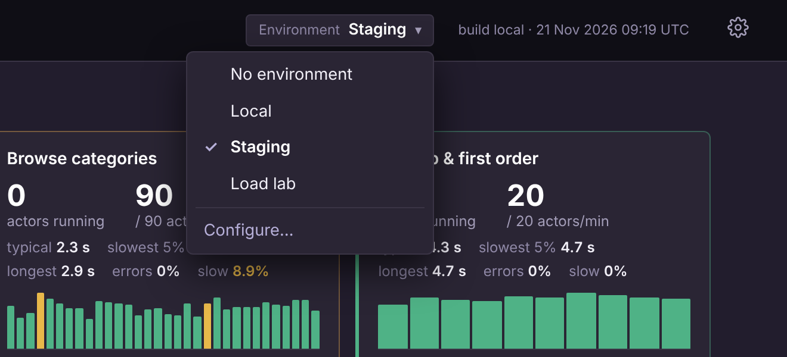
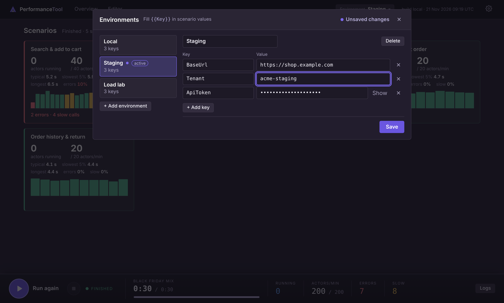
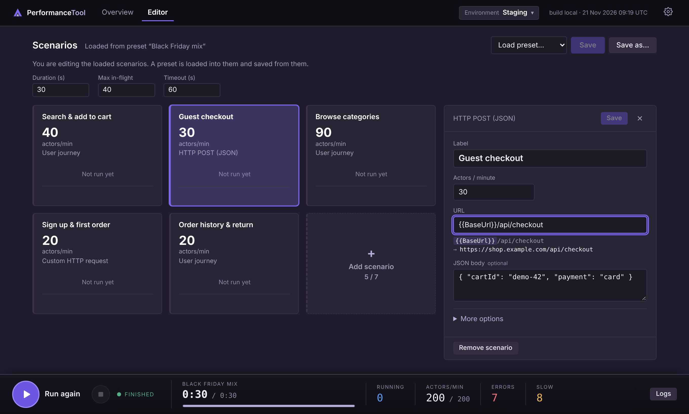
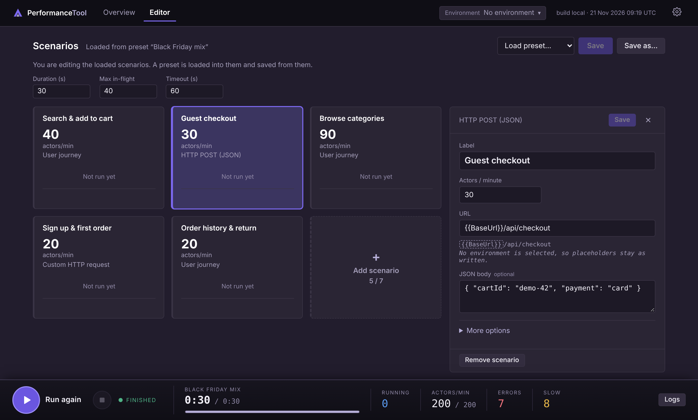
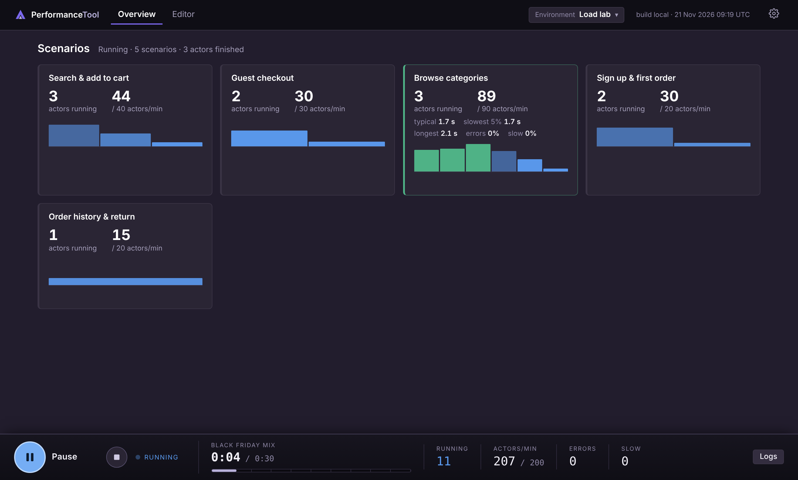
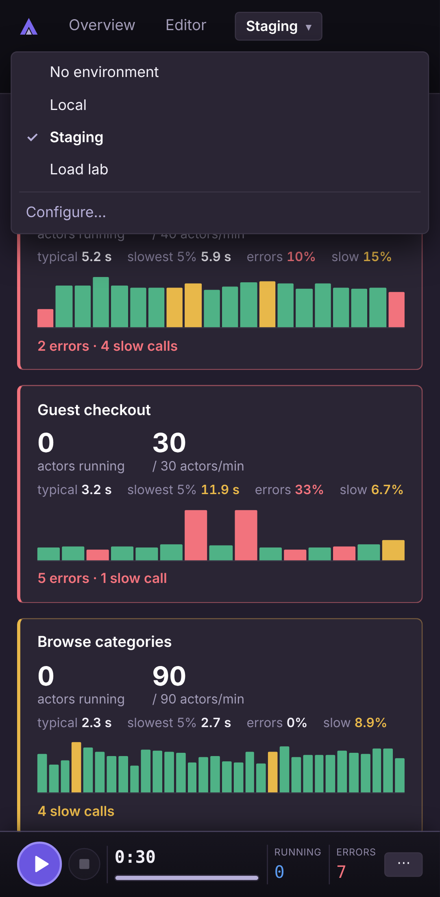
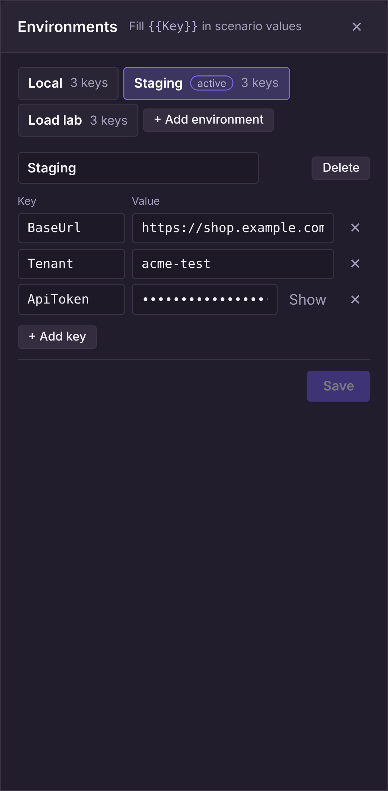
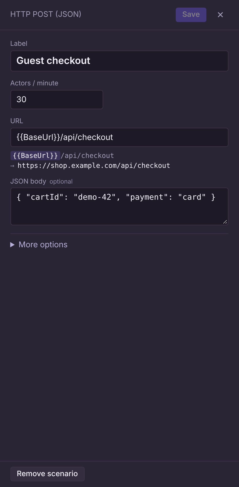

# Environments (brain 0033)

Desktop (2x) and phone (Pixel 7 emulation), fake data, published trimmed build.

Top-bar dropdown:

Configure popup (editing a value, unsaved):

Editor: `{{BaseUrl}}` highlighted, resolved text from the active environment on focus:

No environment selected (quiet note):

A run started with an environment active:

Phone: dropdown, popup and editor sheet:

