# Slowness as a colour gradient (brain 0041)

Published (trimmed) Release build, Playwright. Desktop = 1280 px at device scale 2, phone = Pixel 7. The finished run is a 5 minute one
(`?simulate=5m`) so that the calls of old actors are still kept. Scenario entry "Browse categories" (bursts of 15 actors).
Green = typical time or faster, then three steps of yellow-green, full amber = slow (over 2x typical).

| | Desktop | Phone |
|---|---|---|
| Overview (card sparks) | 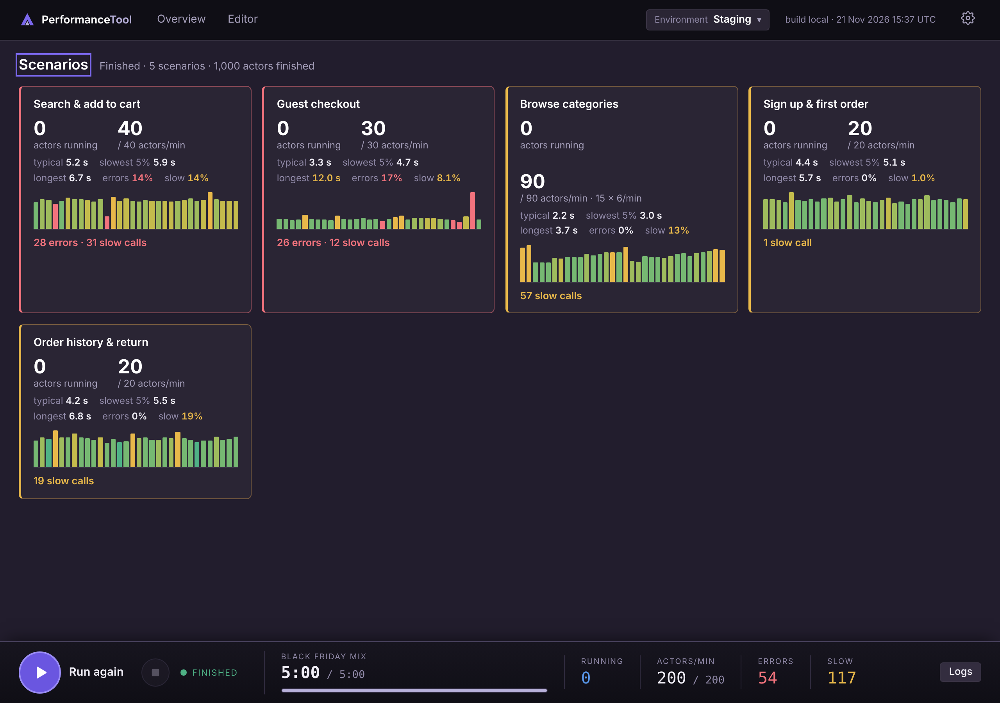 | 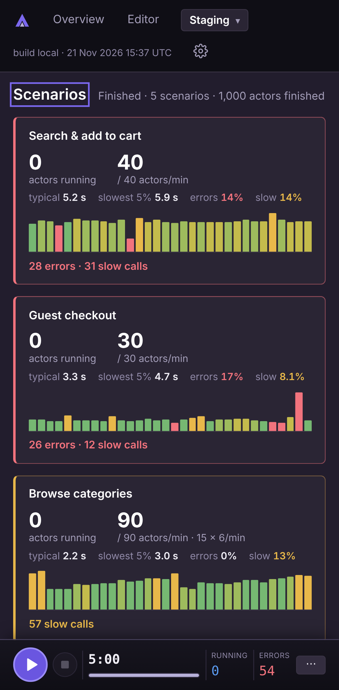 |
| Popup, whole run (group bars take their worst actor) | 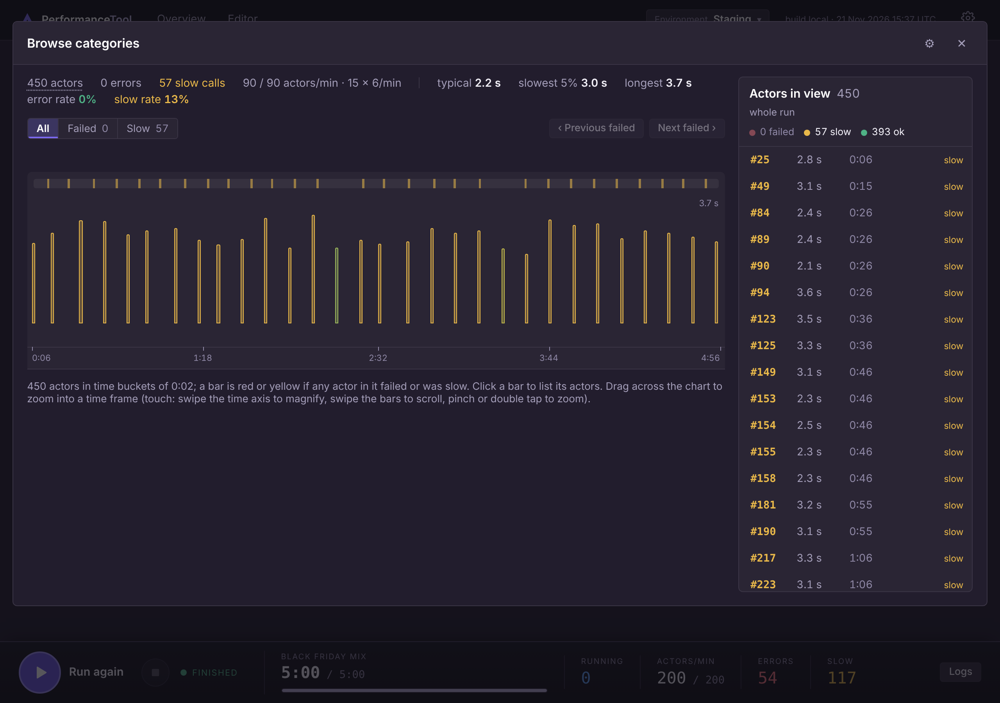 | 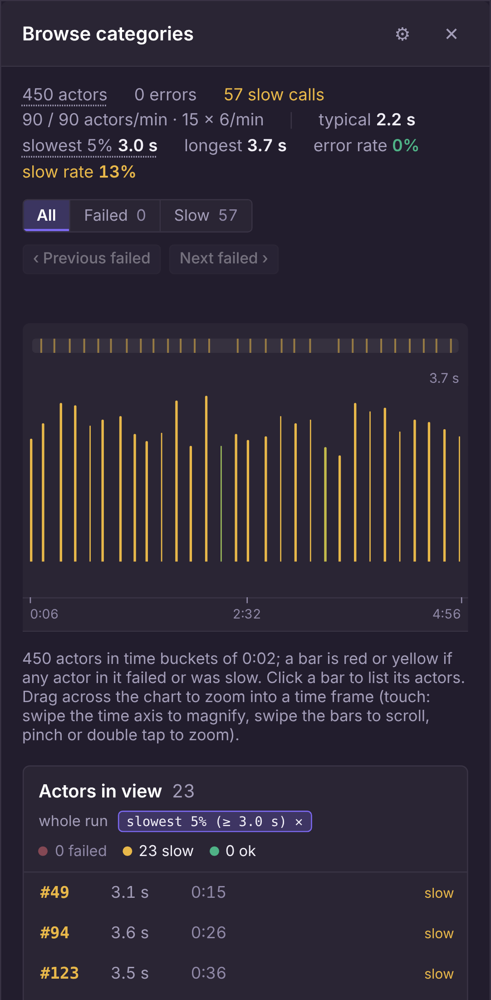 |
| Zoomed | 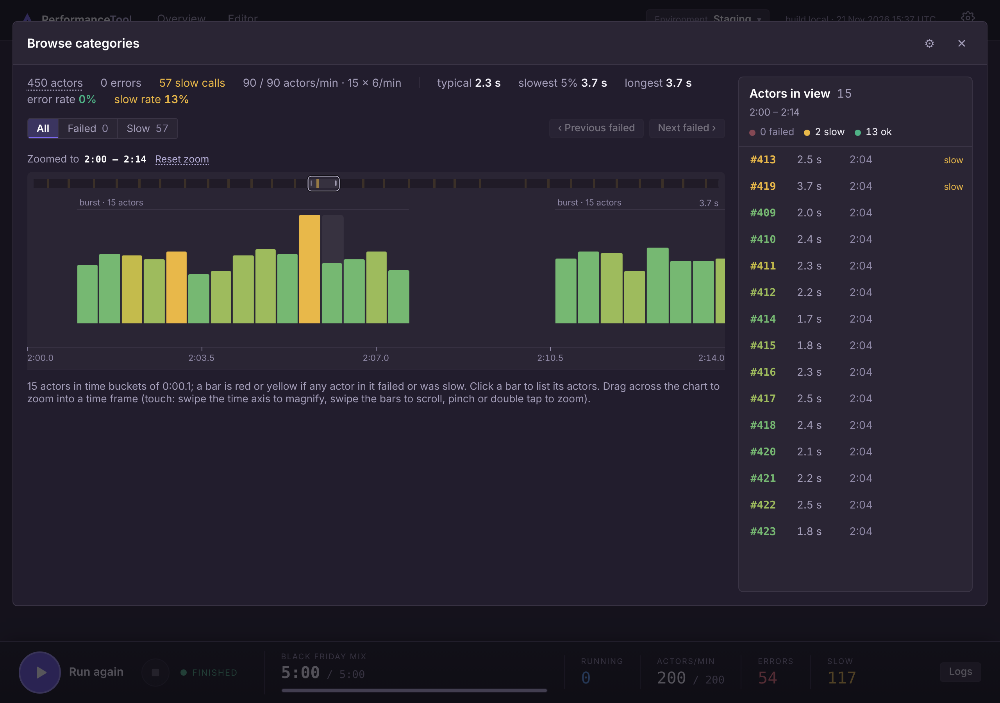 |  |
| Unfolded burst: the gradient bar by bar |  | 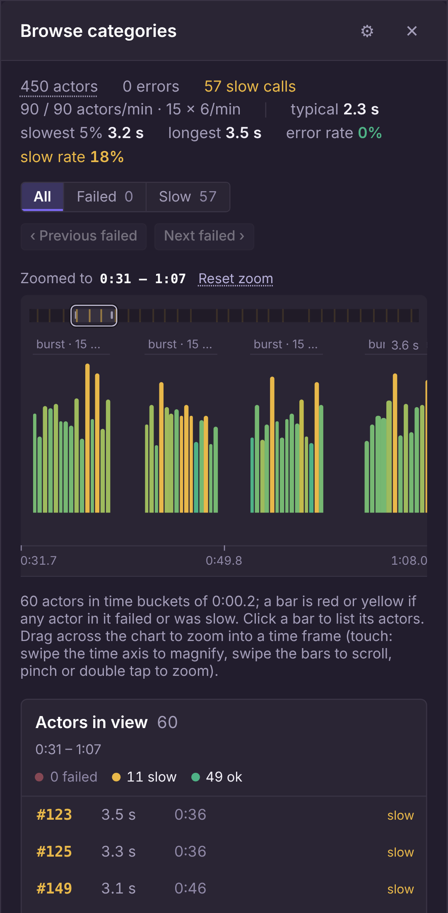 |
| Selected actor with its "x typical" figure | 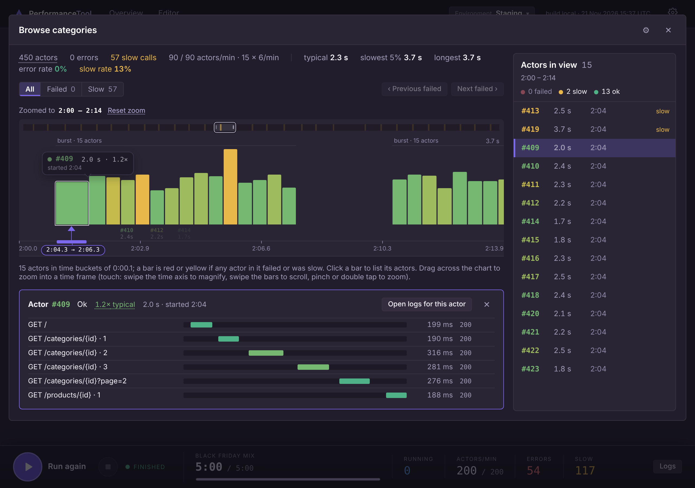 | 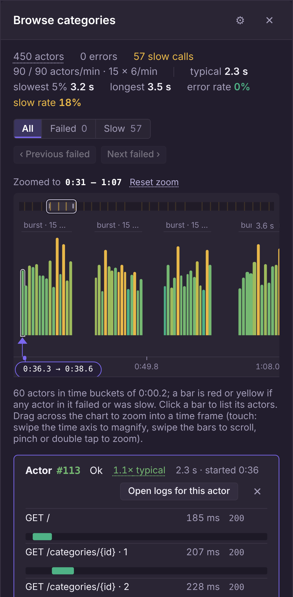 |
| The figure clicked: typical time of each call | 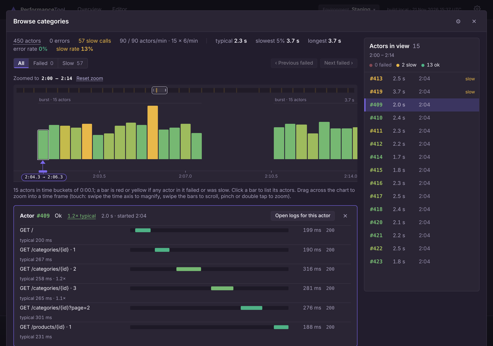 | 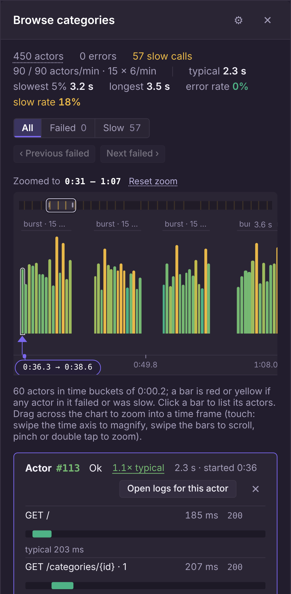 |
| Logs popup (actor numbers carry the colour) | 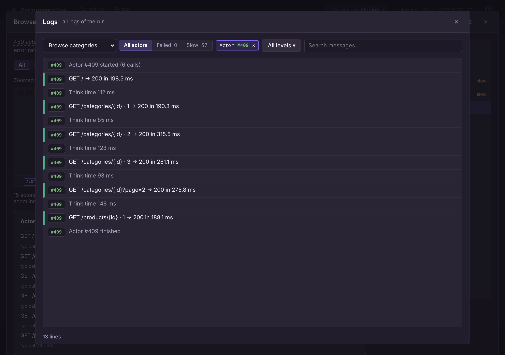 | 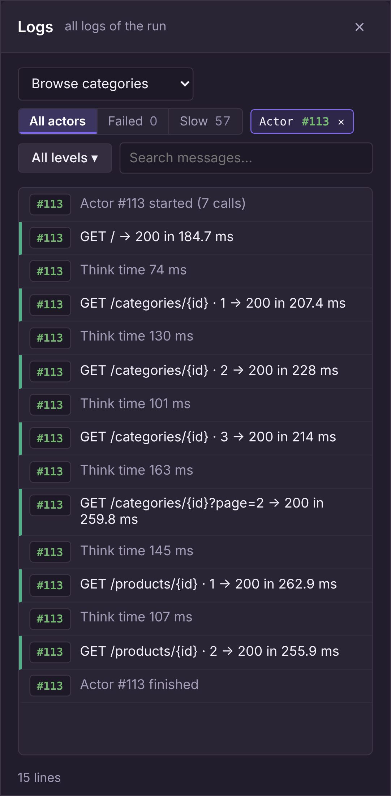 |
