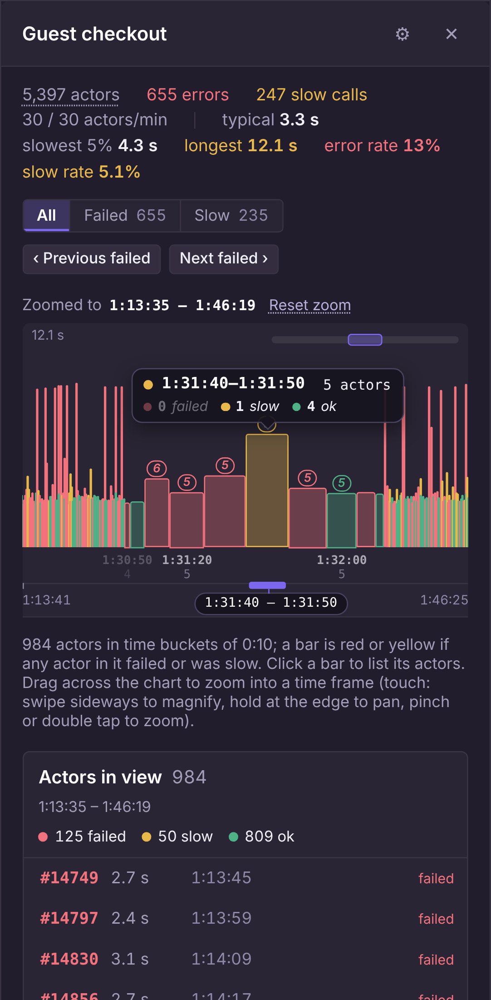
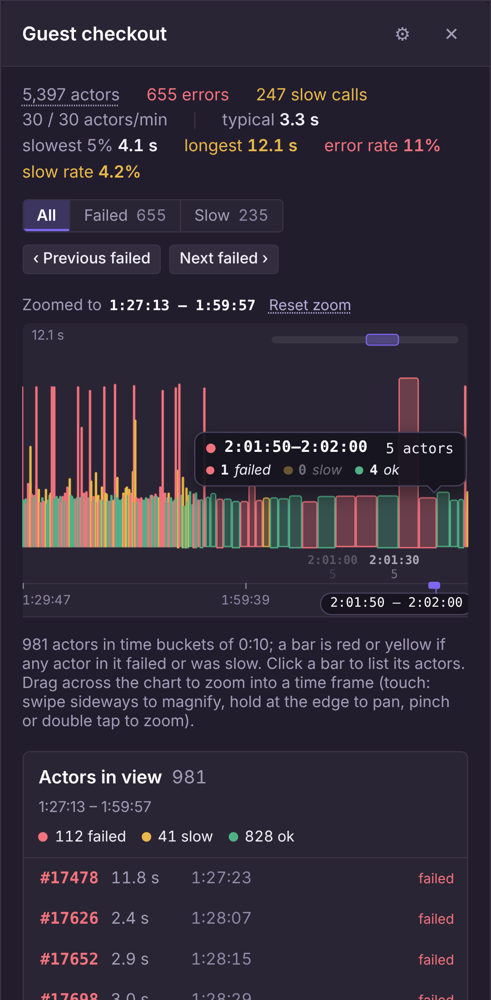
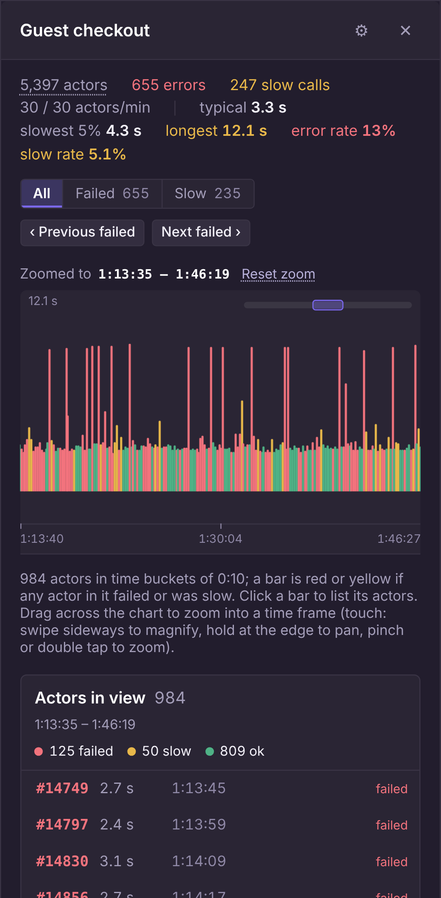
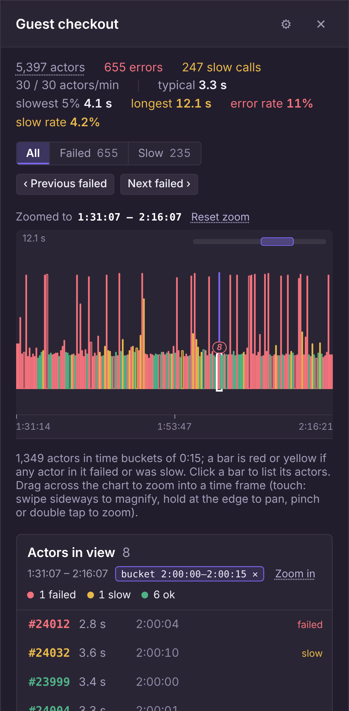
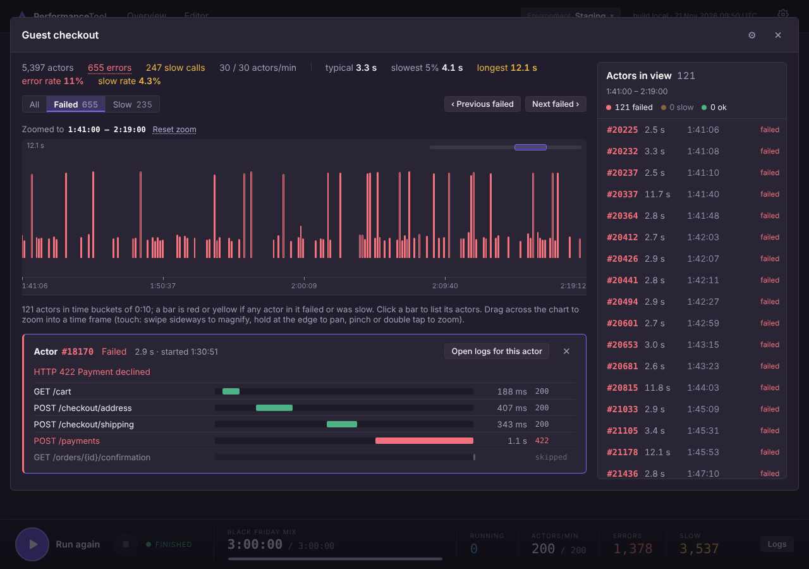

# Smooth panning, swipe magnifier, overview strip, step to failed (Pixel 7 emulation, 3 h simulated run)

Swipe sideways while zoomed in: the Dock magnifier follows the finger (release selects the bar under it).

Finger held at the right edge: the view pans (bars slide, the lit part of the overview strip moves).

Overview strip (top right of the chart, only while zoomed in): the lit part is the view.

"Next failed" moved the view to a group outside it and selected the group.

Desktop (mouse): overview strip dragged.

