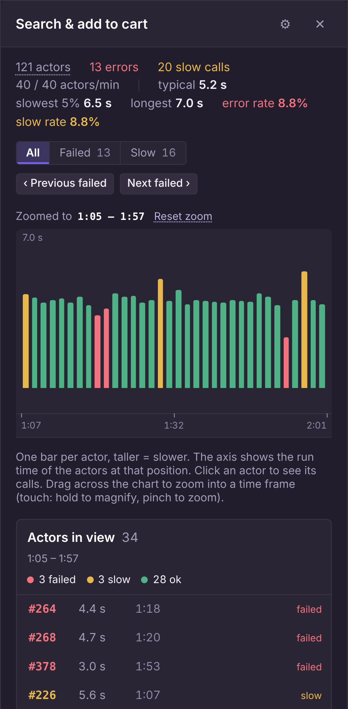
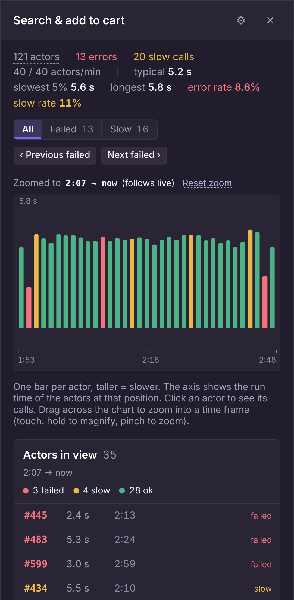
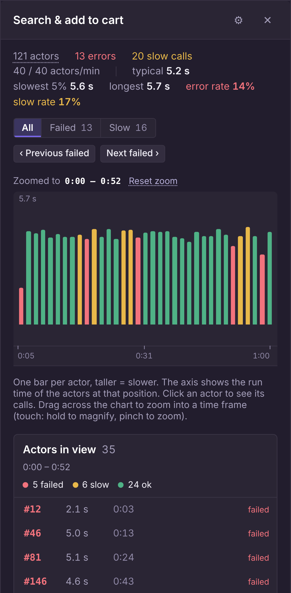

# Touch pan on the zoomed popup chart (brain 0031 update 1)

Phone emulation (Pixel 7). After a pinch zoom the chart is panned with one-finger sideways swipes.

| Zoomed (1:05 - 1:57) | After panning to the live end |
|---|---|
|  |  |

Panned to the run's start (0:00 - 0:52, clamped):

