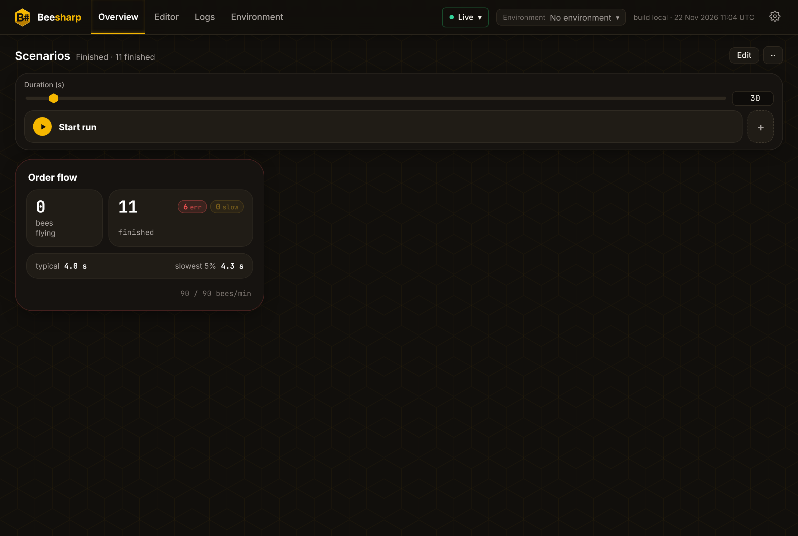
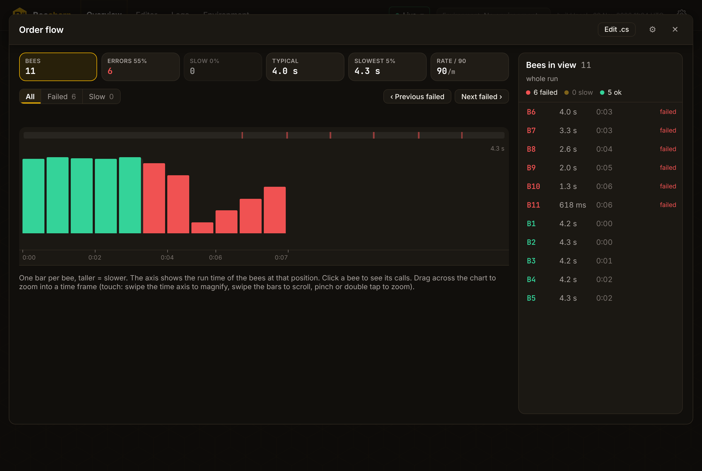
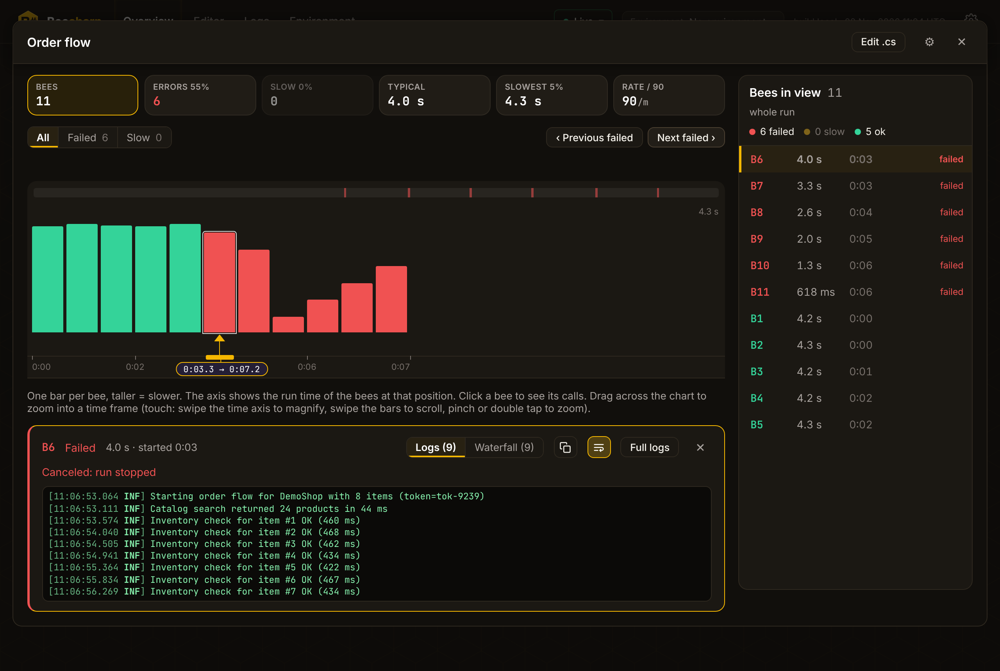
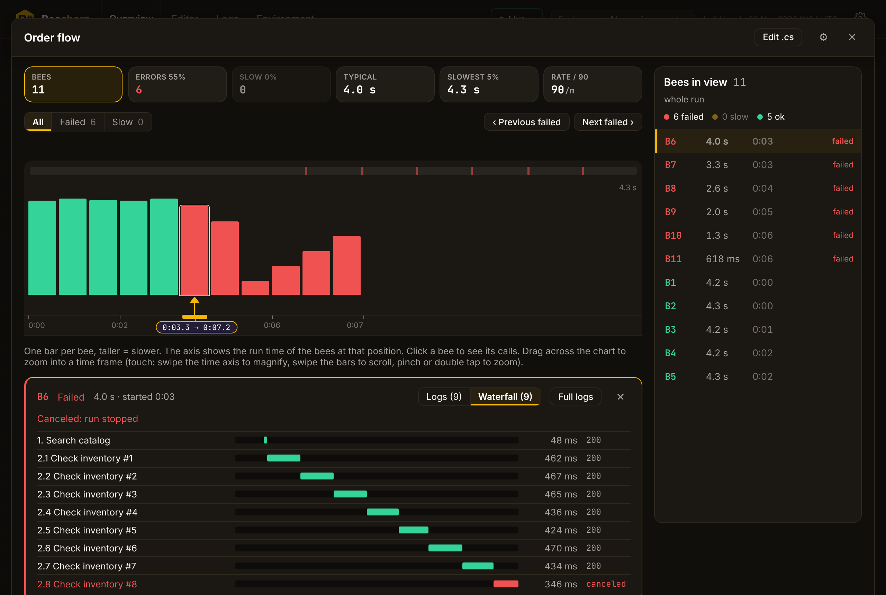
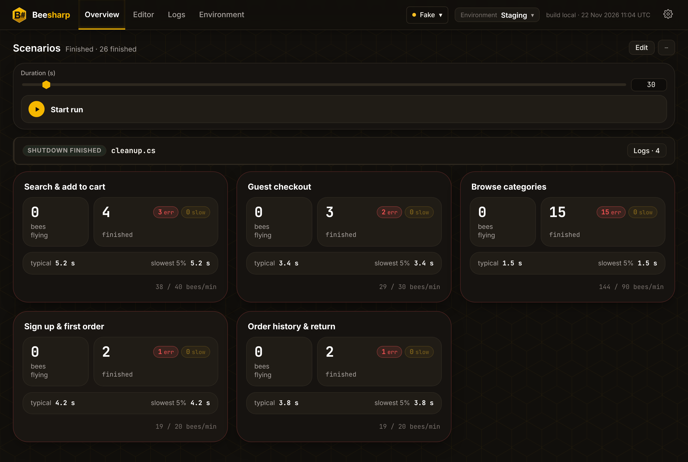
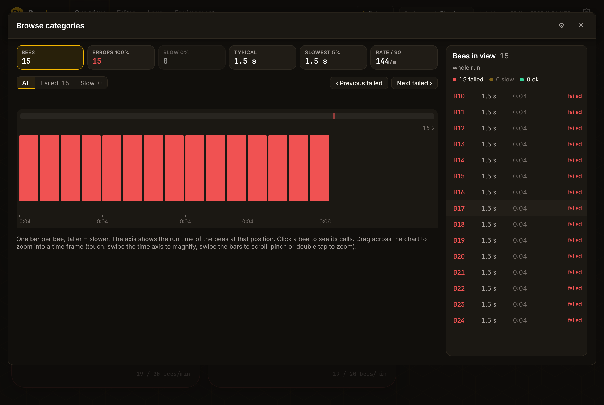
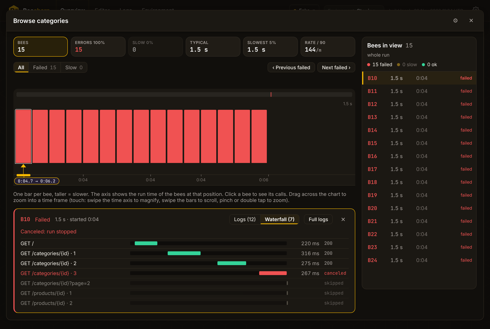

# Canceled bees (brain 0053)

Bees in flight when the run is stopped are kept as canceled: they look and count like failed (red, in the errors), with the error "Canceled: run stopped", their logs and their calls. The call cut off by the stop is failed (status "canceled") with the time it ran until the stop.

## Live mode (server), Multi-Step Order Flow, stopped after about 7 s

Overview after the stop: 6 of the 11 bees were in flight and are counted as errors.

Popup chart: the canceled bees are the red bars, shortest bar = the youngest bee.

A canceled bee with the logs it already had:

Its calls: finished calls unchanged, the cut-off call failed.

## Fake mode

