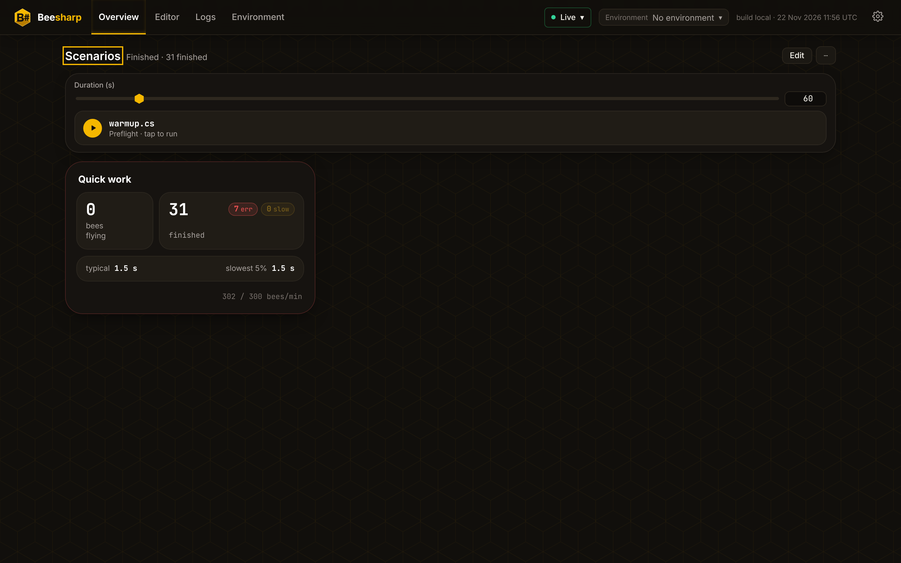
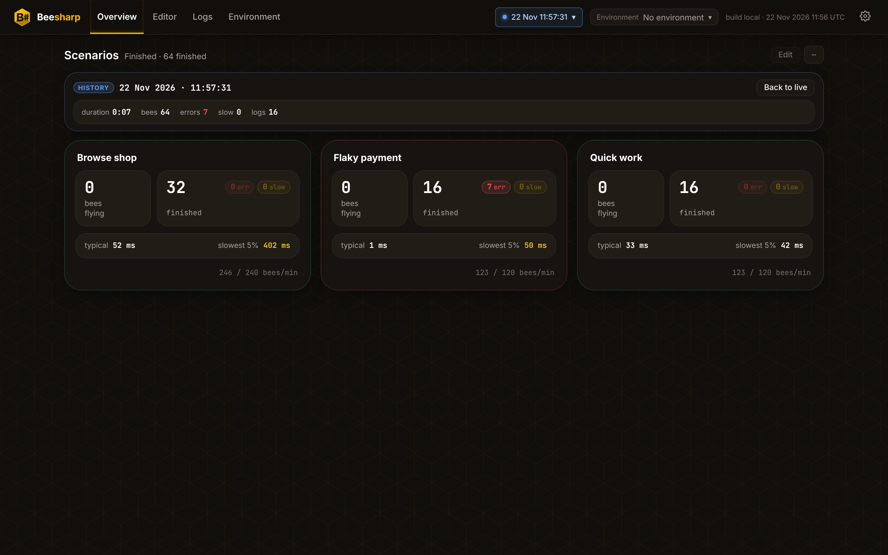

# Command-line tool (U3)

Runs from `beesharp run` against a temp root (script scenarios, HTTP GET against a tiny local server, a preflight and a shutdown program). Terminal output as text files:

- [help](0-help.txt)
- [passing/failing mix, exit 1](1-passing.txt) (3 entries, 7 of 64 bees failed with HTTP 503)
- [all bees failed, exit 1](2-failing-bees.txt)
- [missing preset, exit 2](3-missing-preset.txt)
- [preflight failed, exit 2](4-preflight-failed.txt)
- [unknown placeholder, exit 2](5-unknown-placeholder.txt)
- [Ctrl+C mid-run, exit 1](6-ctrl-c.txt)

A run with all bees succeeded exits 0 (covered by `CliTests`).

## Ctrl+C run

```
$ beesharp run --preset Long --env Staging --progress 2   (Ctrl+C after 8 seconds)
beesharp run: preset "Long", environment Staging
  1 scenario entry, 1 min 0 s, preflight warmup, shutdown program cleanup
  root <root>, storage DuckDB
Preflight warmup.cs...
  preflight> [  0.00s] [INF] Starting preflight 'warmup.cs'…
  preflight> [  0.01s] [INF] Warming up...
  preflight> [  0.01s] [INF] Ready.
  preflight> [  0.01s] [INF] Preflight finished successfully in 6.1 ms.
Running scenarios...
      2.0 s  3 bees finished, 0 failed, 7 flying
      4.1 s  13 bees finished, 0 failed, 8 flying
      6.1 s  23 bees finished, 0 failed, 8 flying
Stopping: bees in flight are canceled, the shutdown program still runs...
Shutdown program cleanup.cs...
  shutdown> [  0.00s] [INF] Starting shutdown program 'cleanup.cs'…
  shutdown> [  0.00s] [INF] Cleaning up tenant demo
  shutdown> [  0.00s] [INF] Shutdown program finished successfully in 0.9 ms.

Summary
  Run         run-20261122-115751-110  (stopped with Ctrl+C)
  Preset      Long   Environment Staging
  Run time    6.1 s
  Preflight   succeeded (warmup.cs)
  Shutdown    succeeded (cleanup.cs)

  Entry          finished  failed   slow    typical  slowest 5%
  #1 Quick work        31       7      0     1.50 s      1.50 s
  All                  31       7      0
  7 of the failed bees were canceled when the run stopped.

  Most common errors
         7 x  Canceled: run stopped

  Saved to    <root>/data/beesharp.duckdb  (run run-20261122-115751-110)

Result: 7 of 31 bees failed (exit code 1).
exit code: 1
```

## The server shows the CLI's runs

The server was started on the same root (`Storage:DuckDbPath`); the latest CLI run (the stopped one) opens on the overview:



The "Shop checkout" run from the history:


