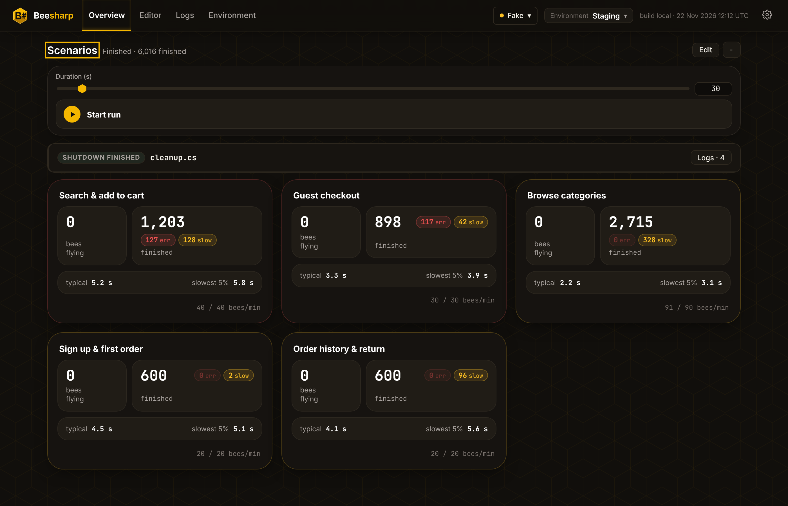
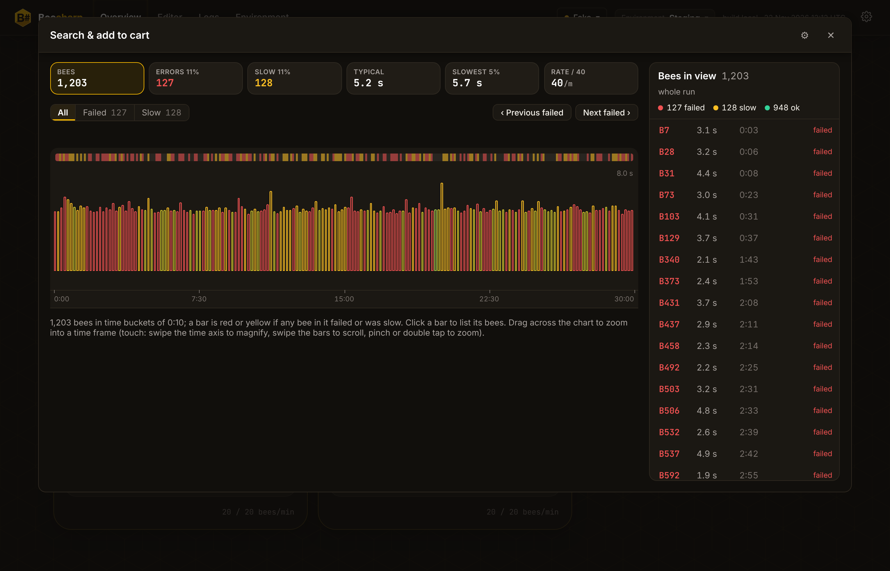
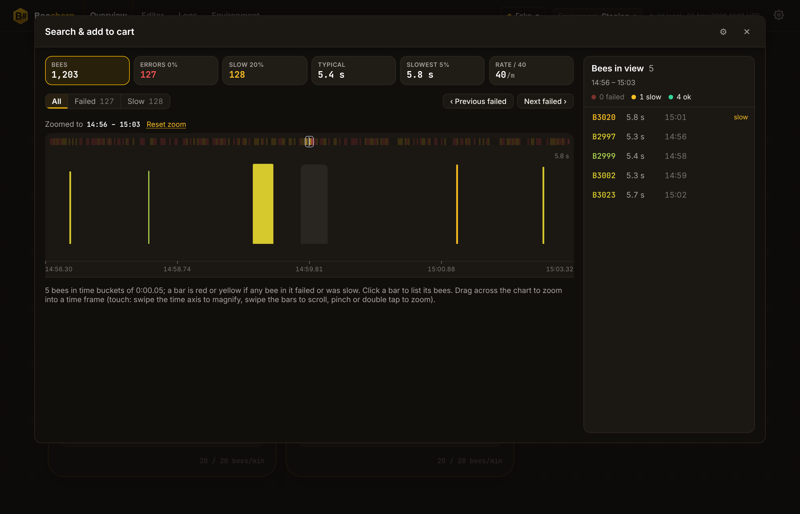
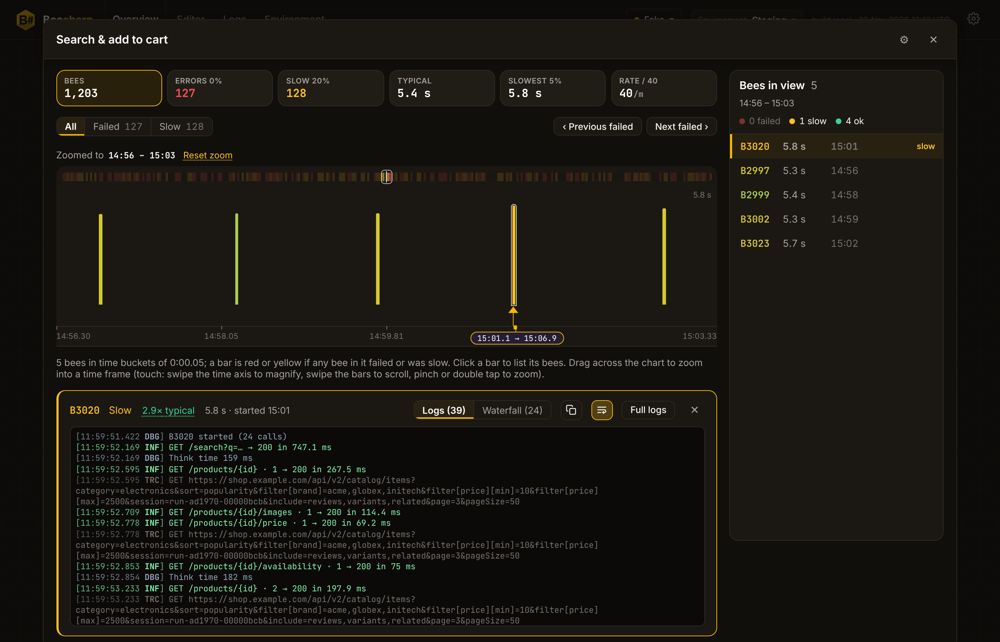
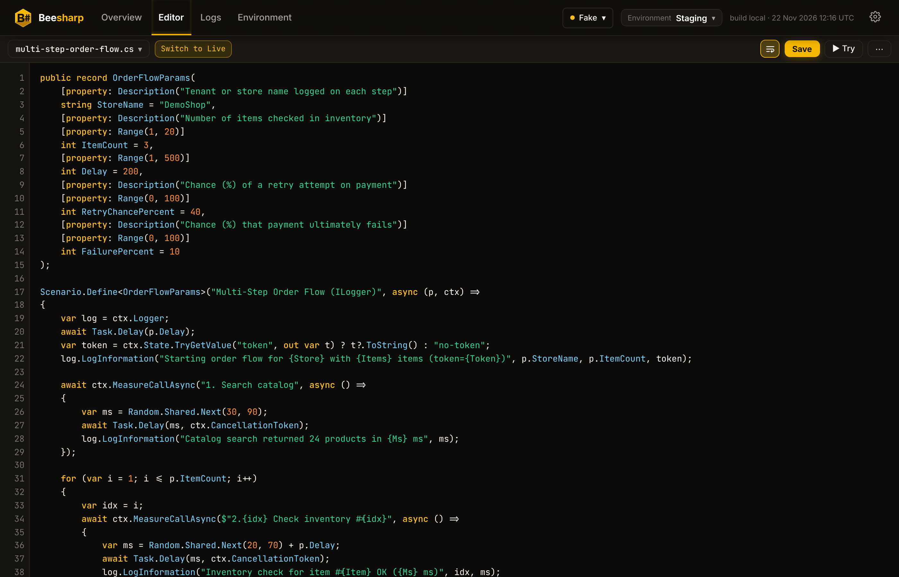
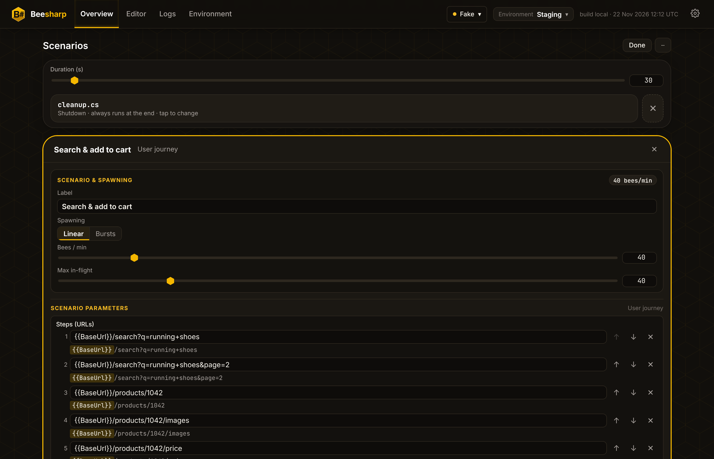
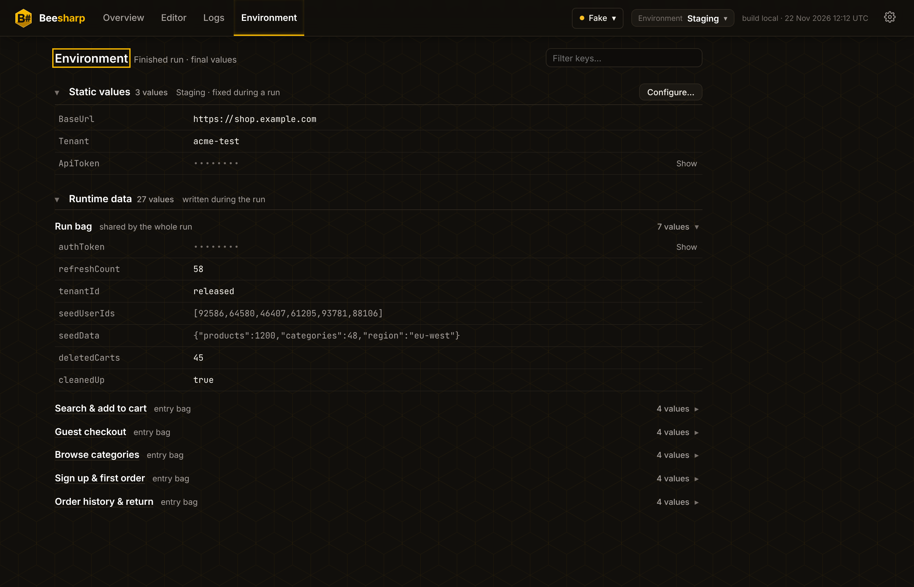
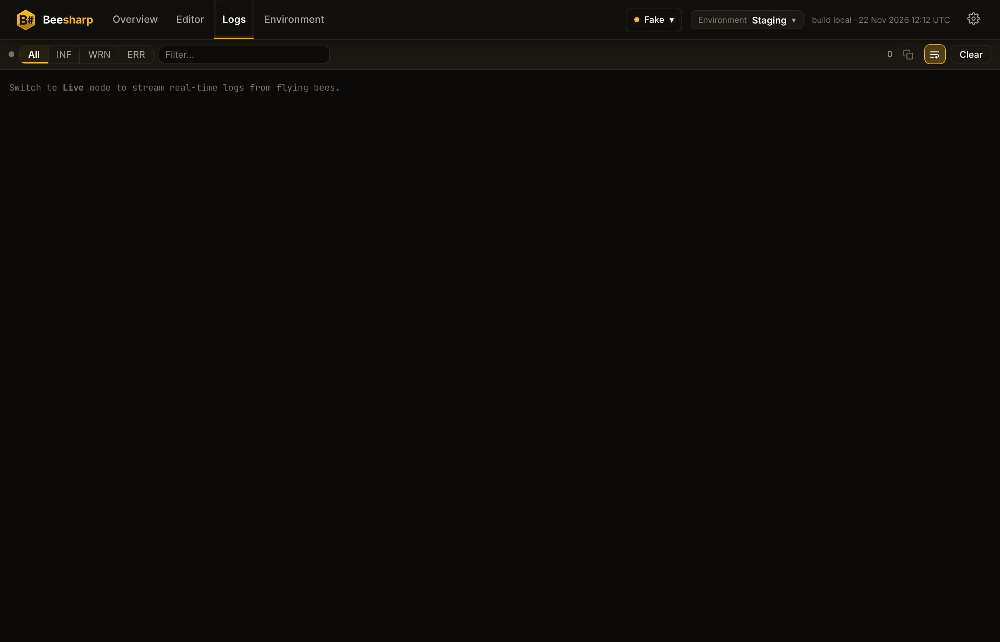

# Client folders by topic (U4)

Trimmed Release publish of the client in Fake mode (plus the editor served by the Live server), after the move to topic folders. Nothing changed visually.

The assistant icon is hidden (assistant not configured).
