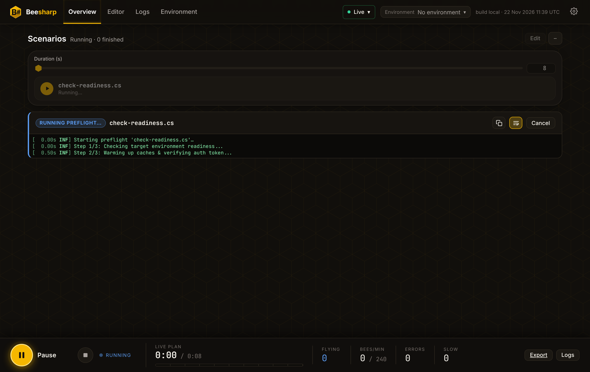
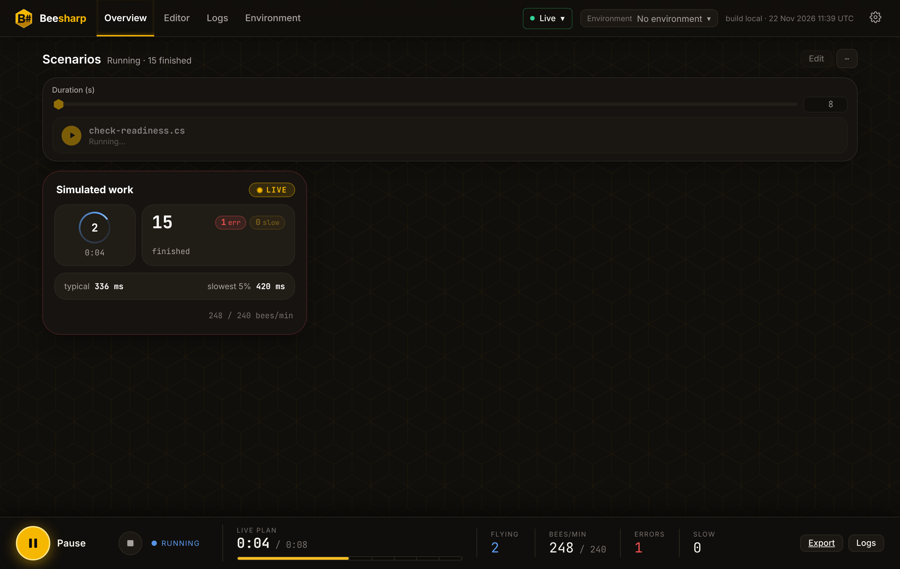
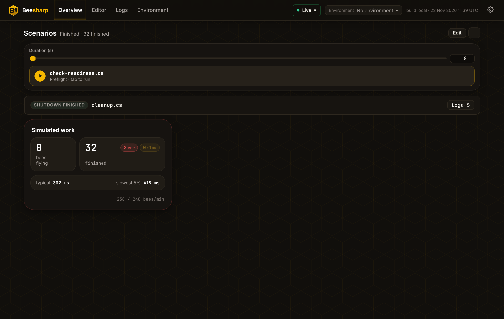
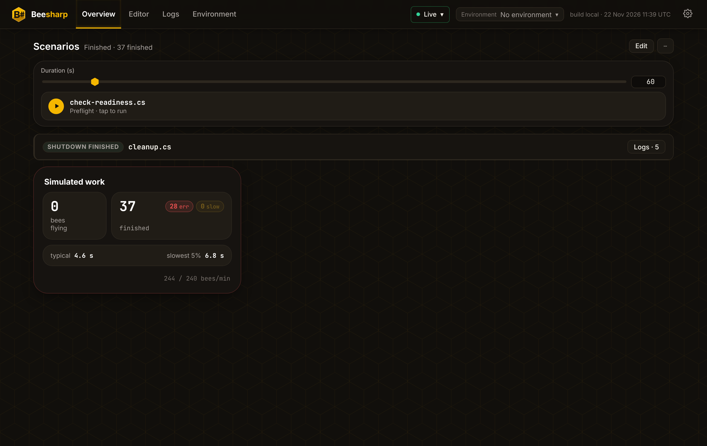
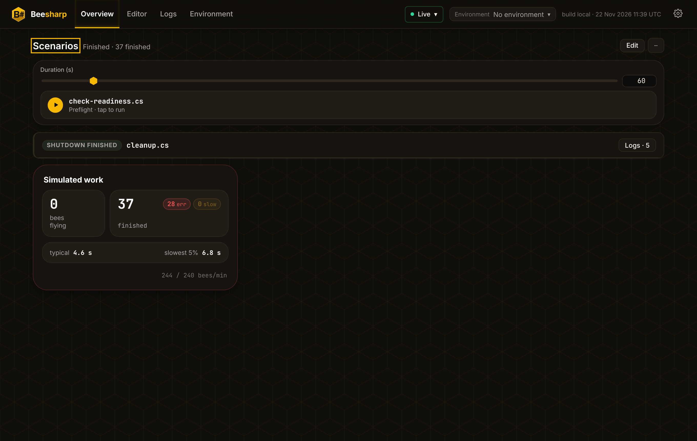
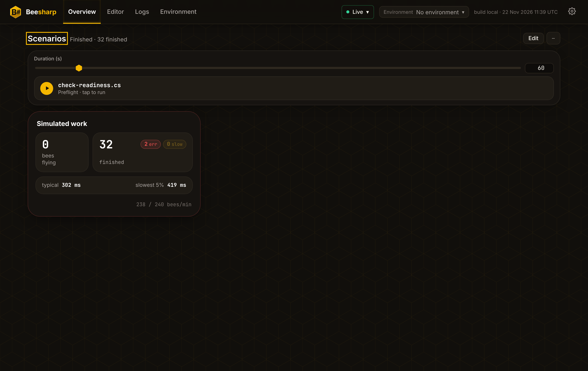
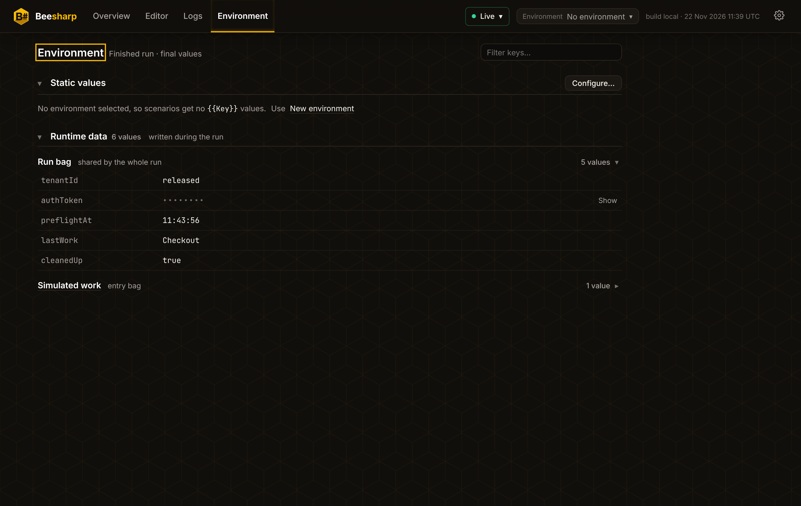

# Engine, Scripting and Storage split out of the host (brain 0054, step U2)

Live mode against the server (DuckDB storage). The modules changed; the UI is the same as before.

1. A run starts: the preflight `check-readiness.cs` runs first.

2. The scenarios run (Simulated work).

3. The run finished; the shutdown program `cleanup.cs` ran after it.

4. A second run stopped mid-way: bees still flying were stored as canceled ("Canceled: run stopped"), shown as errors.

5. After a page reload the latest run is restored from storage.

6. The first run loaded from history (`POST /api/runs/{id}/load`).

7. Environment tab: final values of the past run (run bag written by preflight, bees and shutdown program).

Also driven through REST in the same session: a failing script compile (diagnostic with line and column), script, preflight and shutdown test runs.
