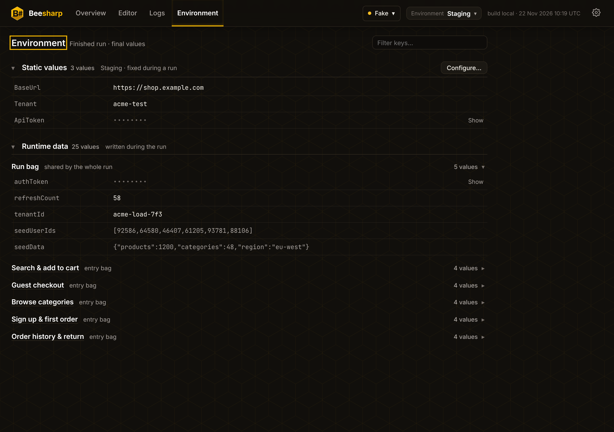
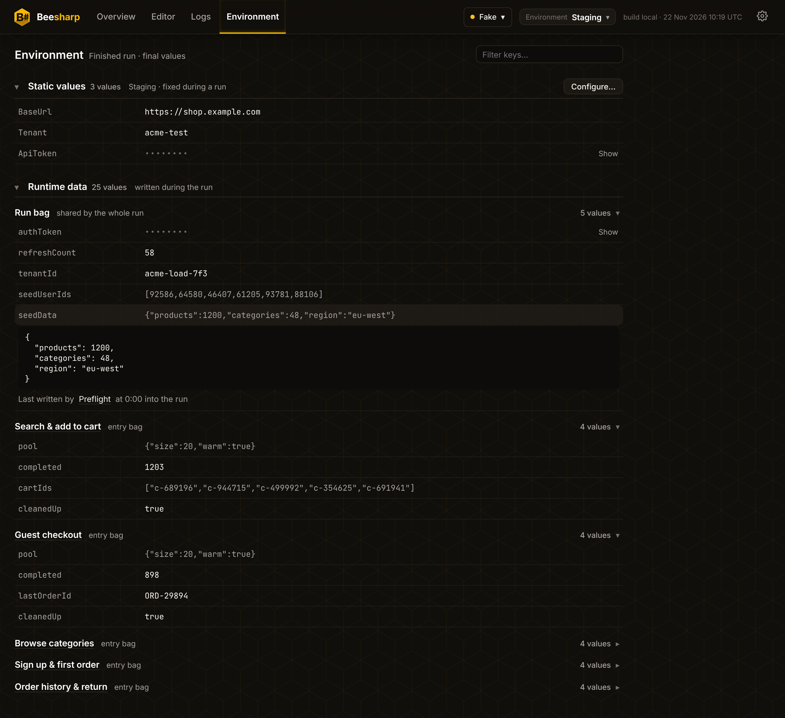
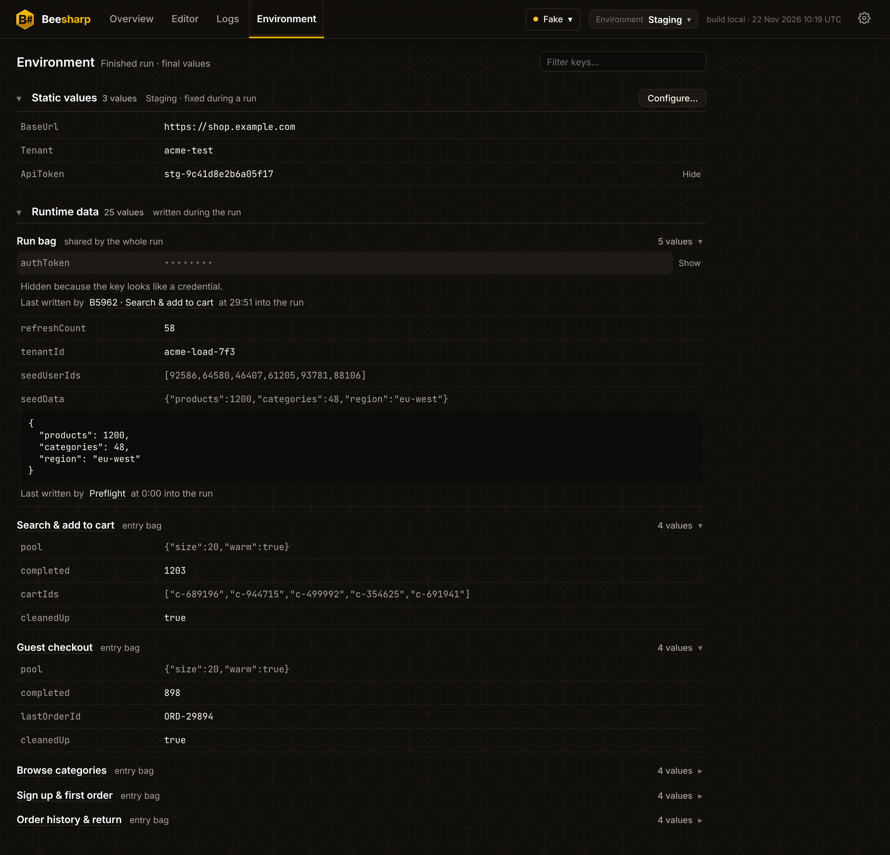
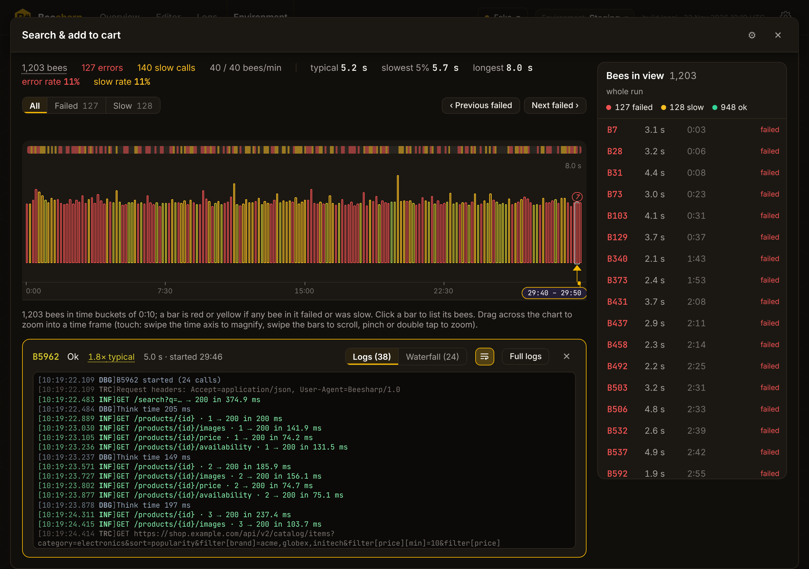
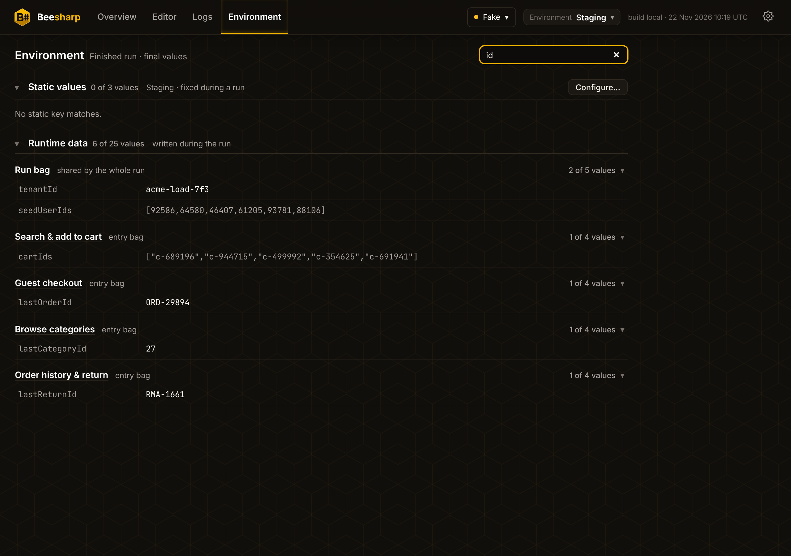
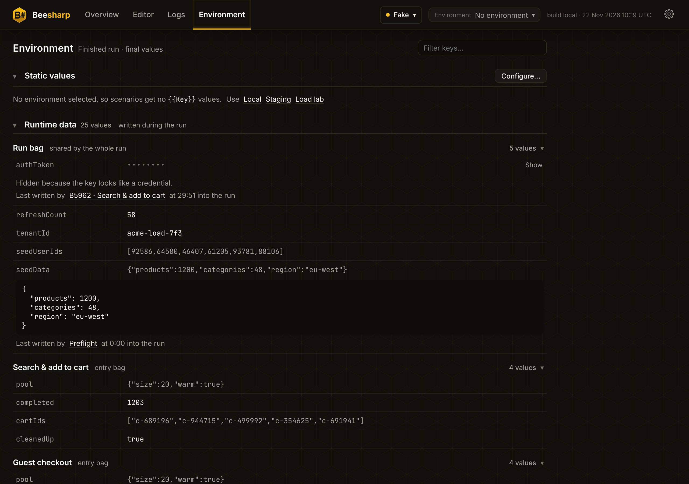
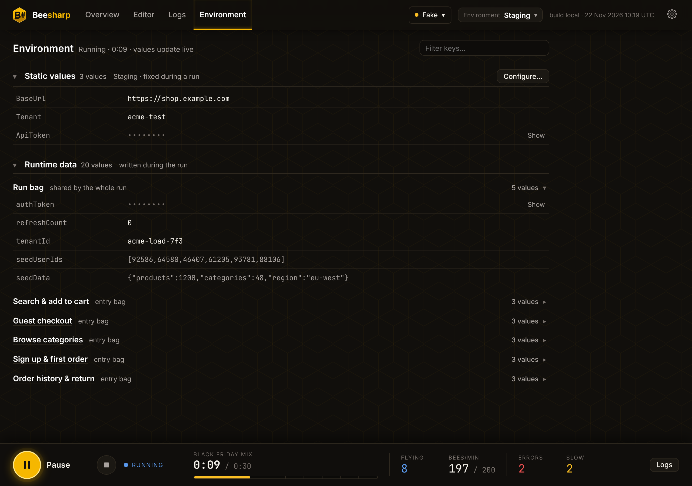
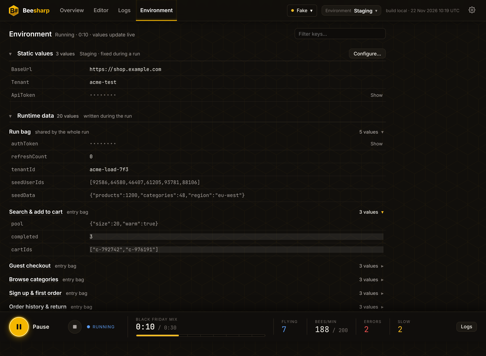
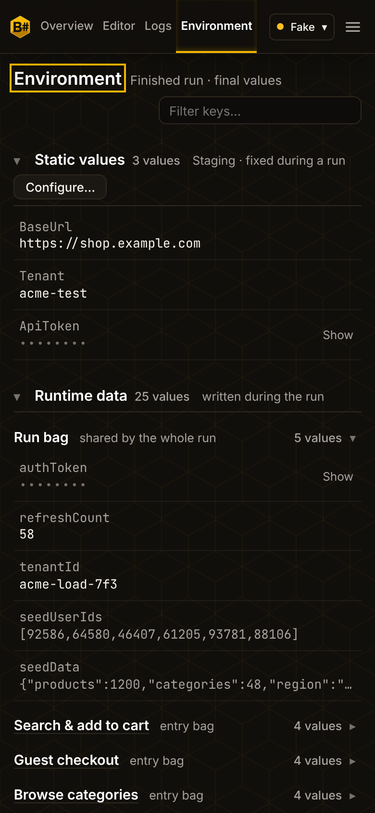
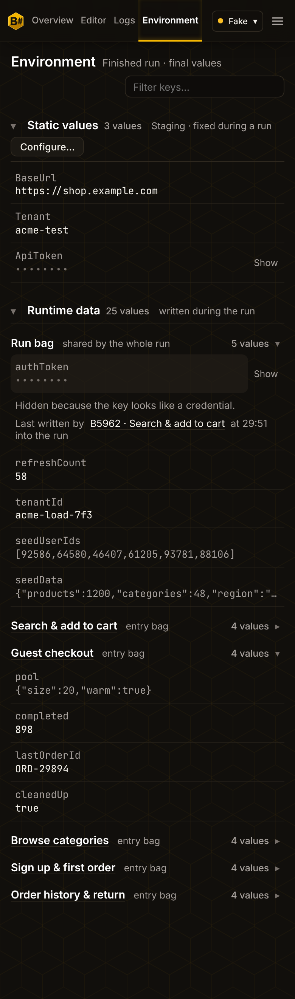

# Environment tab (brain 0052, step S1), fake data

1. Seeded finished run: static values and the final runtime data (run bag, entry bags collapsed).

2. Expanded entry bags and one object value as pretty JSON.

3. Credential-looking keys are masked; Show reveals the static one, the runtime token stays hidden and says who wrote it.

4. Drill-down: the writer "B5962 · Search & add to cart" opens that bee in the scenario popup.

5. Key filter over both scopes.

6. No environment selected: a quiet line with a way to pick one.

7. Live run (0:09): values update while it runs.

8. Live run with an entry bag open.

9. Phone width (390 px), finished run.

10. Phone width, values expanded.

