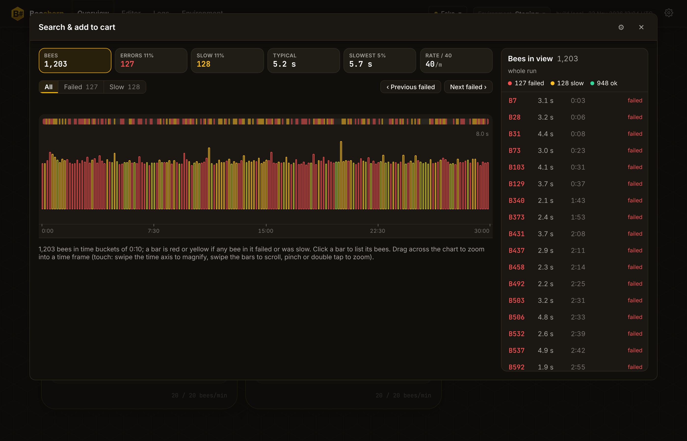
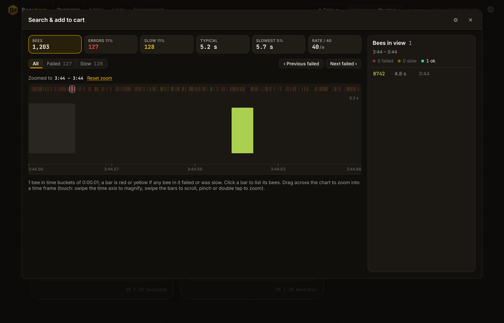
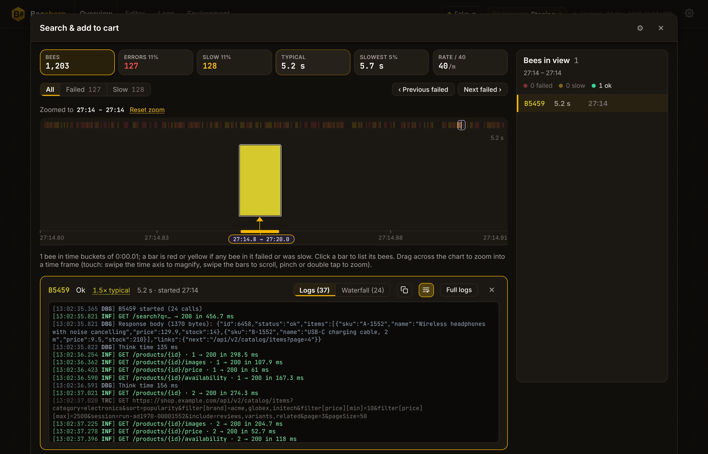

# Popup boxes always show the whole run (brain 0056)

Seeded 30-minute run, scenario "Search & add to cart".

1. Unzoomed: Errors 11% / 127, Slow 11% / 128, Typical 5.2 s, Slowest 5% 5.7 s.

2. Zoomed into one bee (3:44): the boxes show the same whole-run figures; only the chart and "Bees in view" follow the zoom.

3. Click Typical while the median bee is outside the zoom: the view moves to it (27:14) and the bee opens.

