# Rename to Beesharp namespaces and the shared Contracts project (brain 0054, step U1)

Nothing should look different. Live mode: the server (Development) plus the client, a real run with the sample preflight and shutdown program against a local target. Fake mode: the Release published (trimmed) client.

1. Live, before the run: plan with preflight `check-readiness.cs`, two entries.
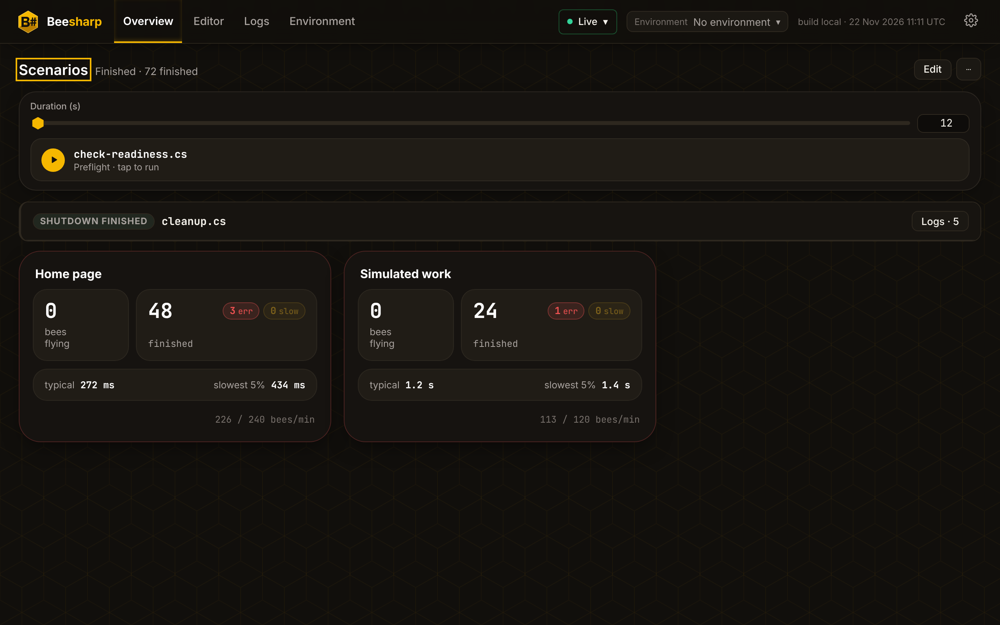

2. Live, running.
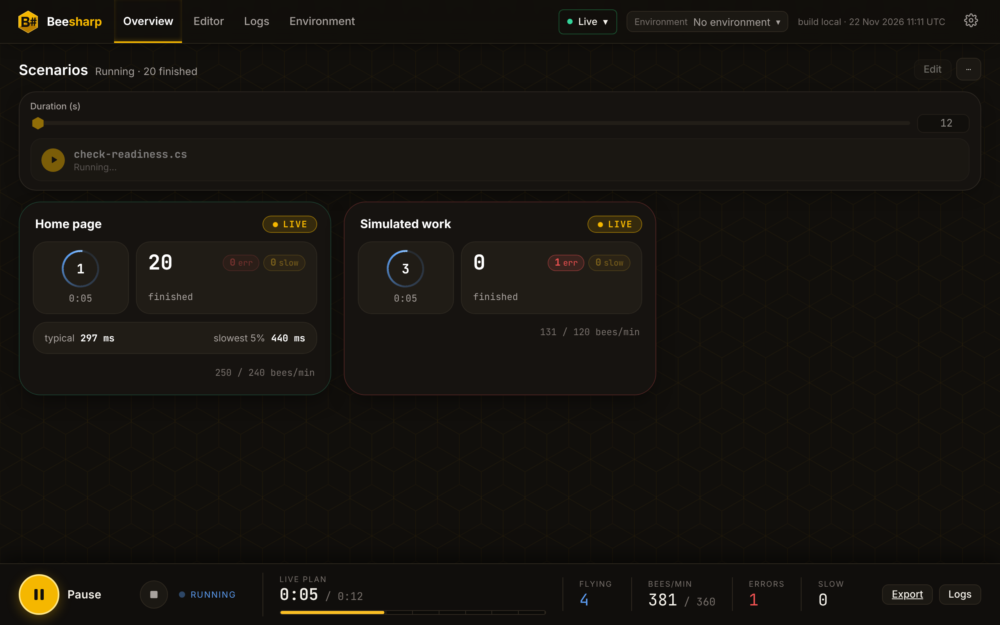

3. Live, finished: the shutdown program ran (cleanup.cs), counters and errors came through the shared wire types.
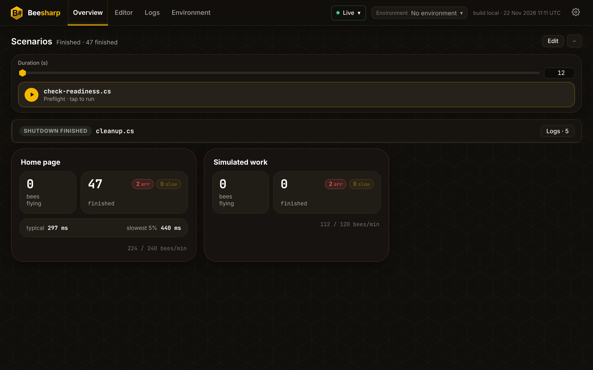

4. Scenario popup of a finished entry.
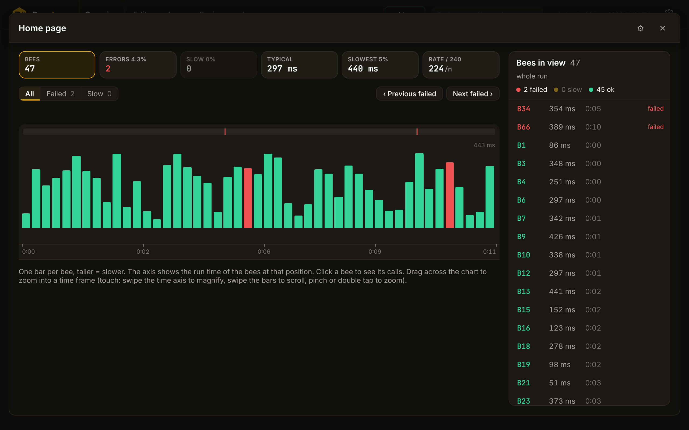

5. Script editor (Custom C# Scenarios) with the sample scripts from the server.
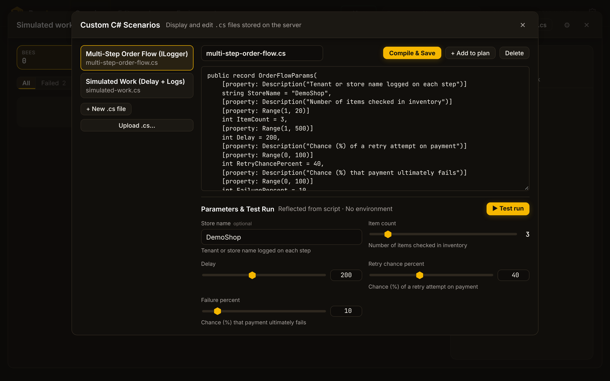

6. Environment tab: final run bag and entry bag.
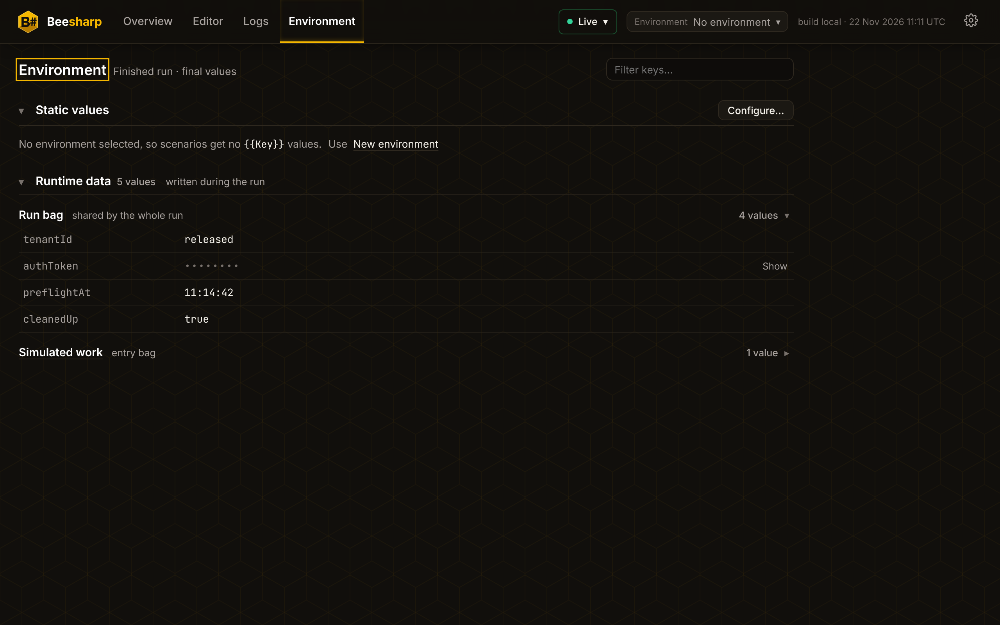

7. Editor page.
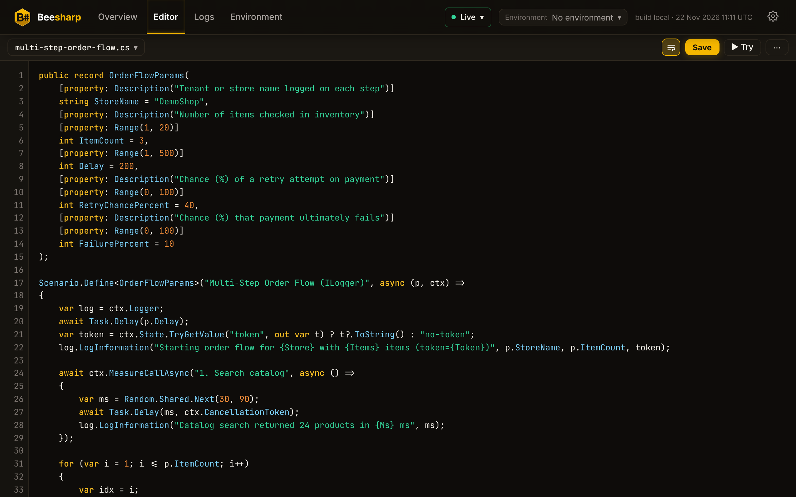

8. Fake mode, trimmed Release publish: overview.
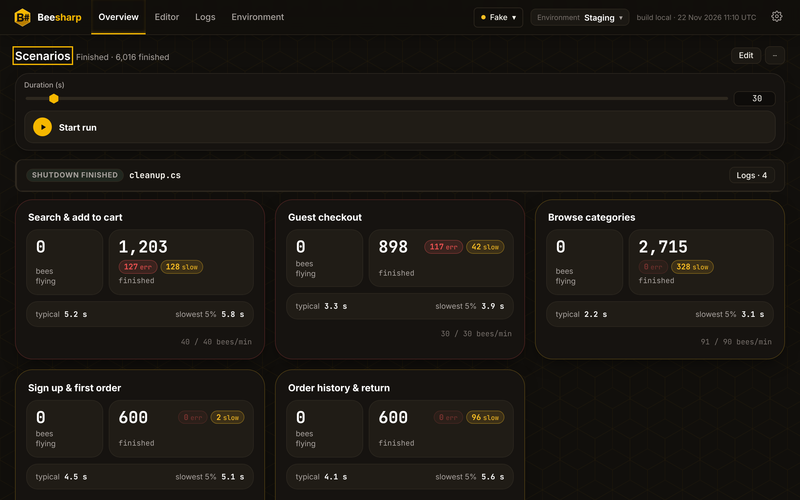

9. Fake mode, scenario popup.
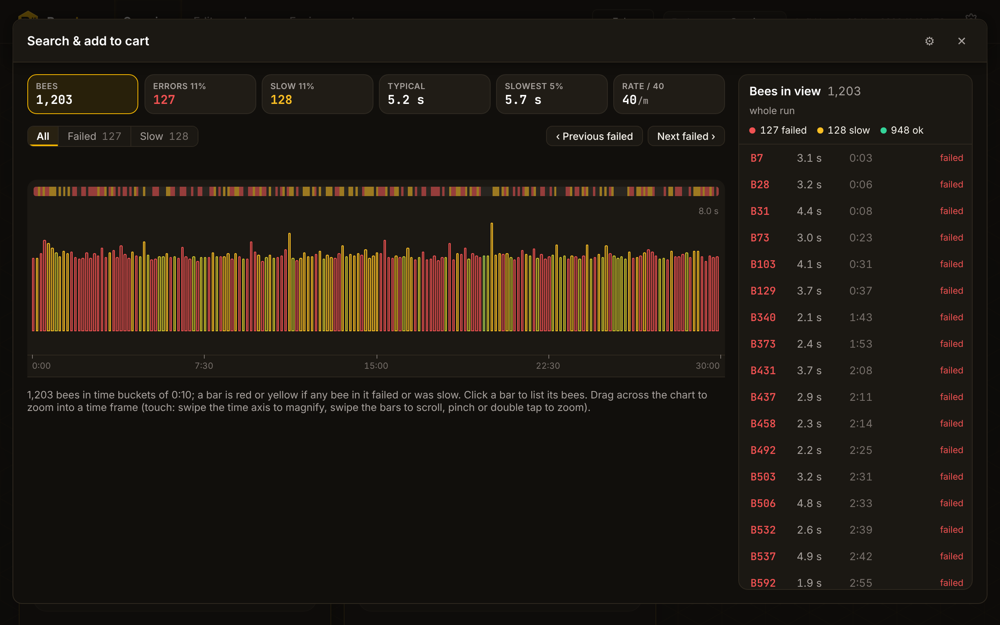

10. Fake mode, editor with the generated parameter editor reachable (trimmed build); the red line is the missing server API of a static host.
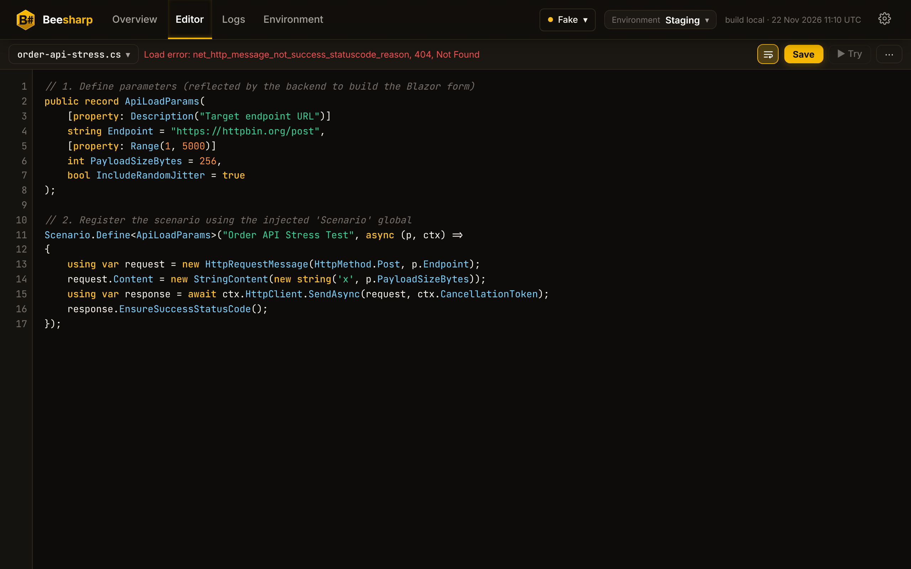

After merging step T (canceled bees, brain 0053), Live mode:

11. A run stopped after 9 s against a slow target: bees in flight at the stop are shown red like failed (24 failed of 37).
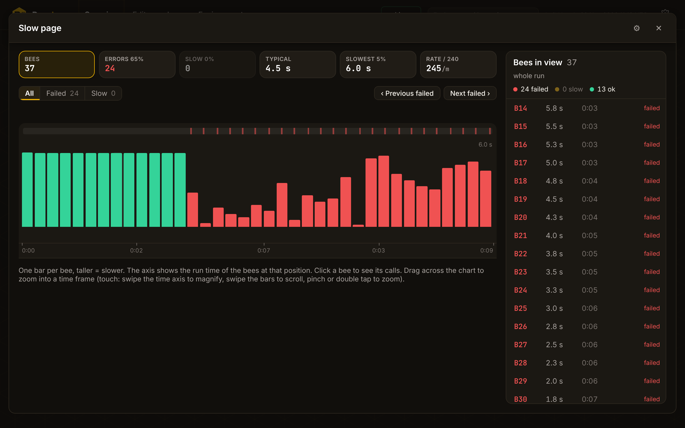

12. One canceled bee (B14) opened: "Canceled: run stopped", its call under Waterfall (1), its logs tab.
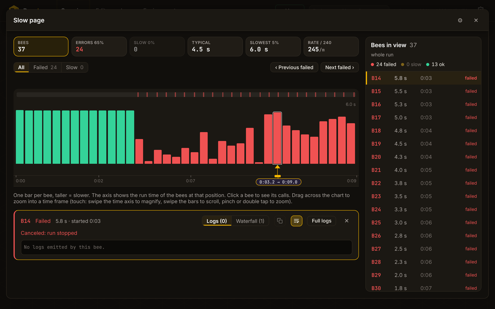
