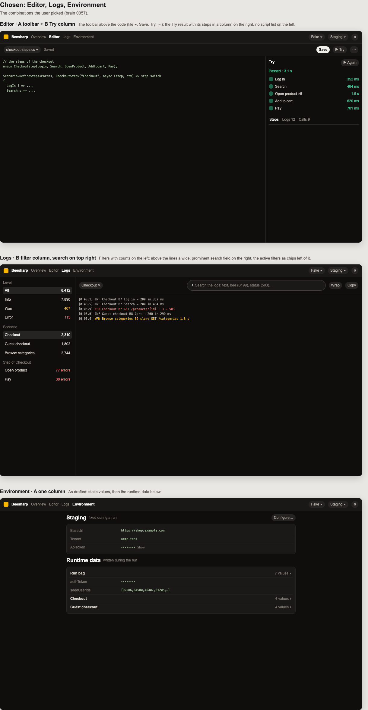
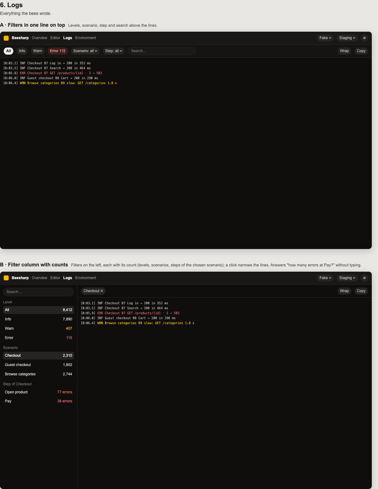
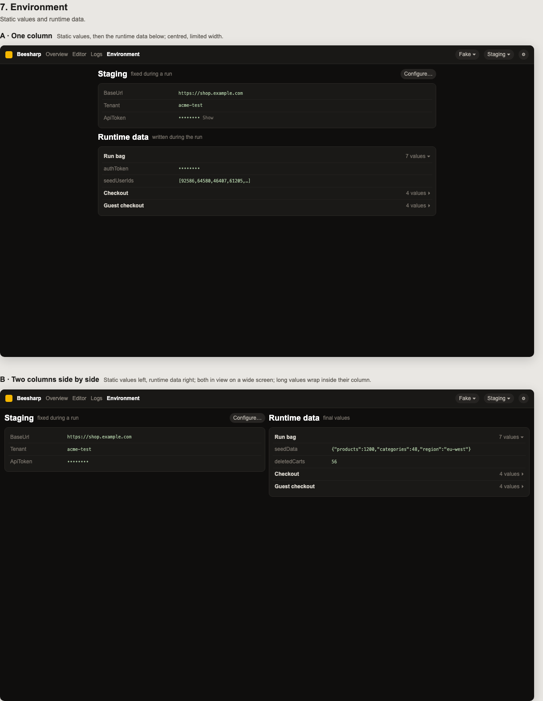
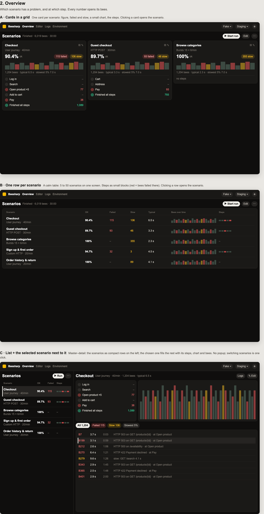

# Layout drafts (desktop), 2026-11-23

Rough wireframes with fake content to choose a layout per page (brain 0057). Source: `layouts-desktop.html` (desktop), `layouts.html` (first draft with phone frames).

Decided (brain 0057): app frame A, overview A, one scenario B, one bee B, editor A toolbar + B Try column, logs B with the search on top right, environment A.

## Chosen: Editor, Logs, Environment

## Editor

## Logs

## Environment

## Decided pages

