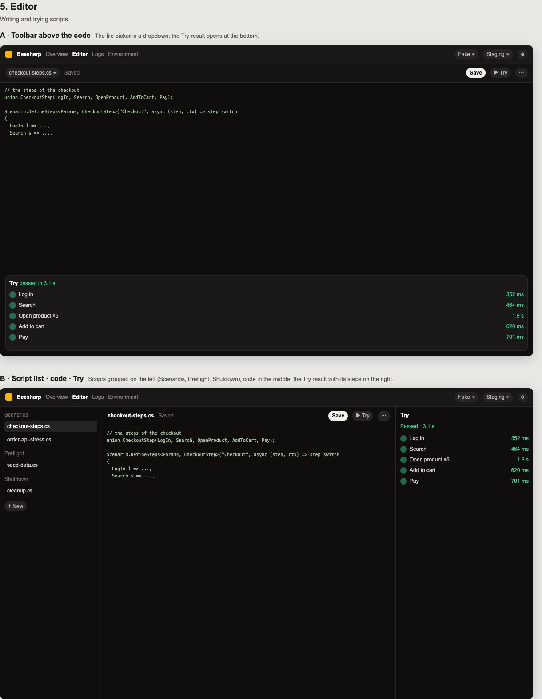
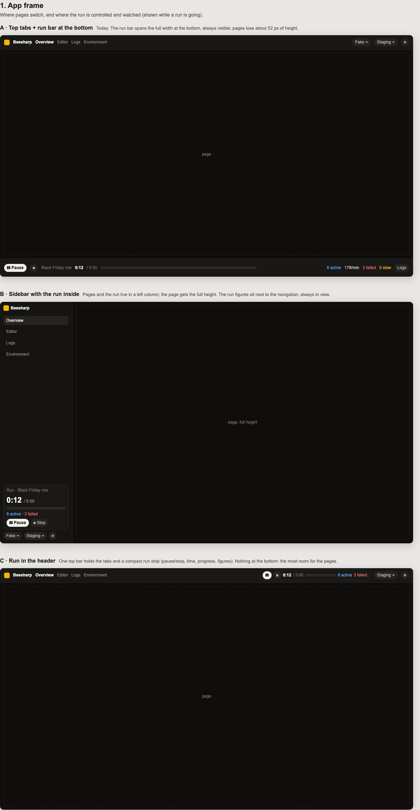
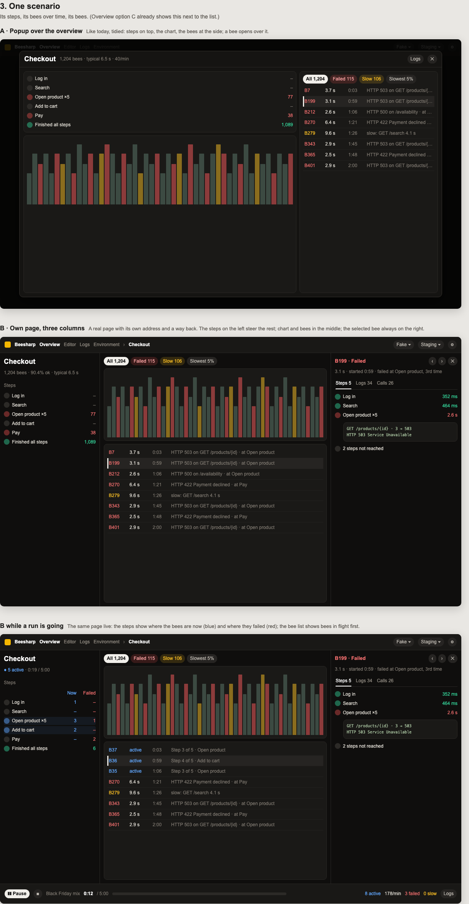
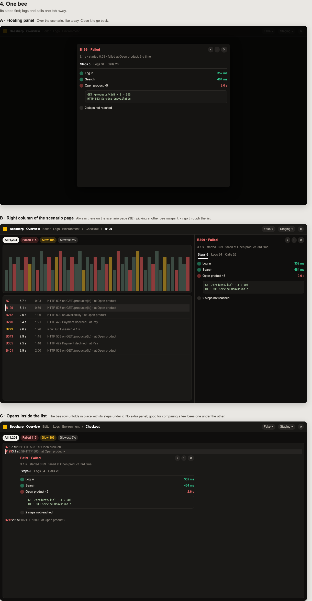

# Layout drafts (desktop), 2026-11-23

Rough wireframes with fake content to choose a layout per page (brain 0057). Source: `layouts-desktop.html` (desktop), `layouts.html` (first draft with phone frames).

Decided: app frame A, overview A, one scenario B, one bee B. Open: editor, logs, environment.

## Editor

## Logs

## Environment

## Decided pages

