# UI polish review, 2026-11-23

One calm look for all pages (brain 0016, 0018), new overview cards, the scenario steps as a list (brain 0056), fixes. Desktop 1440 × 900 and phone 390 × 844, fake data.

## Before and after
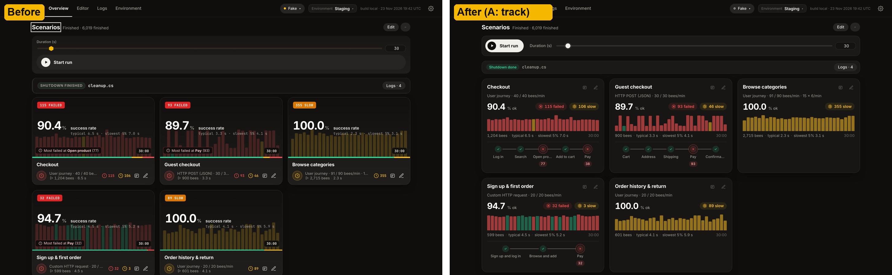
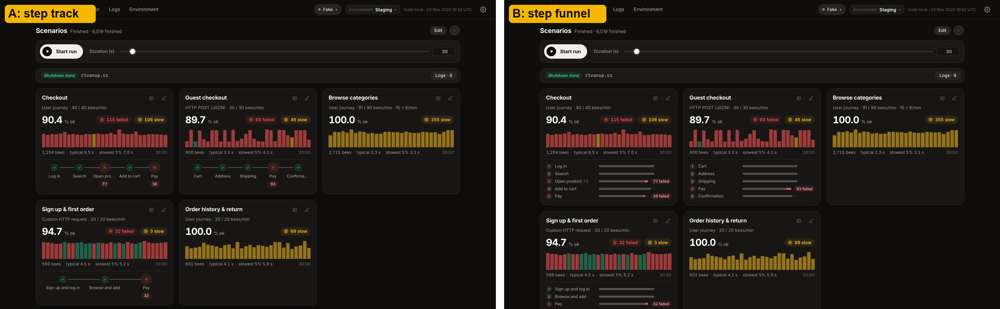
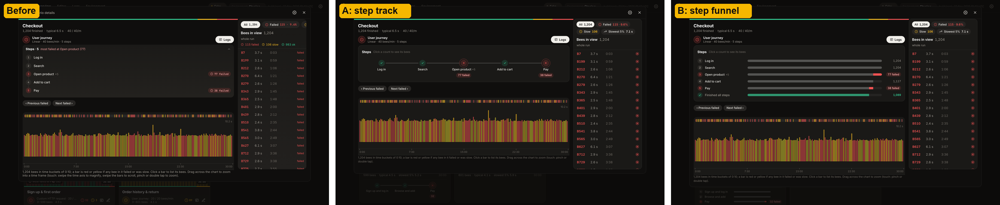
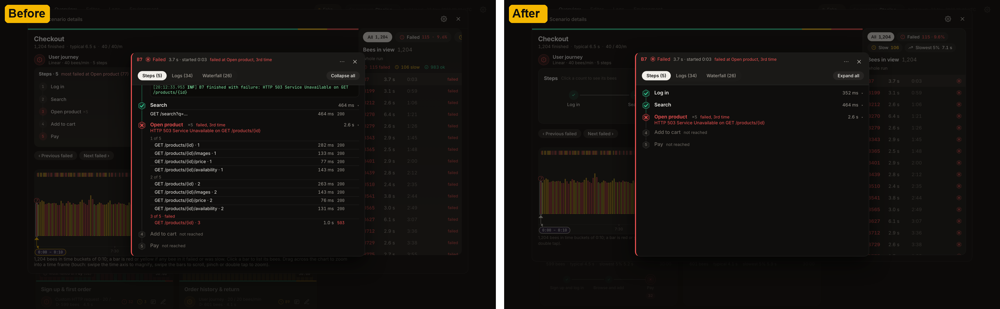
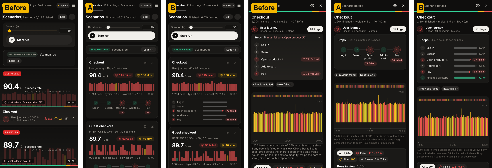

## Any number of steps (debug URL ?stepcount=1,2,3,8,14,24)
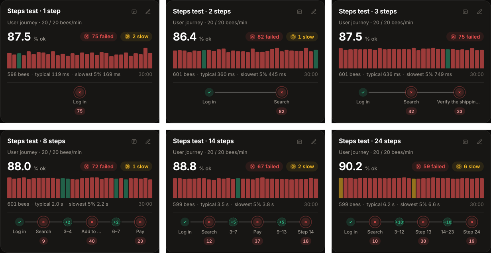
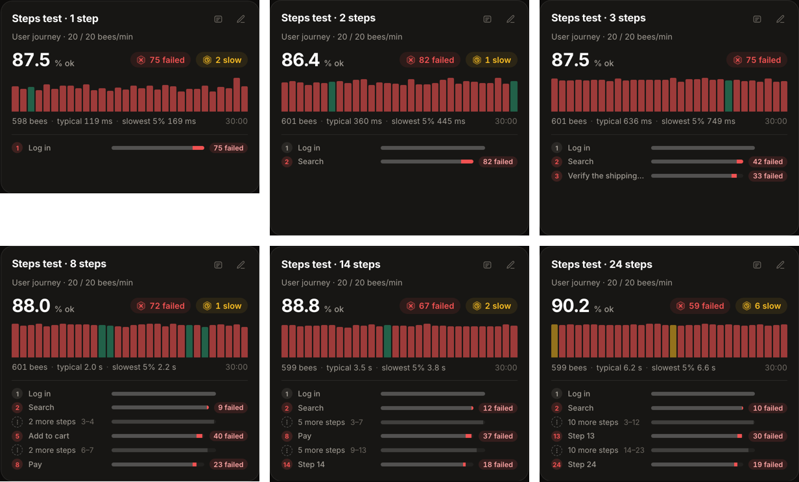
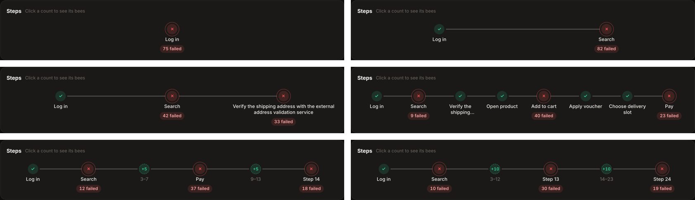
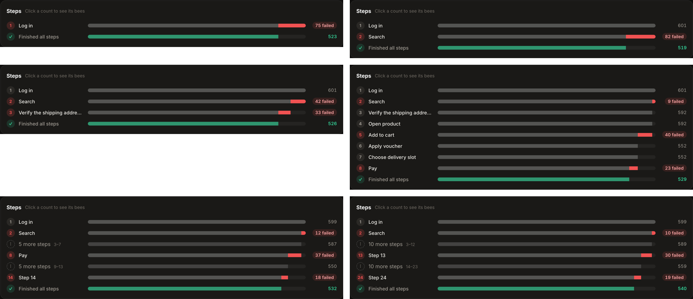
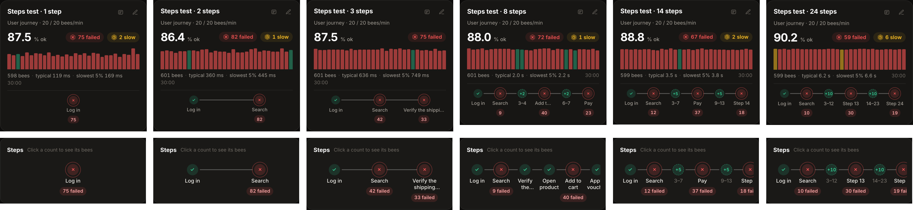
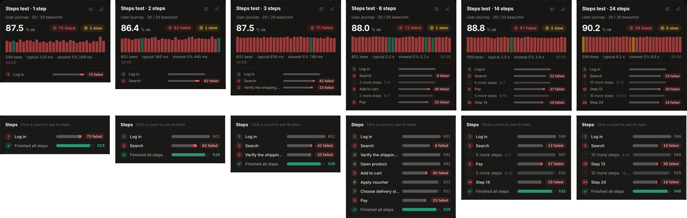
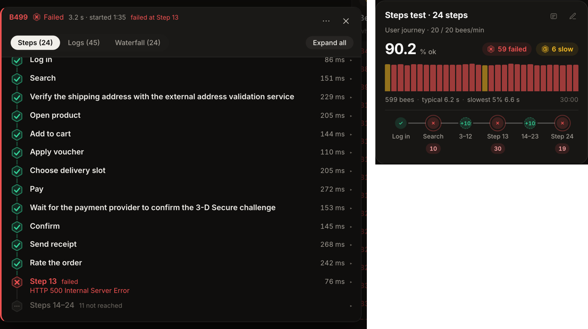

## The step list (chosen): Now, Failed, Finished all steps
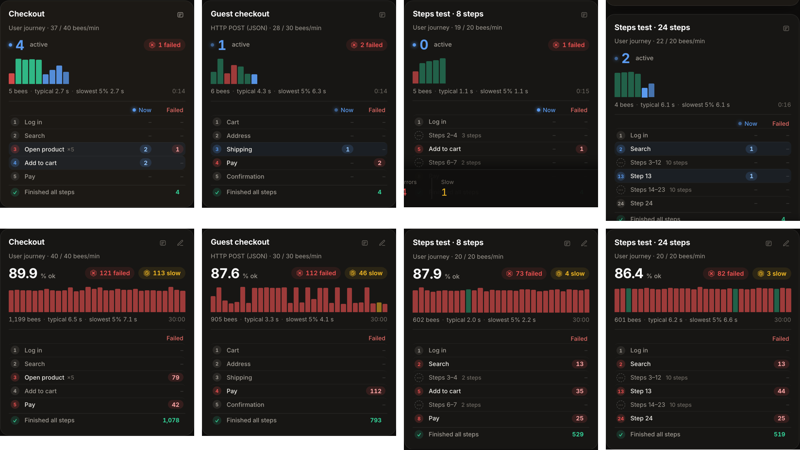
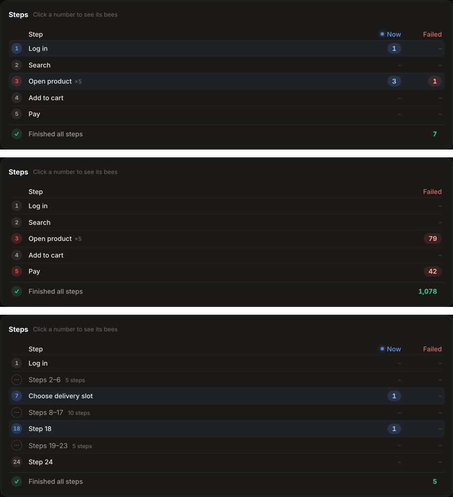
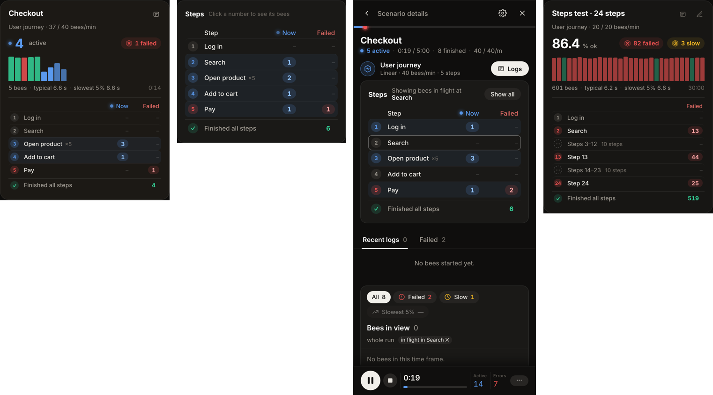
