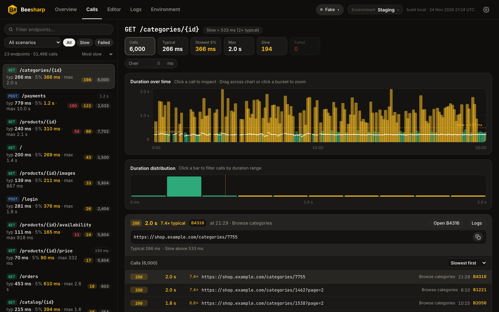
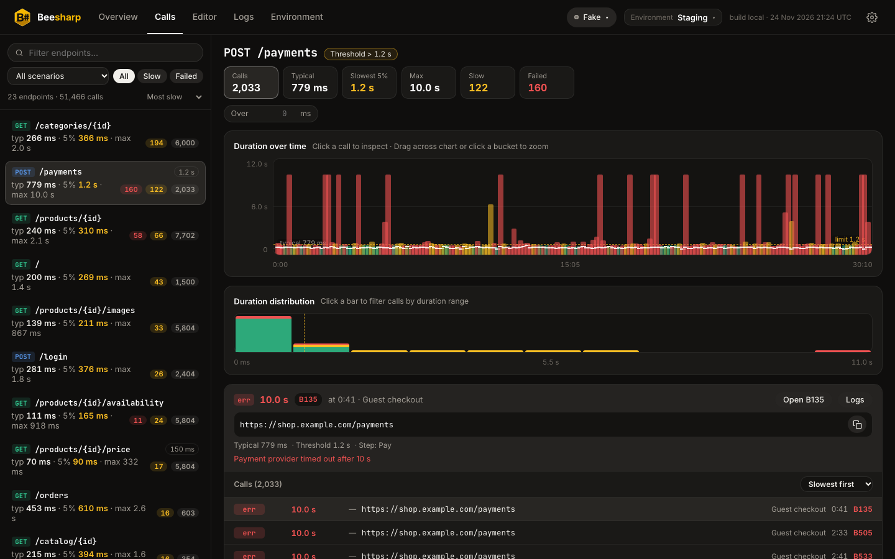
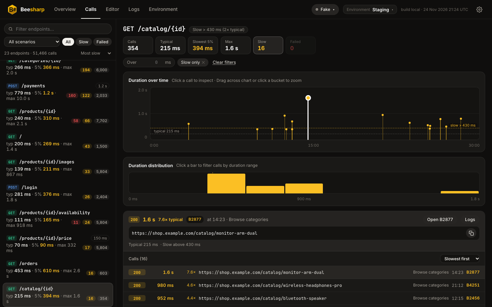
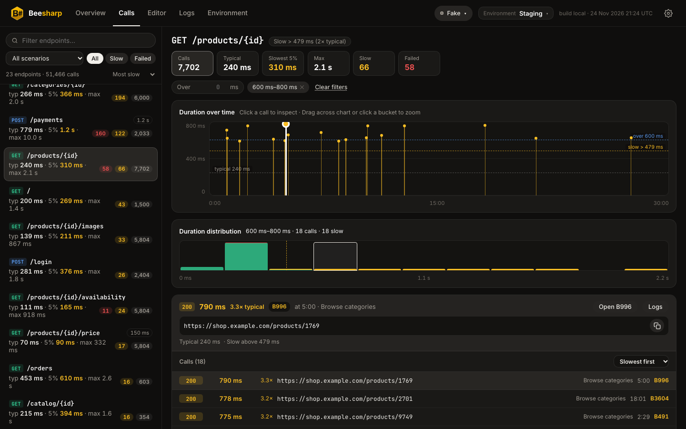
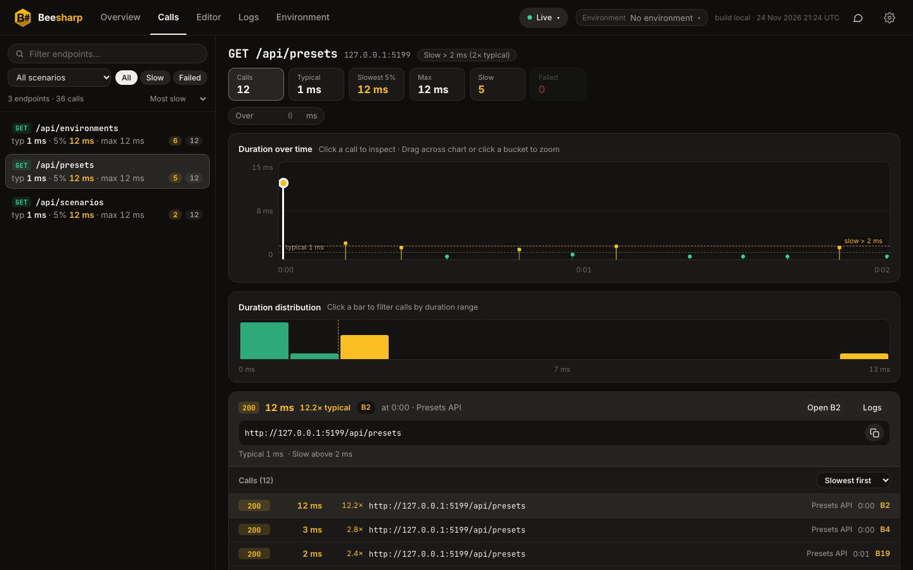
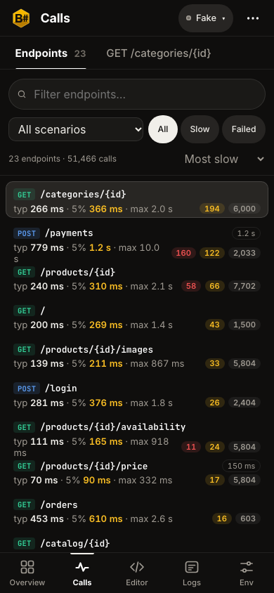
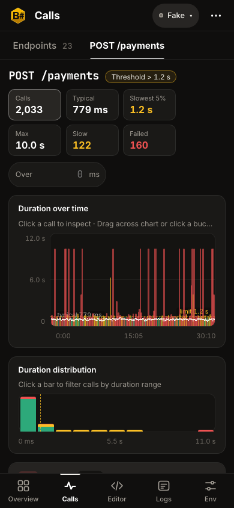
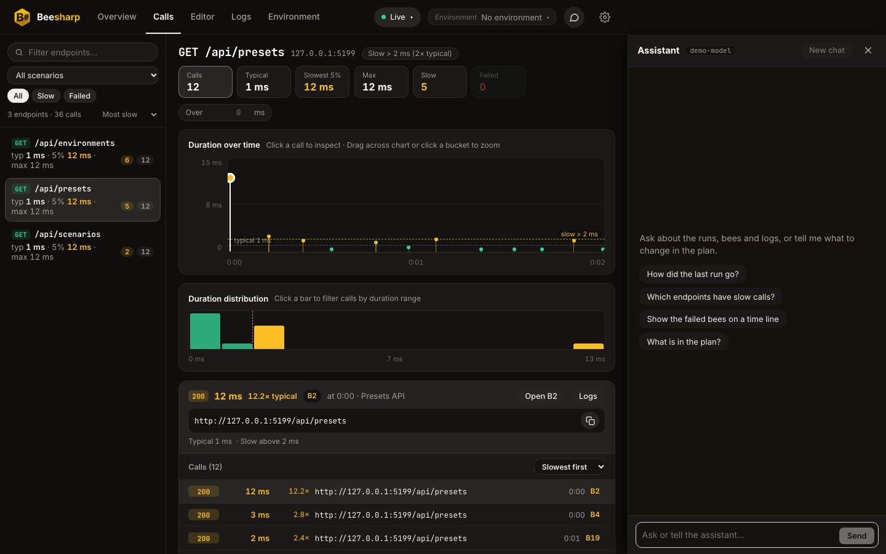

# Calls analysis (`/calls`, brain 0060), 24 Nov 2026

Desktop at 1440 x 900, mobile at 412 x 915.

## Fake run: endpoint list, duration over time, distribution histogram, and slow-first call list
The 2-column master-detail `/calls` page showing auto-detected endpoints on the left and the selected endpoint's duration-over-time chart, latency distribution histogram, call inspector (exact raw URL + Bee/Logs drill-down), and call list on the right.

## Author-configured slow threshold (`POST /payments`)
Custom slow limit (`Threshold > 1.2 s`) configured by the scenario author shown on the endpoint header, chart reference line, and histogram.

## Adaptive slug collapse (`GET /catalog/{id}`) + slow filter
Over 10 distinct product slugs (`wireless-headphones-pro`, `usb-c-charging-cable`, ...) automatically collapsed into `GET /catalog/{id}`, filtered to slow calls only while preserving exact raw URLs in the call list.

## Clickable histogram bucket filter (`GET /products/{id}`)
Clicking a histogram bucket narrows the duration-over-time chart and call list to that latency range.

## Live run via REST API
Switching to Live mode and running scenarios against the ASP.NET Core host: `/calls` loads auto-detected HTTP and step-machine calls from `/api/runs/{id}/calls/*`.

## Phone layout (390 px, endpoints & detail tabs)
Phone top bar, 5-tab bottom bar (`Overview`, `Calls`, `Editor`, `Logs`, `Env`), and `Endpoints` / `Details` tabs on `/calls`.

## Live `/calls` with Assistant side panel open
Top bar compacts automatically without clipping the Assistant or Settings buttons, `/calls` adapts alongside the 420 px side panel, and the assistant offers slow-endpoint analysis prompts and cards.

