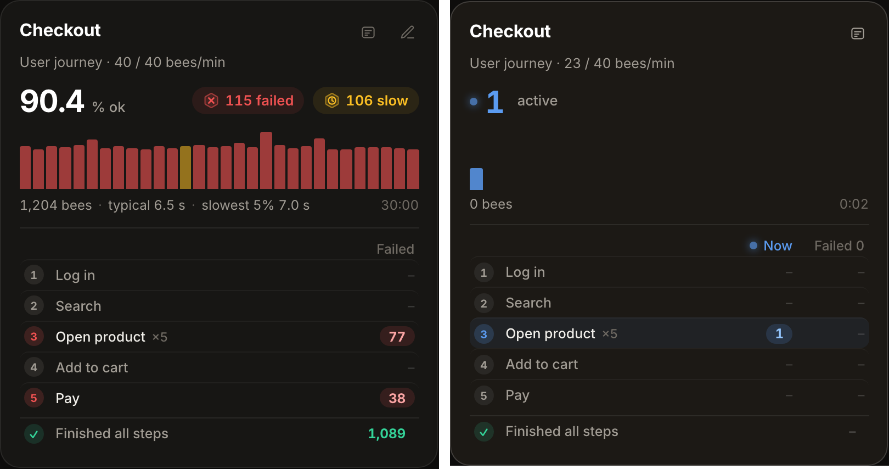

# Neutral "Failed" heading in the step list, 2026-11-24

User feedback: a red "Failed" column heading made every card look broken. The heading is grey now; a scenario without failures says "Failed 0"; only real counts are red.

