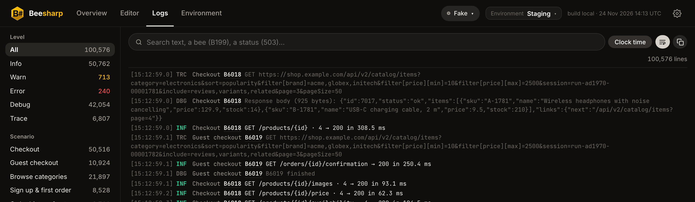

# Logs: run time or clock time, 2026-11-24

A toggle in the Logs toolbar switches the time of every line between time into the run (0:05.9) and the clock time (14:02:07.3, browser time zone). Remembered in the browser; Copy all uses the same.

