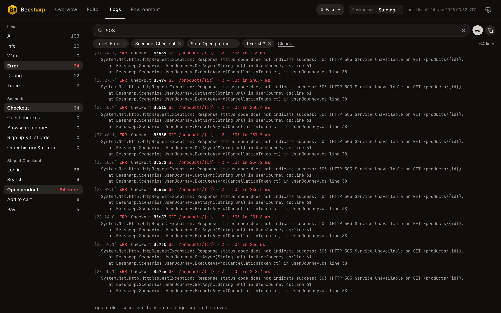
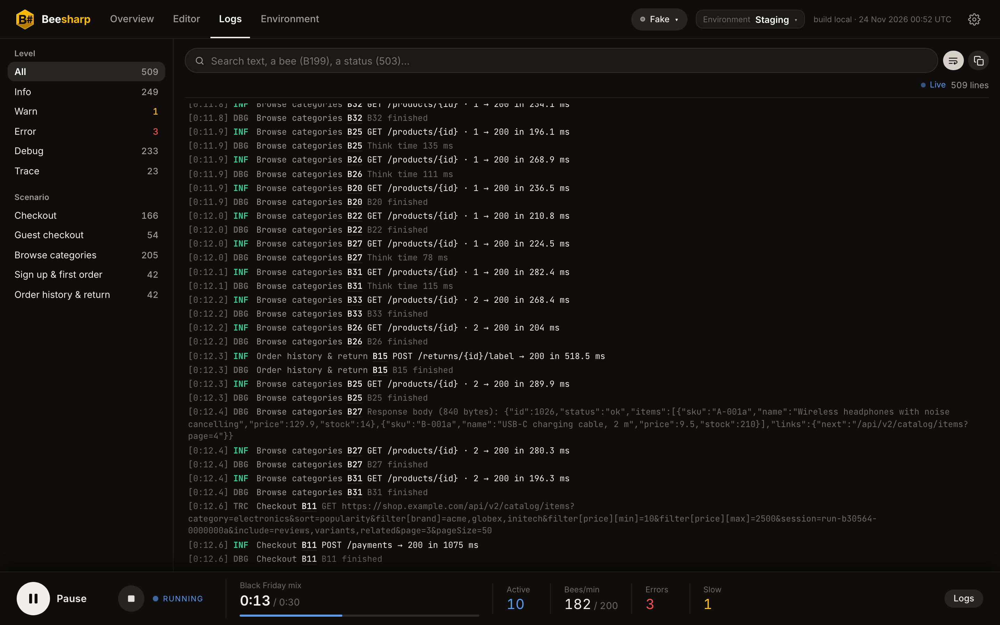
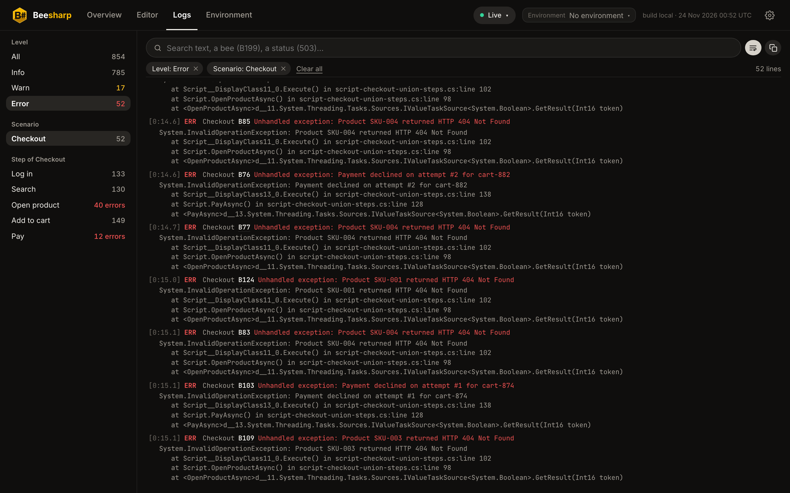
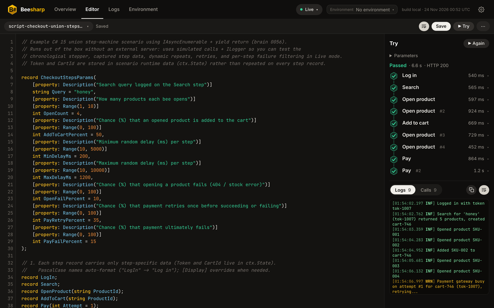
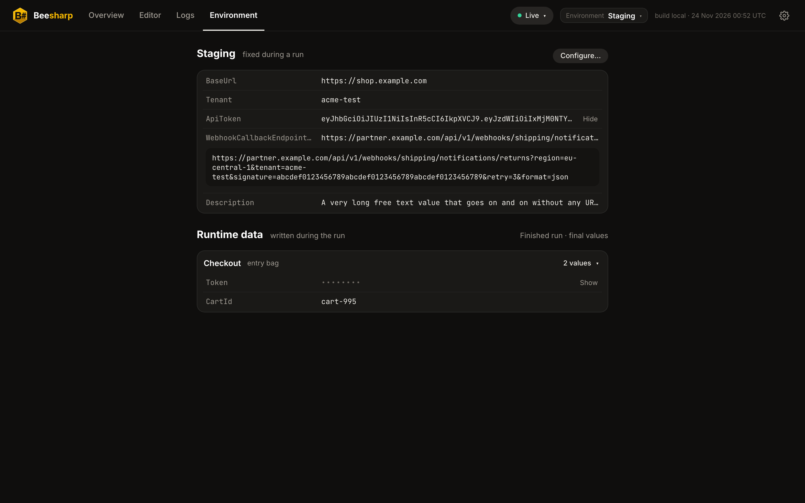
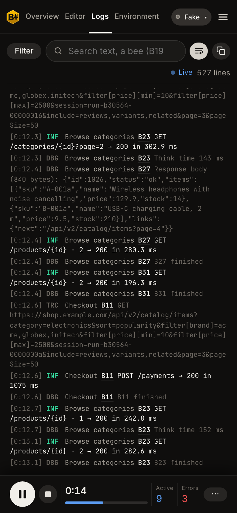
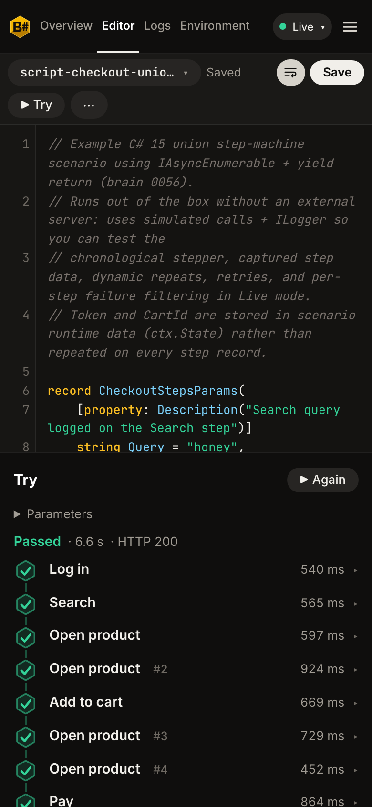
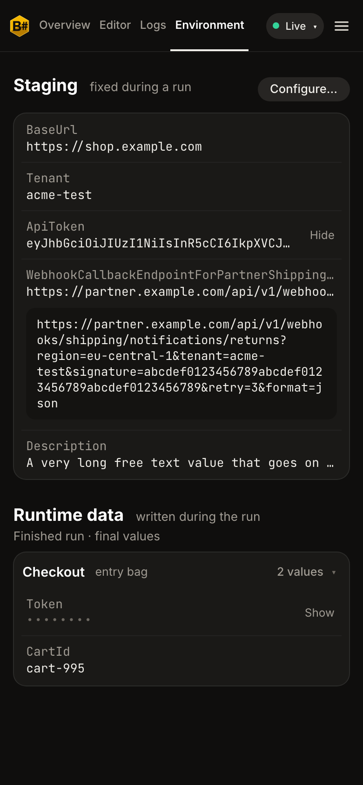

# Logs, Editor, Environment (brain 0057, Y2), 24 Nov 2026

Desktop at 1440 x 900, phone at 390 px, device scale factor 2.

## Logs
Filter column with a count per choice (level, scenario, the steps of the chosen scenario with their errors), a full-width search, every active filter as a chip with an x, "Clear all" and the line count. Fake run: level Error, scenario Checkout, step Open product, text 503.

A fake run in progress: the list follows the newest line, "Live" shows next to the count.

A stored run picked from the history (Live mode, server-side filtering and paging, scenario Checkout, level Error).

## Editor
The toolbar above the code, the Try result in the column on the right: passed with its time, the steps, then the tabs Logs and Calls.

## Environment
One centred column: the environment's values (long keys and values end in an ellipsis; one value is expanded, the credential is shown), the runtime data below.

## Phone (390 px)
Logs (the filters fold behind "Filter"), Editor (Try column below the code), Environment.

  
