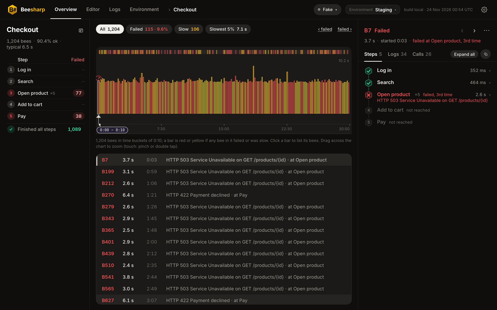
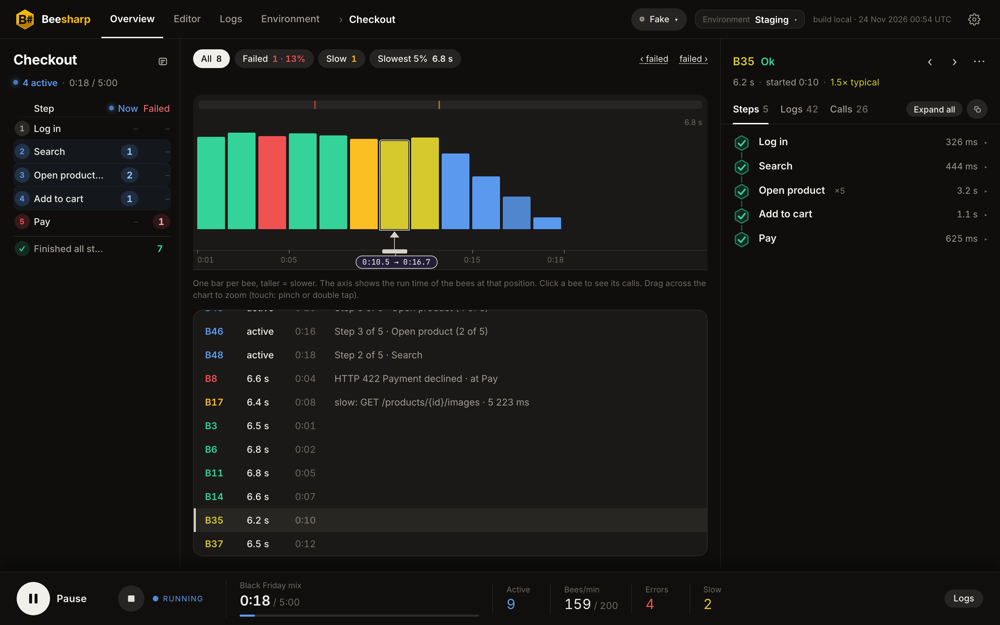
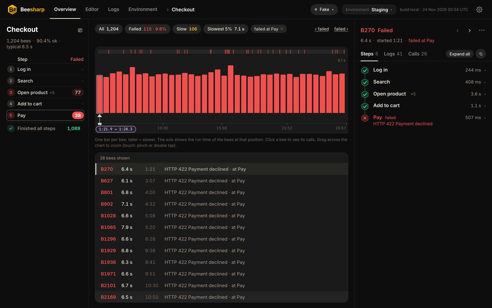
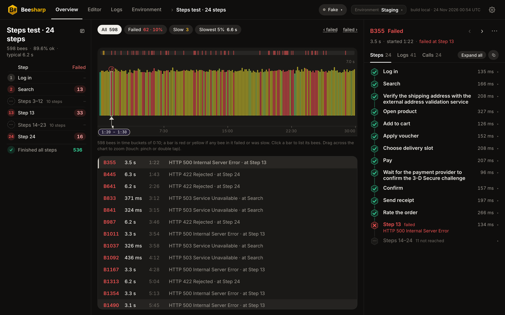
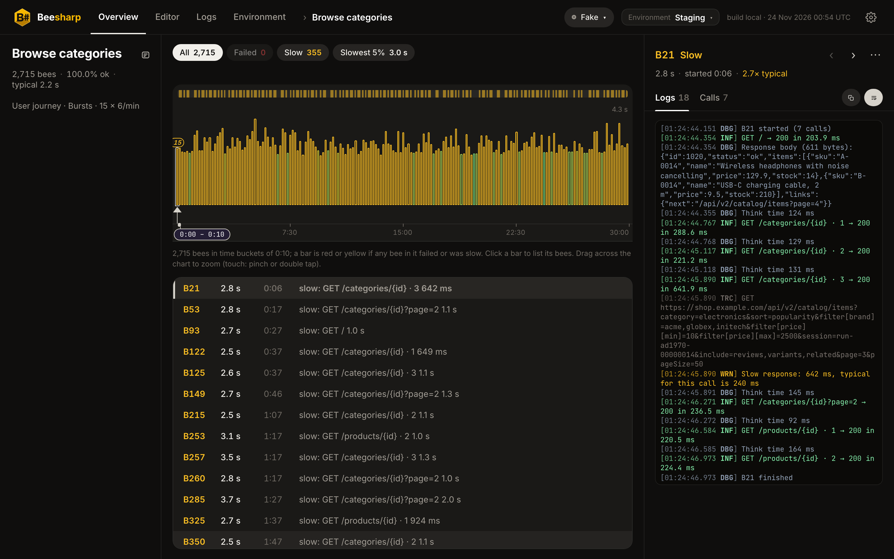
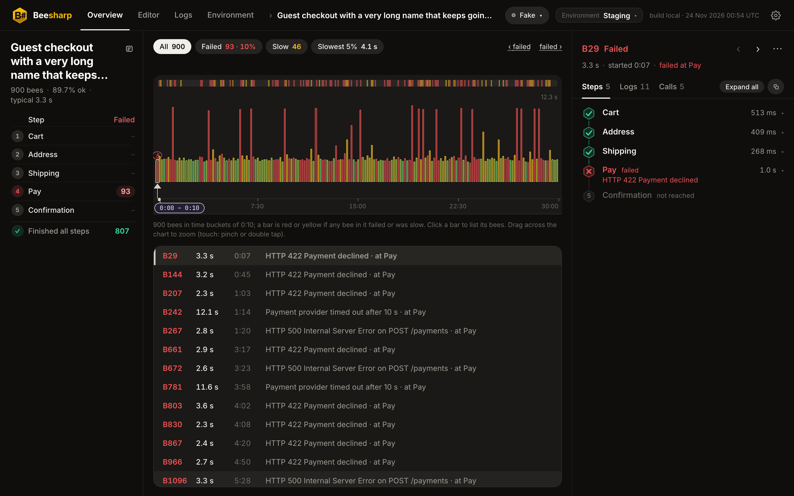
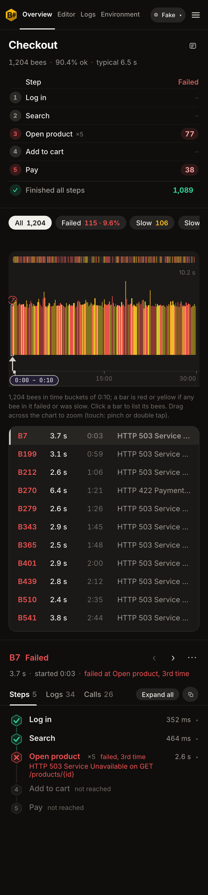

# The scenario as its own page (brain 0057, Y1)

`/scenario/{n}`: steps on the left, filters, chart and bee list in the middle, the selected bee on the right. Fake data, 1440 × 900 at 2x (the phone shot 390 px wide).

## Desktop, finished run
Checkout: the step list steers the page, the chips filter, the chart zooms as before, the list has one row per bee (number in its outcome colour, duration, start, the error and the step it failed at), the bee column shows the first bee of the list.

## Desktop, run going
`● 4 active · 0:18 / 5:00`, the step list has its Now and Failed columns, bees in flight come first in the list (with "Step 3 of 5 · Open product"), the bee column keeps the picked bee.

## A filtered step
`?failedStep=5` (also what a click on the Failed count of the step "Pay" does, on the page or on the overview card): the step is highlighted, a removable chip says "failed at Pay", the list holds the 38 bees.

## A bee with many steps
A scenario with 24 steps (`?stepcount=1,8,24`): quiet steps fold in the left column, the bee column folds the steps it did not reach.

## A scenario without steps
The left column holds the name, the figures and the settings line; the bee column has Logs and Calls.

## A long name
The name is changed in the page only (to show how the layout copes): three lines in the left column, an ellipsis in the breadcrumb.

## Phone (390 px)
The columns stack: left, middle, right below each other; the page does not scroll sideways (the chips scroll inside their row).

