# Phone layouts (brain 0059, Y3)

Chosen drafts: frame A, overview A, scenario A (+ "A while a run goes"), bee B, logs, editor B, environment one column. Fake data (Live for the editor's Try), Chromium with `isMobile`/touch, 390 × 844 at 2x. The pages are checked at 390 × 844, 360 × 740 and 844 × 390 (no sideways scrolling).

## Overview, scenario (finished run)
Bottom tab bar (Overview, Editor, Logs, Env), top bar with the page title, mode and ⋯.

| Overview: full cards | Scenario: Steps | Chart | Bees |
|---|---|---|---|
| 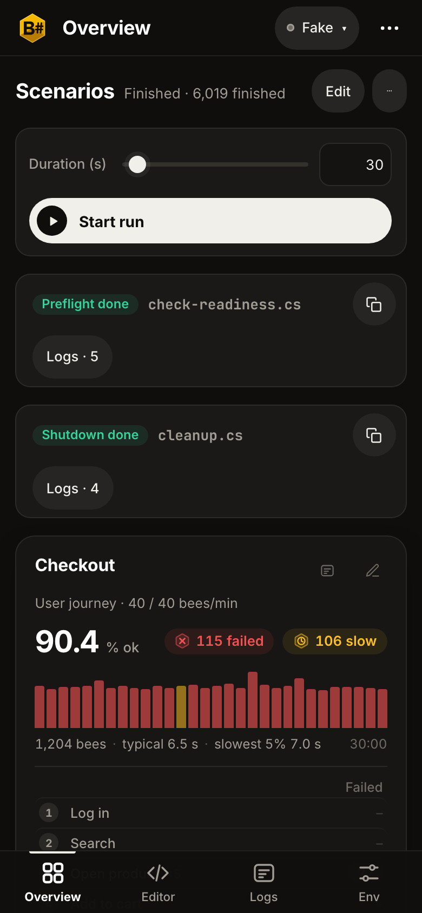 | 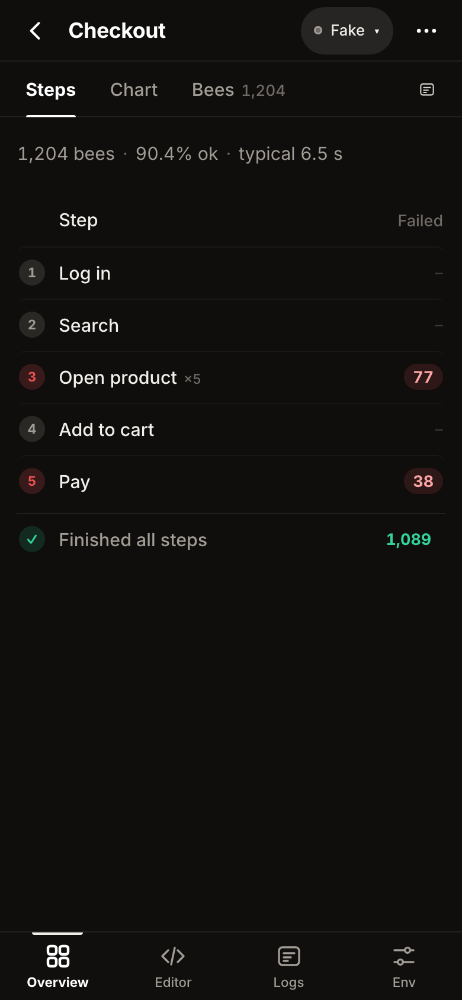 | 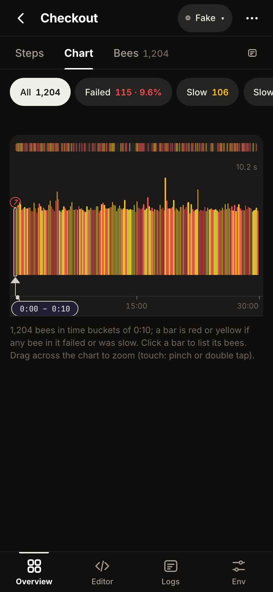 | 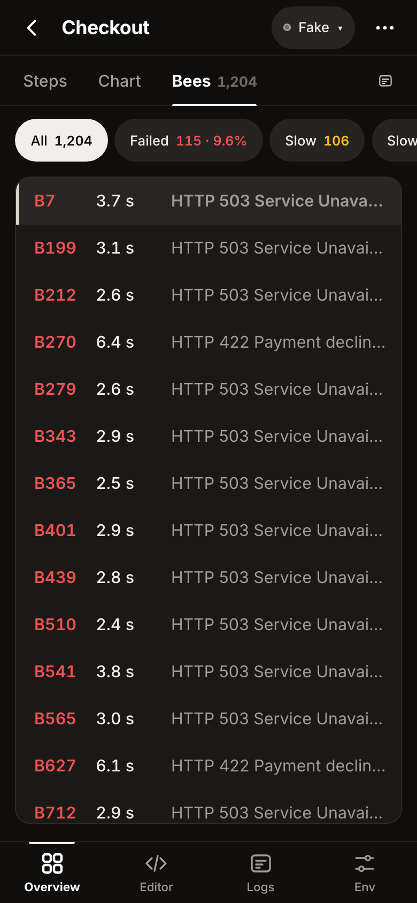 |

## One bee: a bottom sheet over the list
Half height first, drag the handle (or the header) up for full height; swipe down, the backdrop or the browser's Back closes it.

| Half | Full |
|---|---|
| 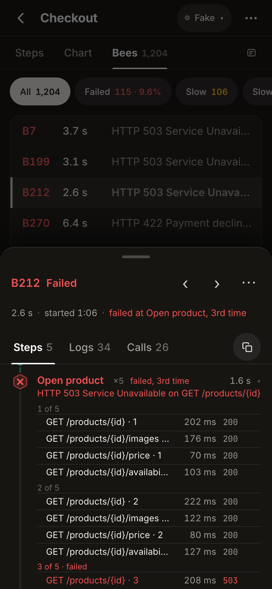 | 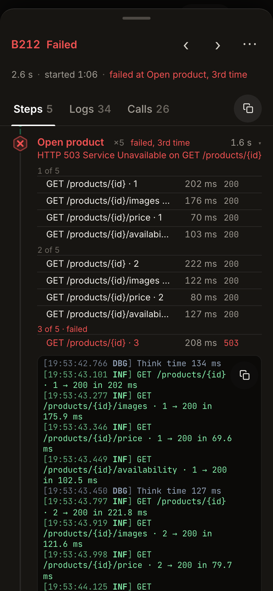 |

## While a run goes
The slim run bar sits above the tab bar (pause, time, progress, active in blue, failed in red); tapping it opens the full player as a sheet.

| Overview | Scenario Steps (Now / Failed) | Player sheet |
|---|---|---|
| 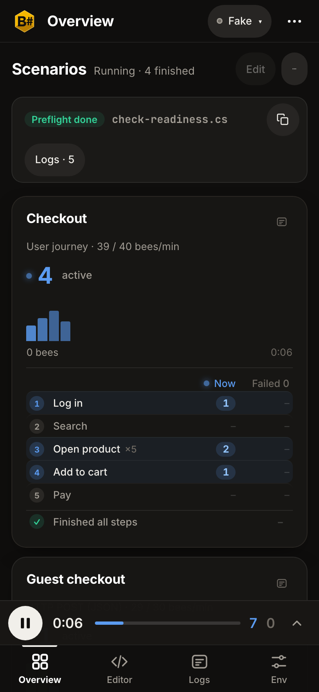 | 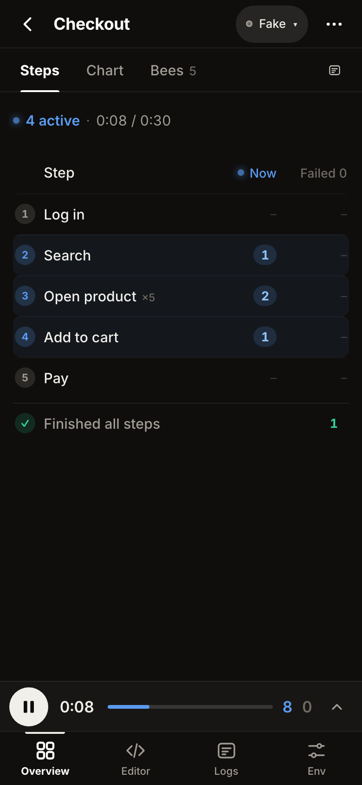 | 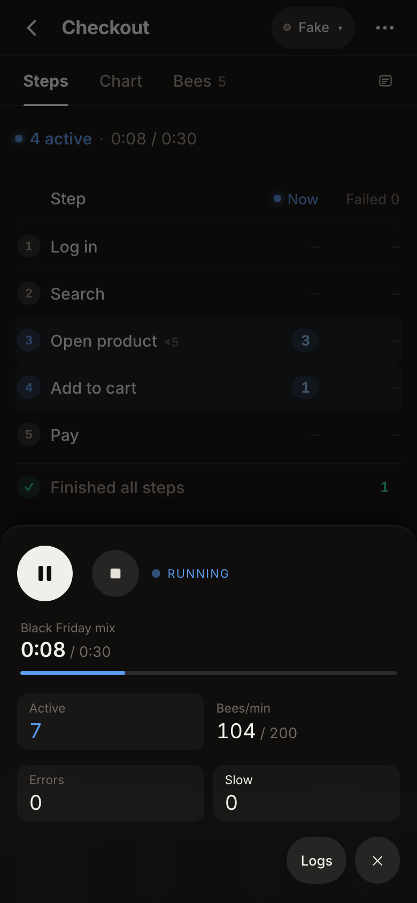 |

## Logs
Search on top, `Filter · N` opens the filter column as a sheet, active filters are chips under the search, "Show N lines" closes the sheet.

| Logs | Filter sheet | Filtered |
|---|---|---|
| 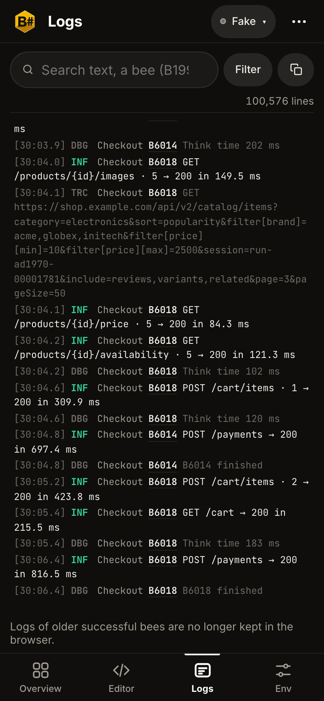 | 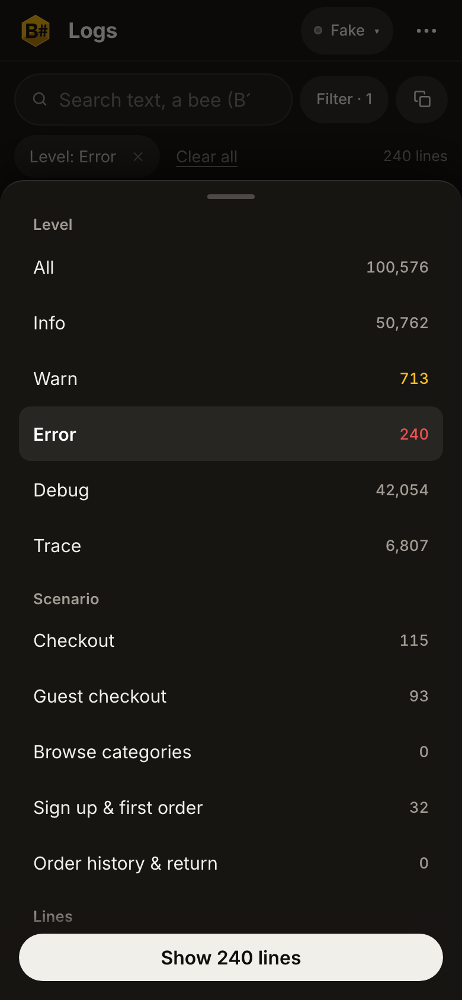 | 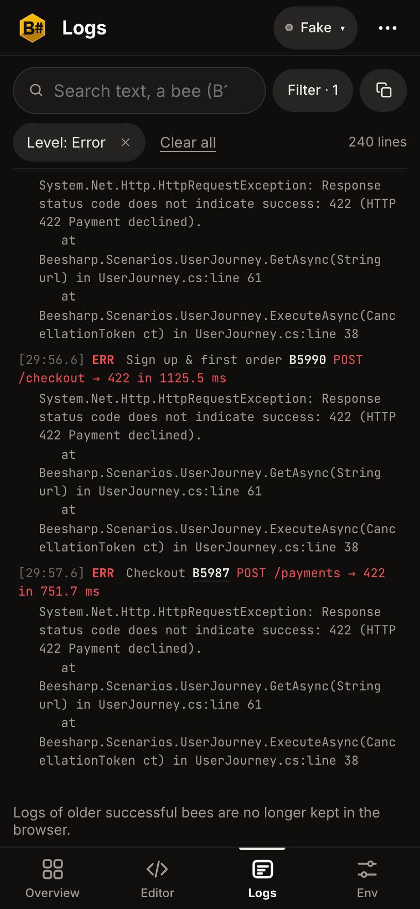 |

## Editor, environment, ⋯
| Editor: Code tab | Editor: Try tab (Live) | Environment | ⋯ sheet |
|---|---|---|---|
| 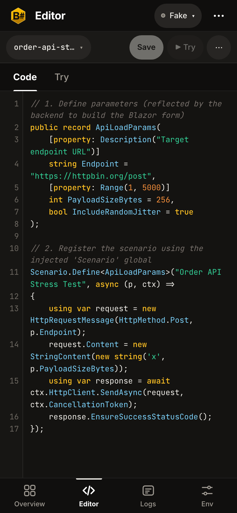 | 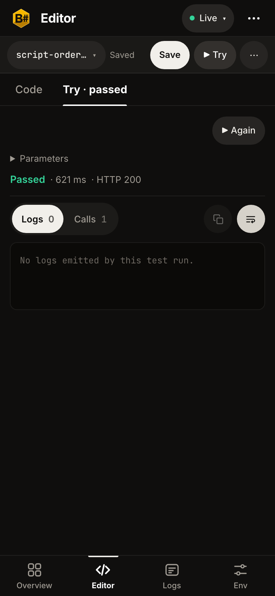 | 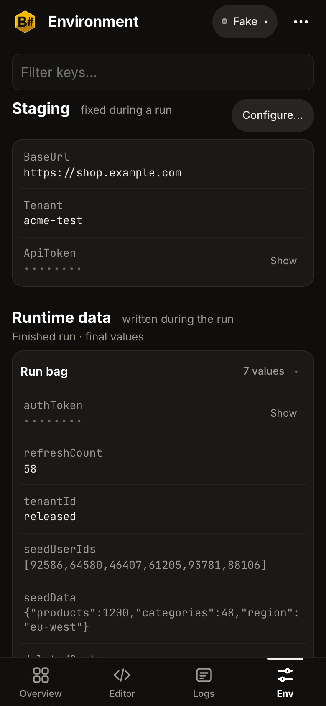 | 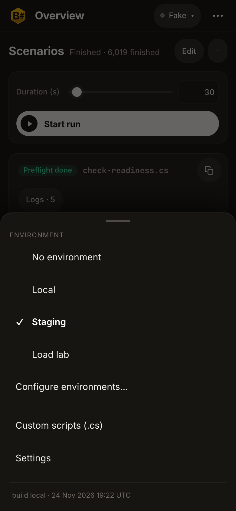 |

## Landscape (844 × 390)
The same phone layout, with a slimmer top and tab bar.

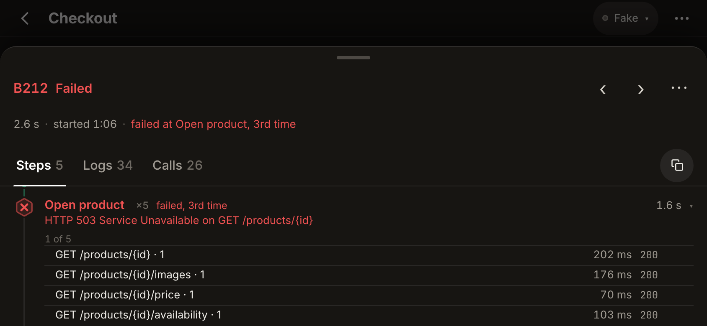
