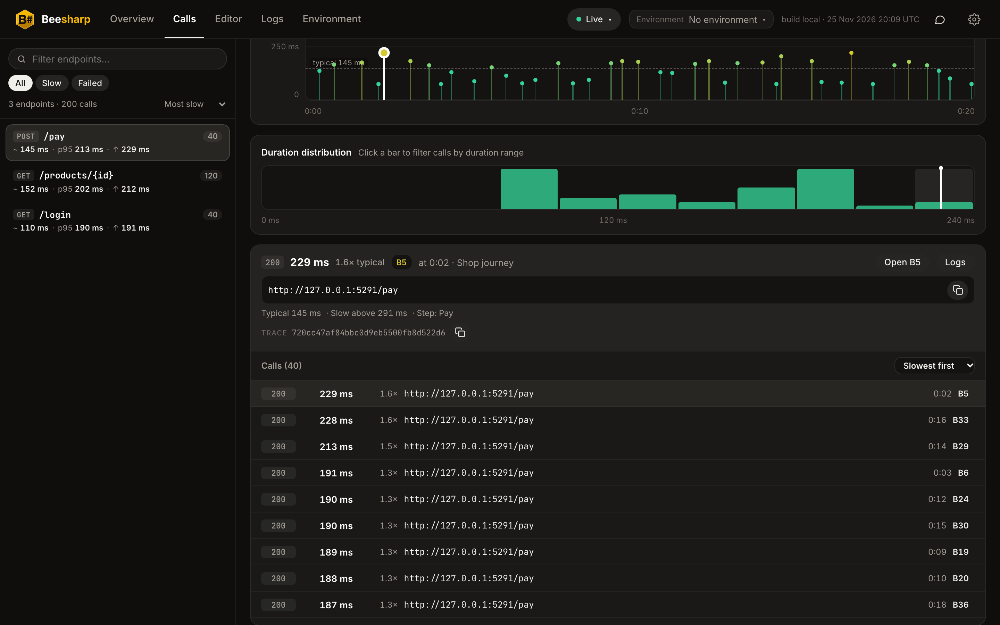
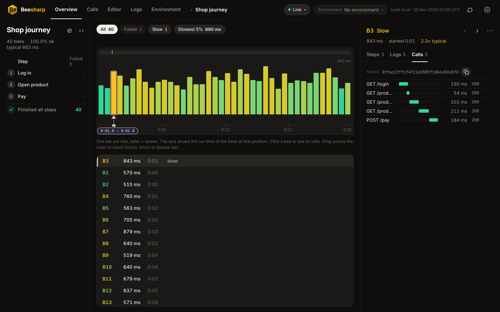

# The trace ID of a call (brain 0063)

Live mode, a real run of a three-step scenario against a small instrumented service. The trace ID is one quiet line with a copy button; it identifies the bee's distributed trace (bee, steps, calls and the service's spans in Jaeger).

The call inspector on `/calls`:

The Calls tab of a bee (all its calls share one trace):

