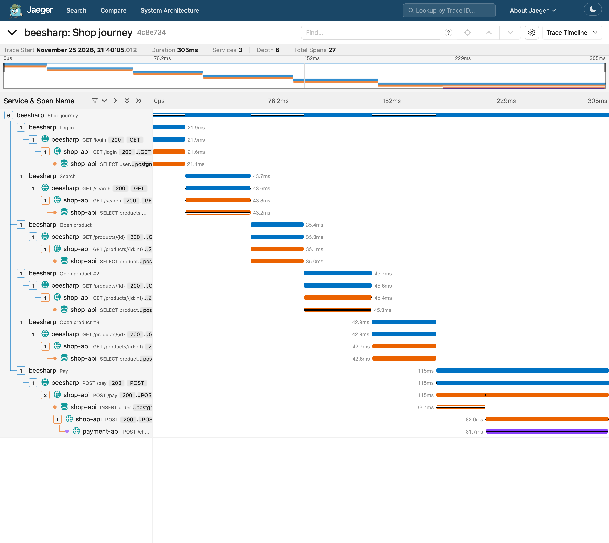
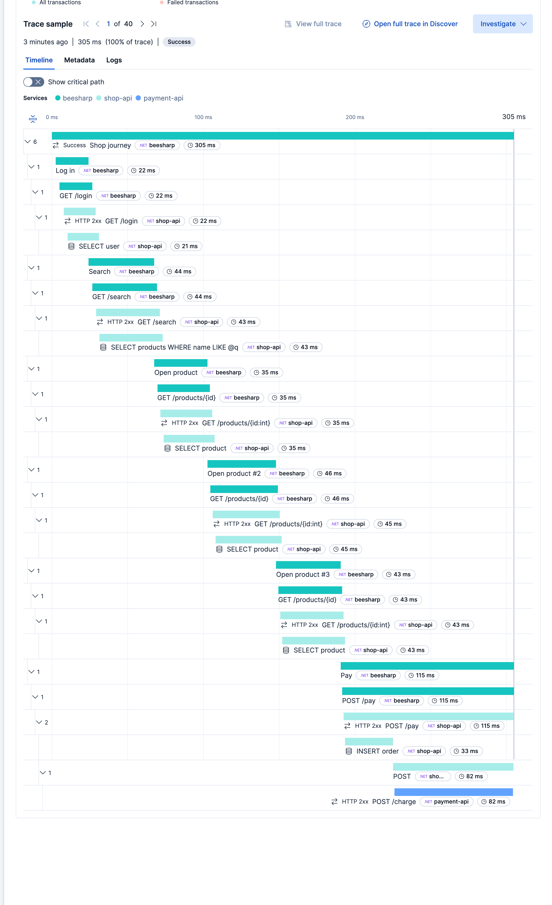

# The tracing example stack (brain 0063, 0064)

One bee of the "Shop journey" preset from `examples/tracing/compose.yaml`: Beesharp → steps → calls → `shop-api`
(with its database spans) → `payment-api`, 27 spans across three services, sent through the OTel collector.

In Jaeger:

The same trace in Kibana (Elastic profile):

