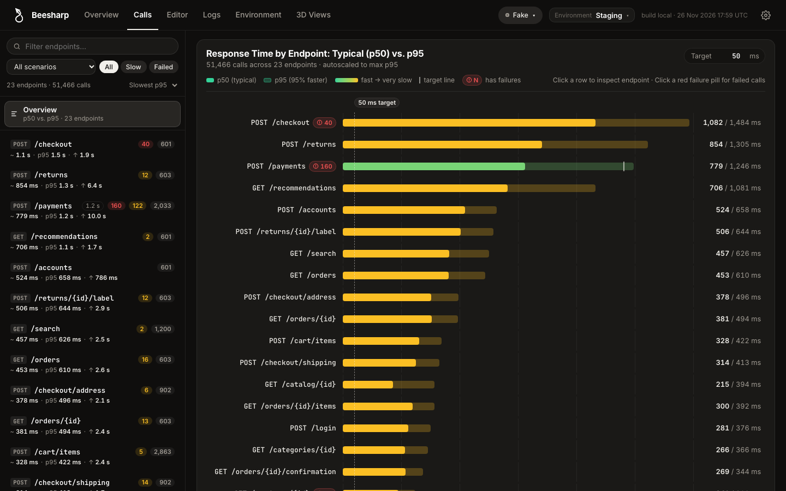
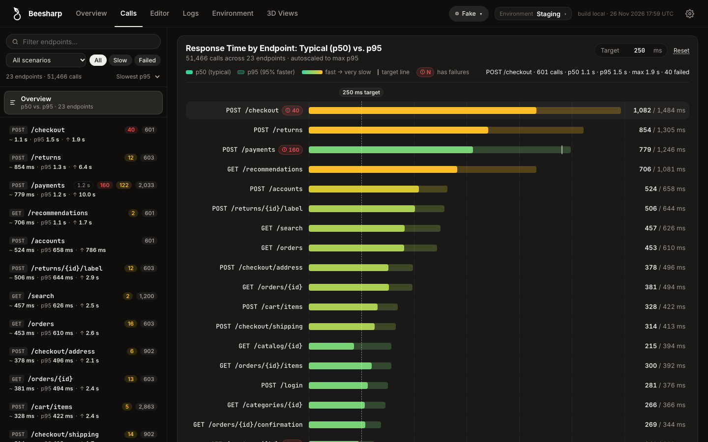
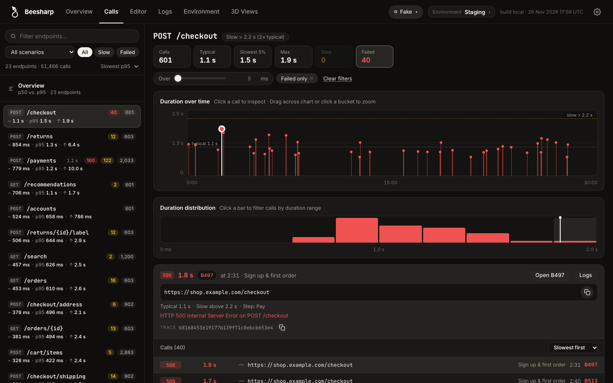
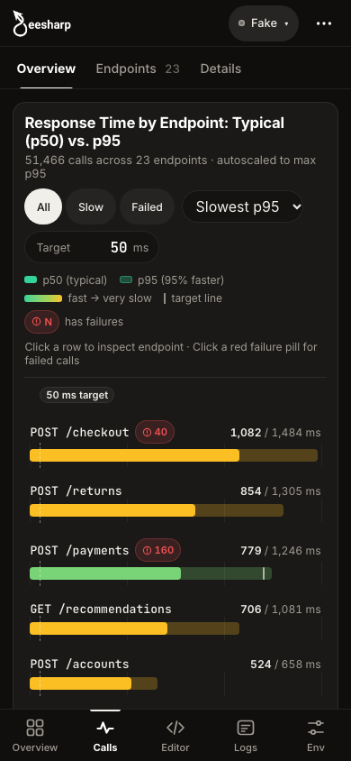

# Calls overview chart: p50 vs. p95 (brain 0067)

Fake data (seeded Black Friday run on `/calls`).

1. Desktop default view on `/calls`: p50 (solid) vs. p95 (translucent) overlaid horizontal bars, autoscaled linear ms axis, 50 ms default target line, latency-only colour gradient, red failure pills, and pinned Overview entry in the left sidebar.
   
2. Inline `Target` adjusted to `250 ms` (`?target=250`) with row hover readout: endpoints within target (and `POST /payments` within its custom 1,200 ms limit) stay green even when they have failures.
   
3. Clicking a red failure pill drills straight into that endpoint's detail filtered to failed calls (`?endpoint=...&show=failed`), with the pinned Overview entry ready to return in one click.
   
4. Phone layout (`Overview` | `Endpoints` | `Details` tabs) with stacked endpoint rows.
   
