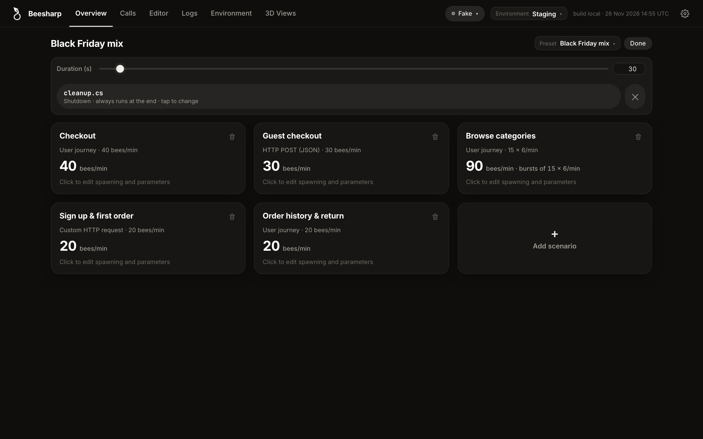
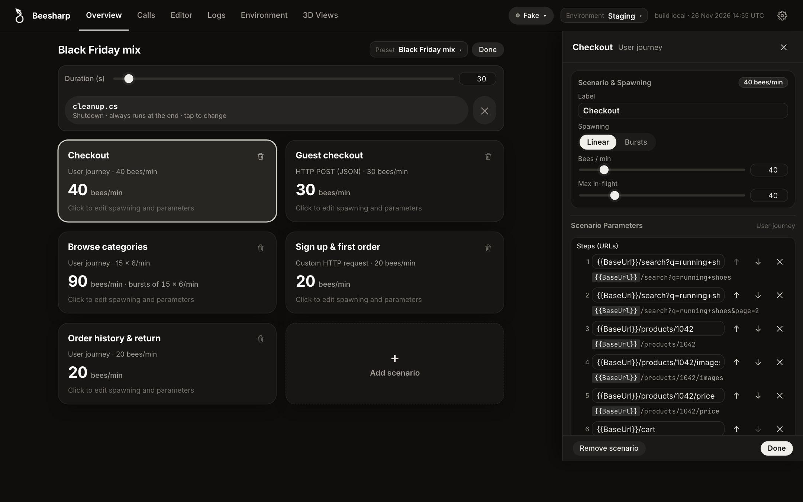
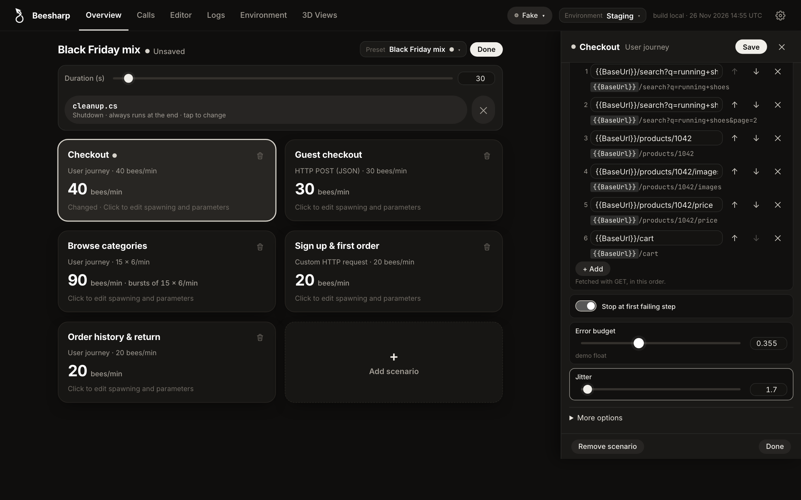
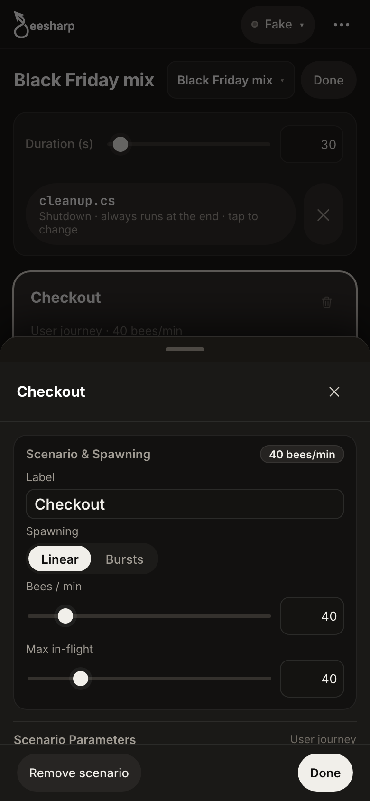

# Scenario settings in a side panel, float sliders (brain 0066)

Fake data. For the float shots a temporary `double` parameter was added to the user journey (not committed: the built-in scenarios have no float parameter yet).

1. Edit mode: the scenarios stay cards.
   
2. Selecting one opens its settings in the right side panel.
   
3. Float parameters: slider plus number input (0.355 reached by sliding, 1.7 by two keyboard steps of 0.1).
   
4. Phone: the same editor in the bottom sheet.
   
