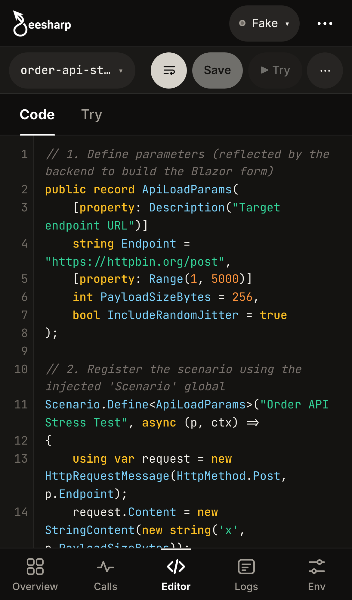
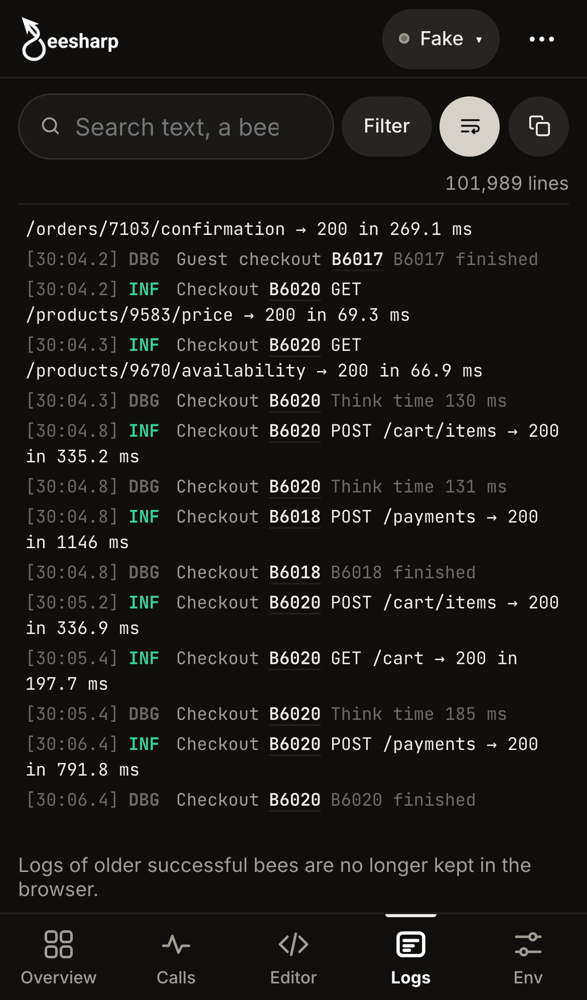

# The line-wrap toggle is a toolbar button on the phone again

The phone layout (brain 0059) had moved the toggle into the editor's "⋯" menu and the logs filter sheet. Now it is the icon button in the toolbar, like on the desktop (40 px touch target).

The editor: file picker, wrap, Save, Try, "⋯".

The logs page: search, Filter, wrap, copy.

