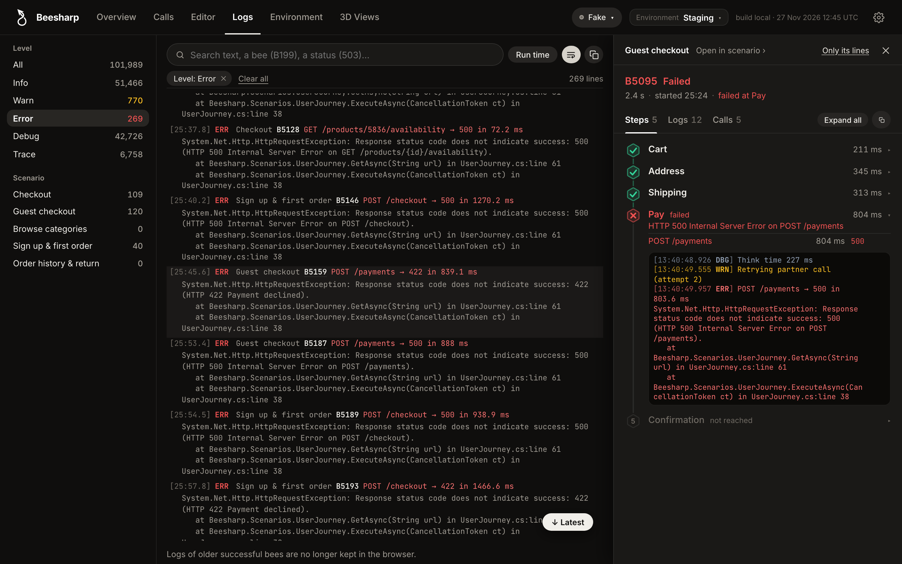
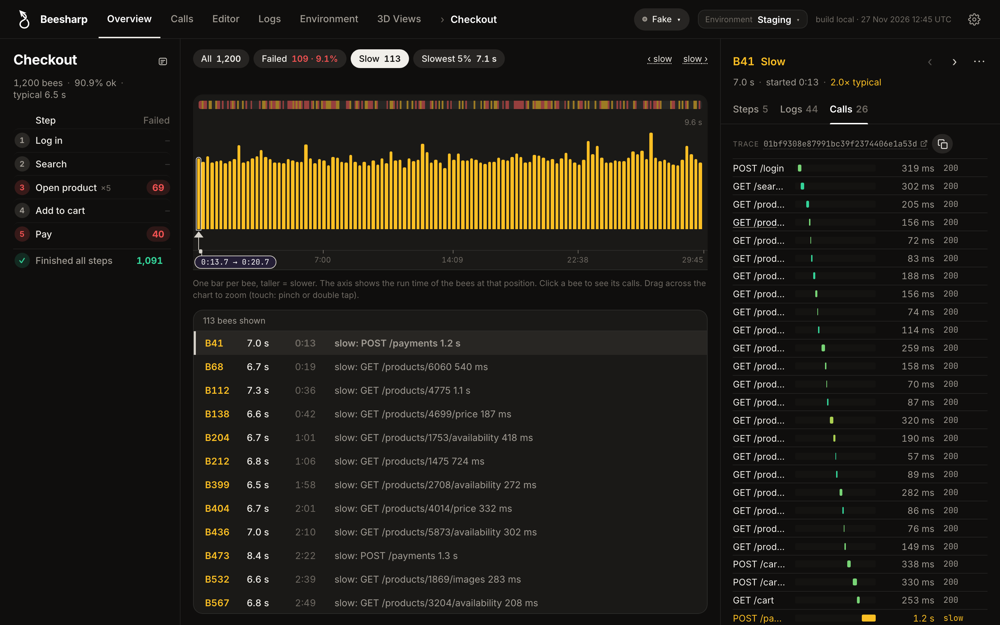
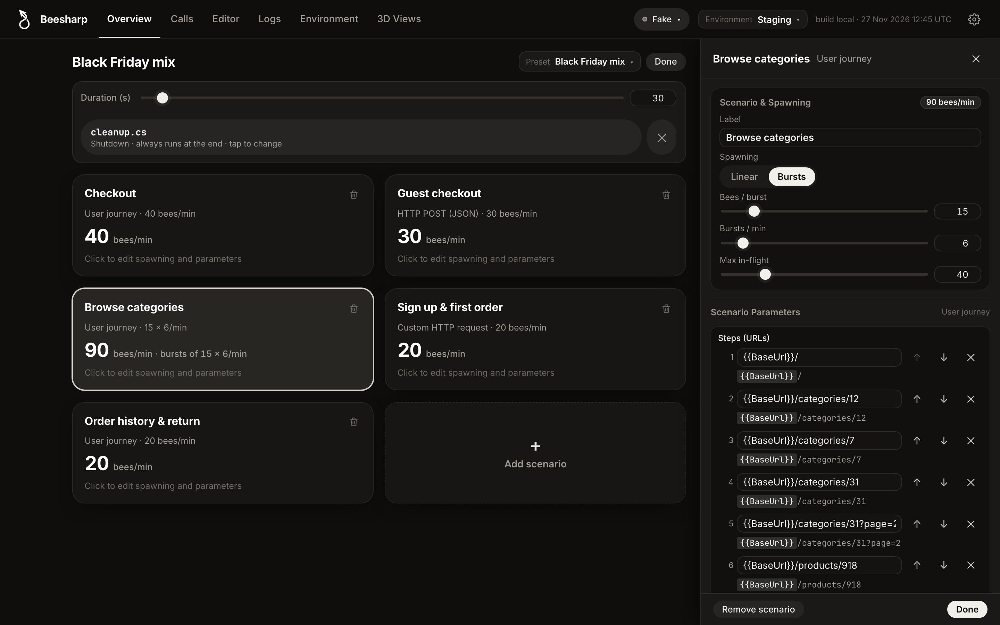
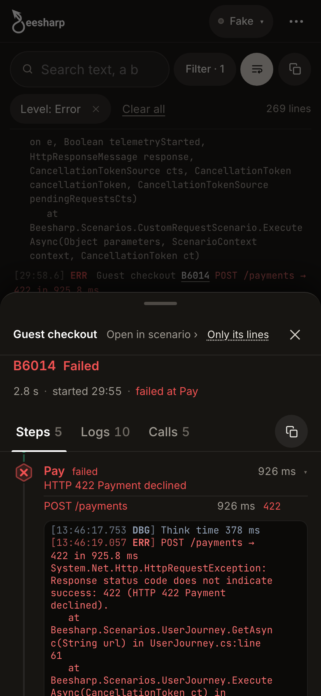

# Bee side panel and "drill down, go back" (W1, brain 0069)

1. Logs page (Fake mode, level Error, scrolled up): a bee number was clicked; the panel opens on the right (`?level=error&open=3127`), the list keeps its filter and place.

2. Live mode, run going: the panel ends above the player bar; a bee of a scenario without steps opens on its Logs tab.

3. Scenario page after Calls tab, a click on a call (leaves for /calls) and Back: the Calls tab is open again (`&beeTab=calls`).

4. Overview: Edit, scenario 3 open, to Logs and back by the Overview tab: edit mode and the settings panel are still there (`/?edit=1&entry=3`).

5. Phone (390 x 844): the bee in the bottom sheet over the Logs list.

6. Phone scenario page, Bees tab, after the sheet's Calls drill down and two Backs: the list is at the row it was.

