# Calls page keeps its state (W2, brain 0070)

Fake mode, seeded 30 minute run. Flow: endpoint far down the list, chronological sort, call list scrolled, a call picked, "Open B663", Back.

1. The picked call in the address (`call=663.0.0.13055`), call list scrolled, endpoint list scrolled.
   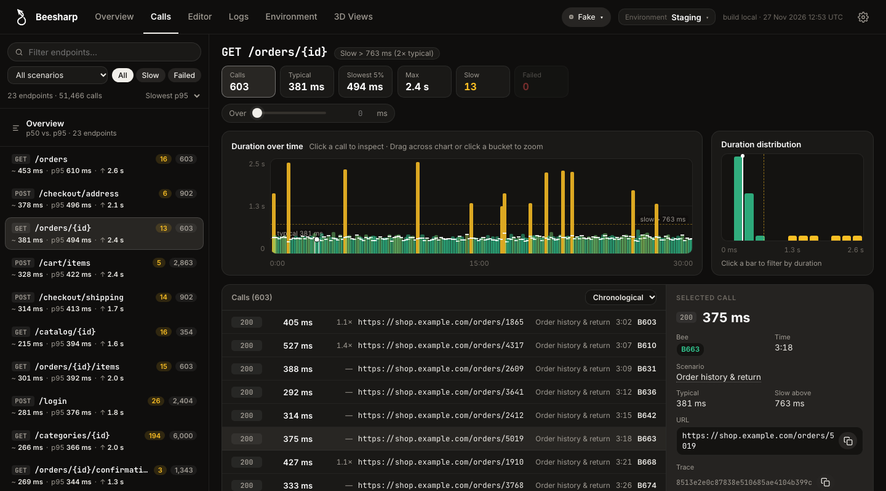
2. "Open B663" opens the bee side panel; at 1920 the page makes room for it.
   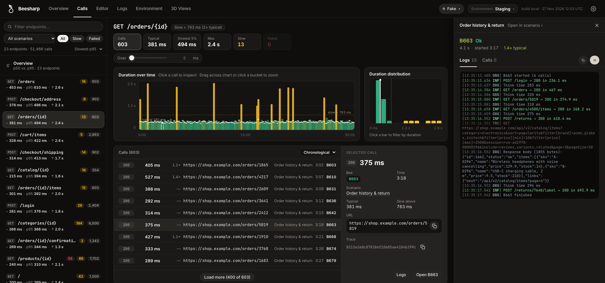
3. At 1440 the panel overlays the page (the page layout underneath does not change).
   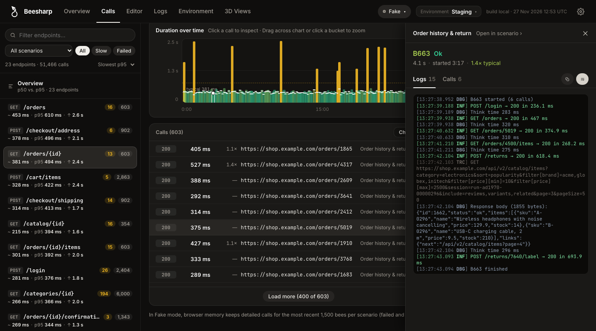
4. At 1100 the same, overlay.
   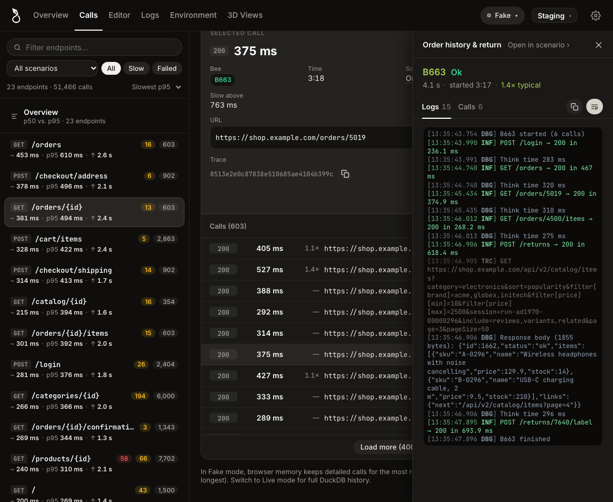
5. Back: panel closed, the same call selected, the call list and the endpoint list where they were ("Load more" went to 400 calls to reach the call).
   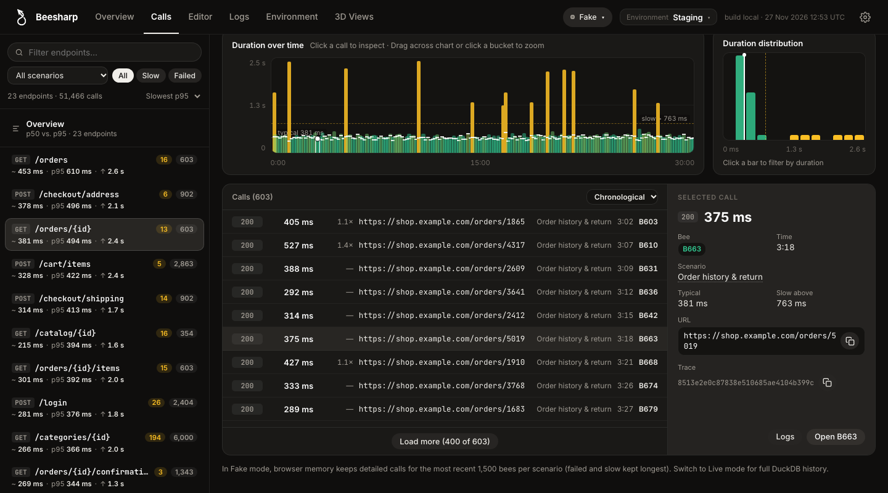
6. Scenario page, bee B3457, Calls tab: click a call.
   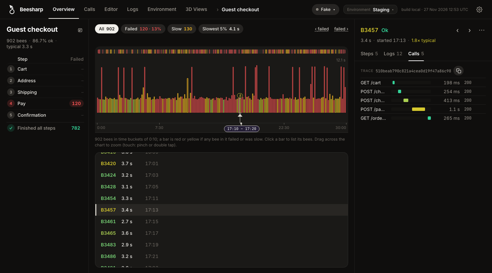
7. The Calls page opens on that call's endpoint with the call selected and "‹ B3457 · Guest checkout" at the top.
   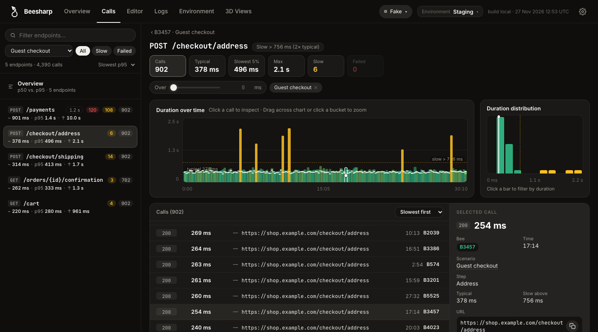
8. Clicking it goes back to the bee's Calls tab (history back).
   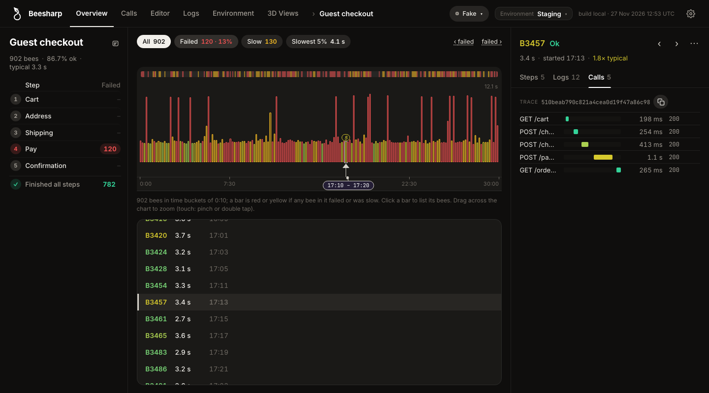
9. A call clicked in the side panel's Calls tab on the Calls page selects it in place.
   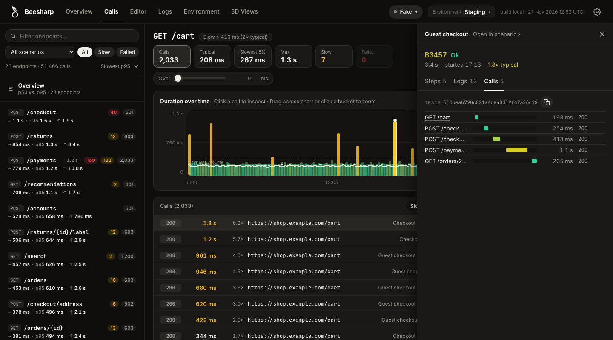
10. Phone (390): the origin link above the endpoint, and the bee as a bottom sheet.
    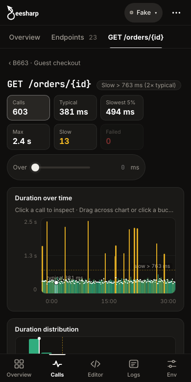
    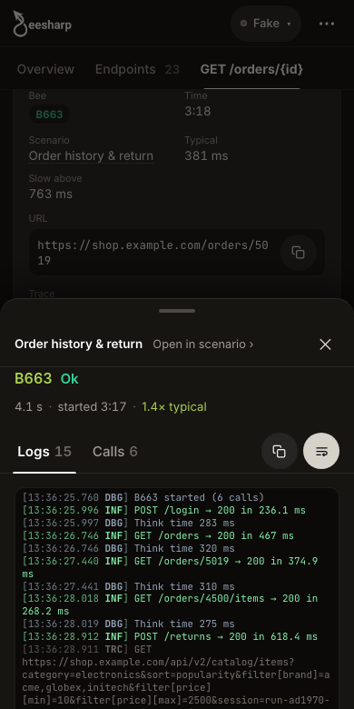
