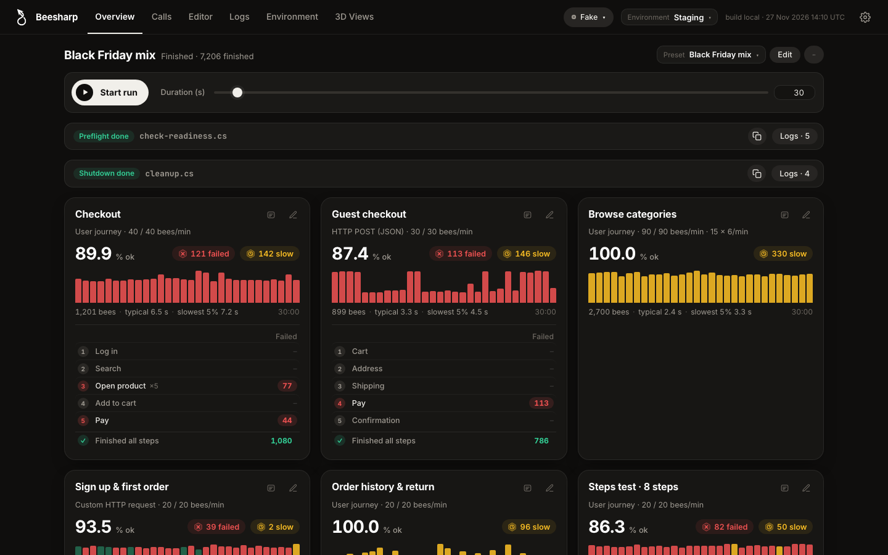
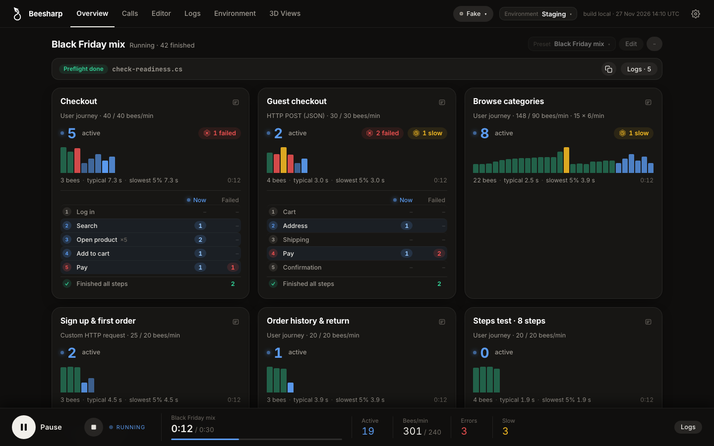
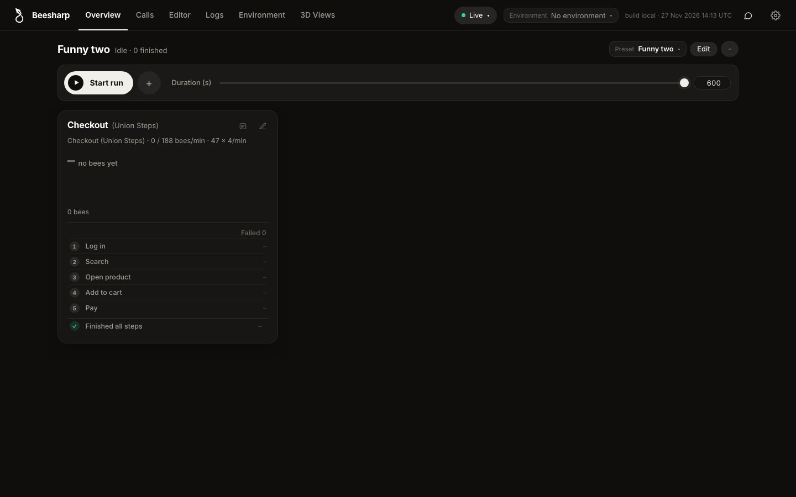
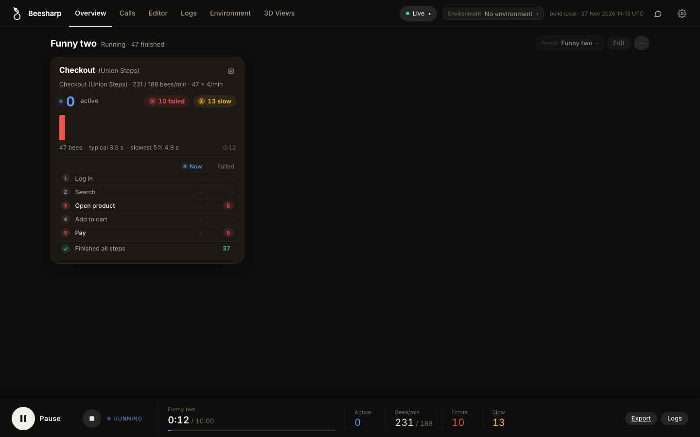
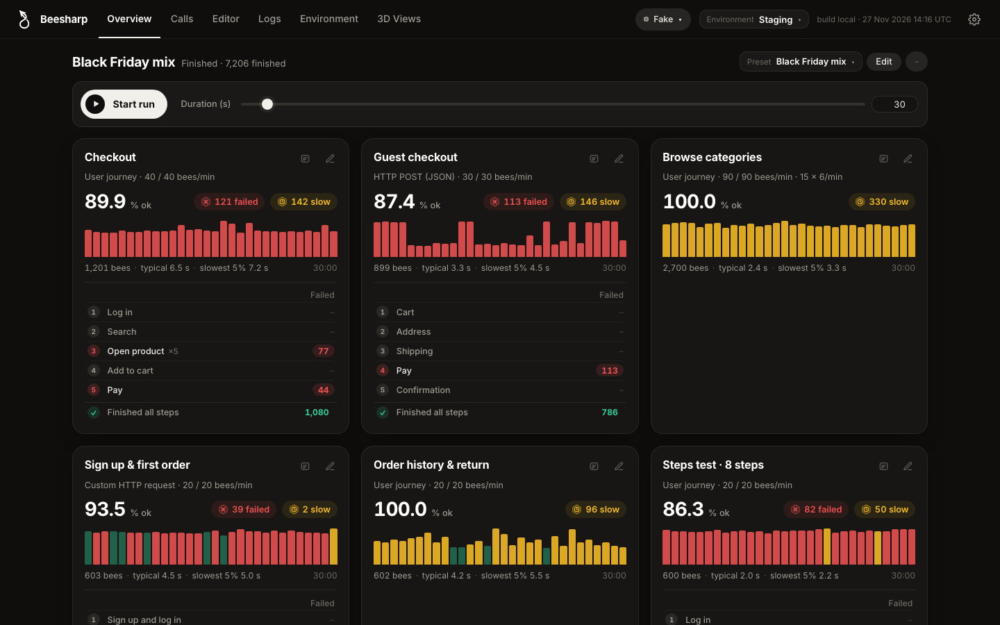
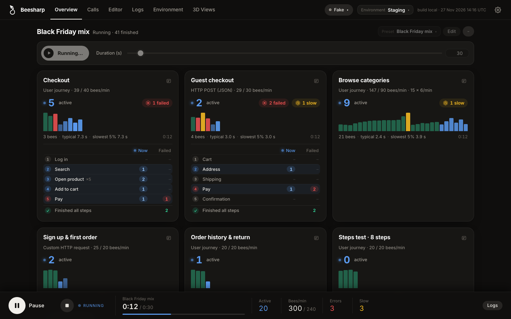
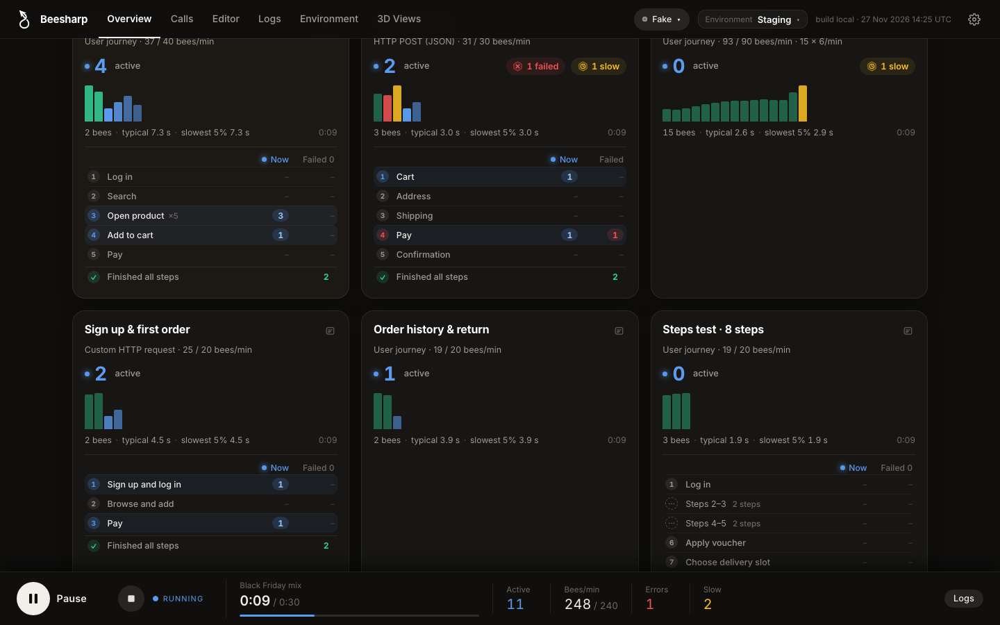
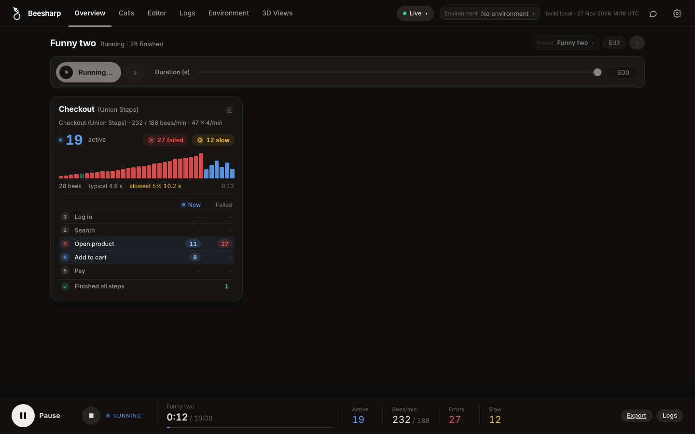
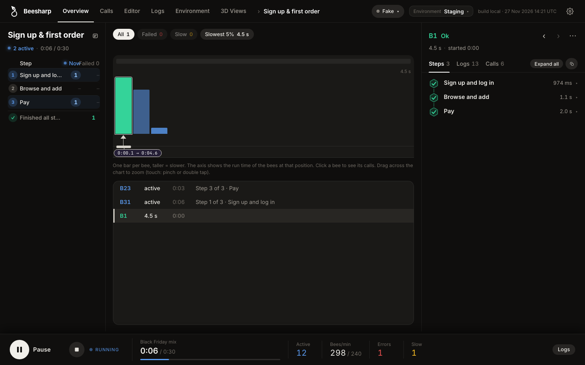

# Calm overview while a run goes (X, brain 0071)

Fake mode `/?stepcount=8,14` at 1440x900, and Live mode with the preset "Funny two".

## Before
Idle, then running 12 s after Start run: the bar with Start run is gone and the cards moved up 82 px.

Live, "Funny two":

## After
The bar stays ("Running…", disabled), the cards keep their place and height.

Folded groups keep their "Now" and "Failed" sums and never unfold by themselves (card "Steps test · 8 steps"):

Live, "Funny two":

The scenario page's step column (same rule, 10 rows at most):

