# Duration slider (brain 0073)

Run bar on the Overview, Fake mode. Before: linear 10 to 600 s slider with a number of seconds. After: non-linear slider, value as time, faint unit marks, caret menu.
Bar height: desktop 65.8 px idle and running; phone 129 px idle and running (was 119 px, the marks add 10 px).

### desktop 20s
Before: 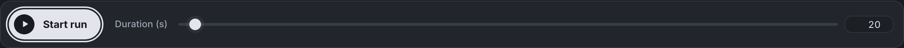

After: 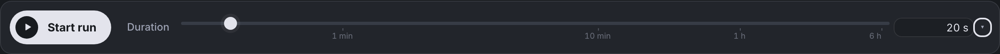

### desktop 3min
Before: 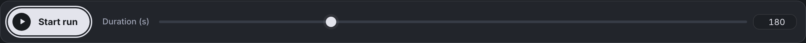

After: 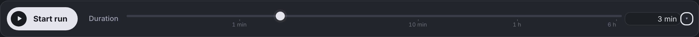

### desktop 45min
Before: 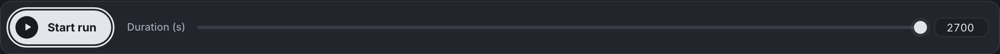

After: 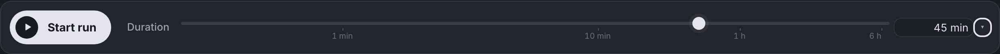

### desktop 2h
Before: 

After: 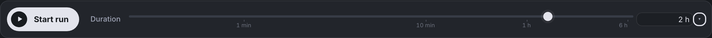

### phone 20s
Before: 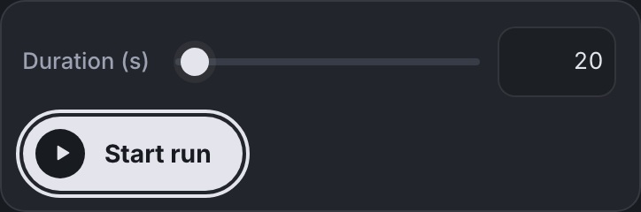

After: 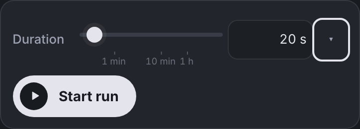

### phone 3min
Before: 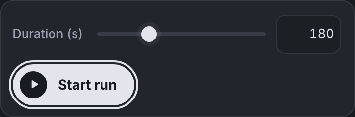

After: 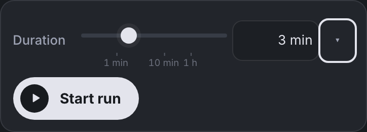

### phone 45min
Before: 

After: 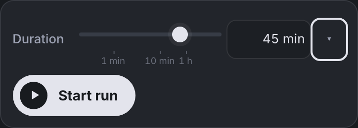

### phone 2h
Before: 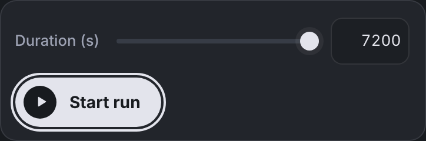

After: 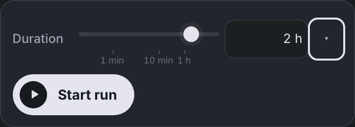

### Usual durations menu
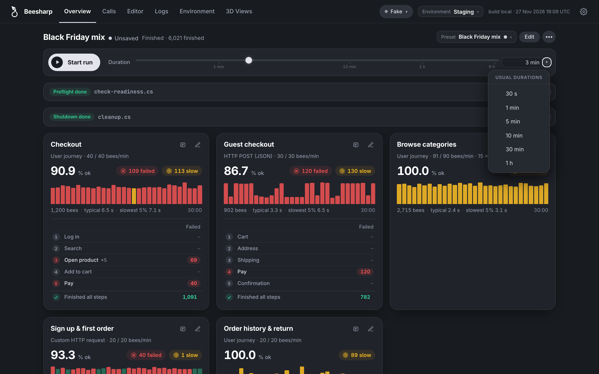

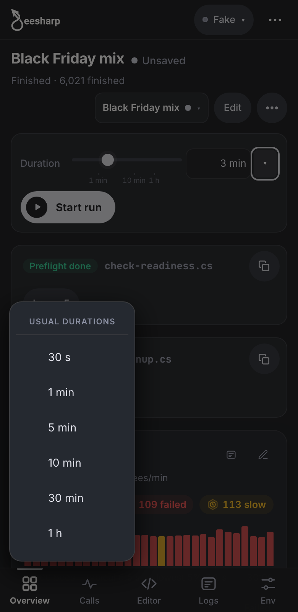

### Edit mode
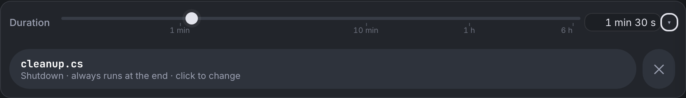

### Running (bar stays)

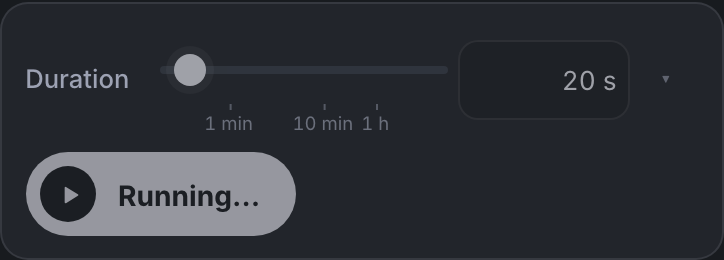
