# Labels and readable controls (L2 to L5, brain 0072)

Before = the commit before this work, after = this branch. Fake mode (seeded run) unless noted, 1440 px wide.

## L3a: the run bar says "Start run"
Live mode, preset "Funny jokes" (preflight `check-readiness.cs`). Same bar height idle and running.

| Before | After |
| --- | --- |
| 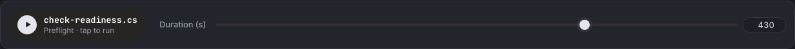 | 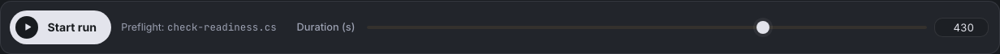 |
| 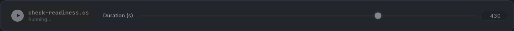 | 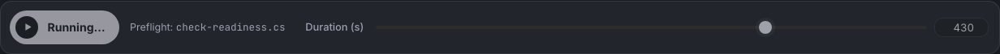 |

## L3b: the "+" is "+ Preflight"
Live mode, preset "Funny two" (no preflight).

| Before | After |
| --- | --- |
| 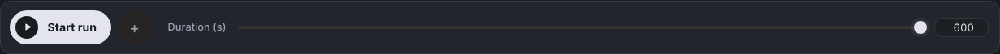 | 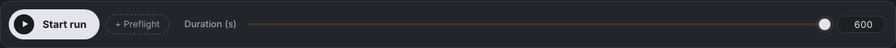 |

## L3c: "Failed bee ‹ ›"
| Before | After |
| --- | --- |
| 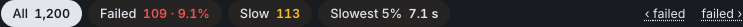 | 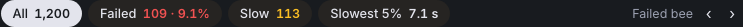 |

The whole scenario page:

| Before | After |
| --- | --- |
| 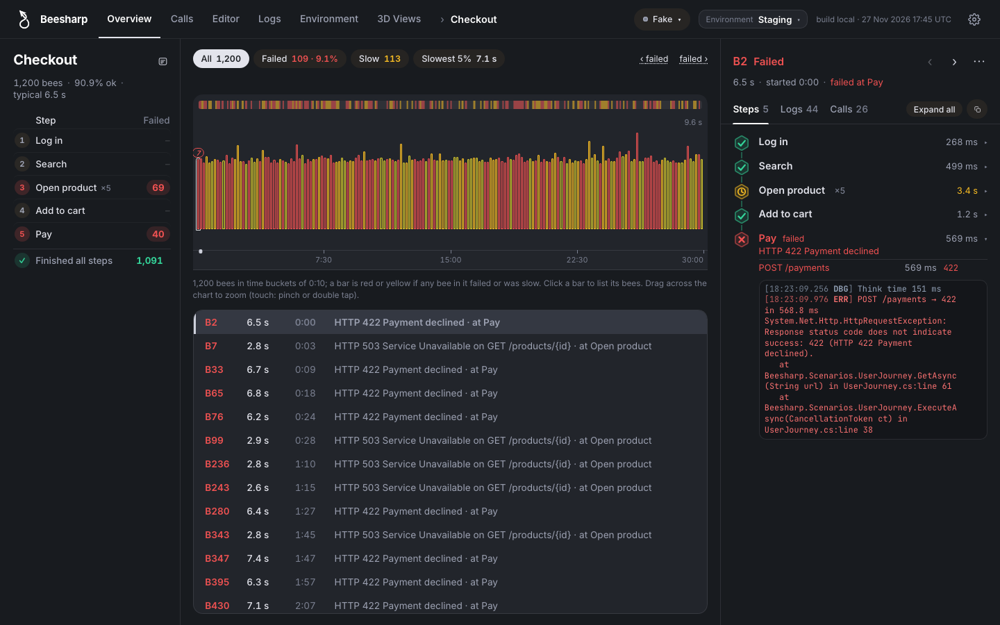 |  |

## L3d: a step's name opens the logs of that step
The step list on the overview card (names are links now), and the Logs page after clicking "Open product" on the scenario page.

| Before | After |
| --- | --- |
|  | 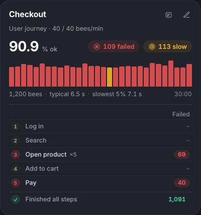 |

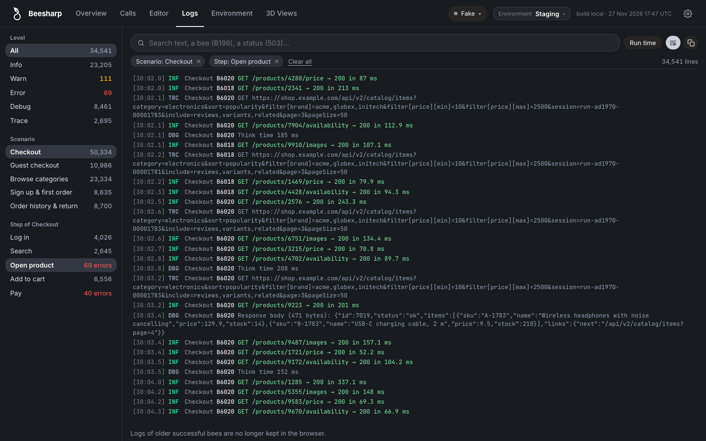

## L4: the bee's Calls tab keeps the end of a call name
| Before | After |
| --- | --- |
| 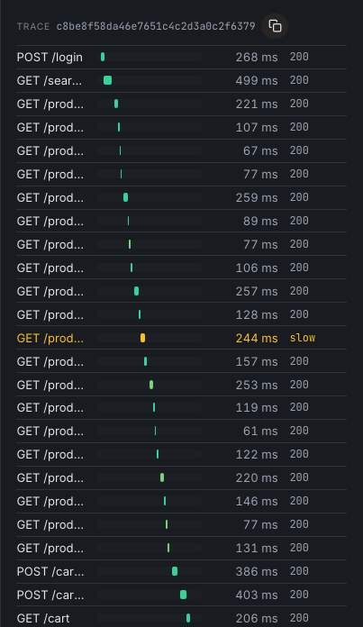 | 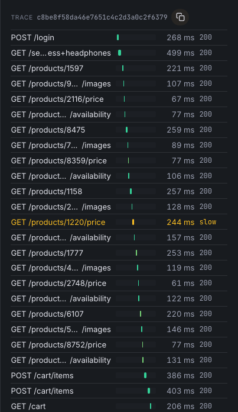 |

## L2: readable faint controls
The header of the Overview, idle and while a run goes (disabled Preset and Edit), then the edit-mode cards ("Click to edit" hint, icons).

| Before | After |
| --- | --- |
| 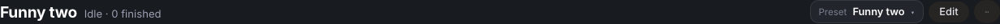 |  |
| 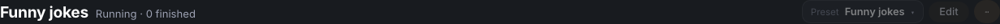 |  |
| 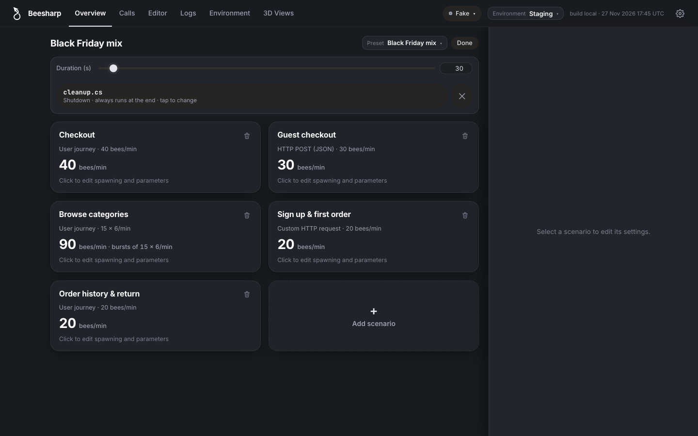 | 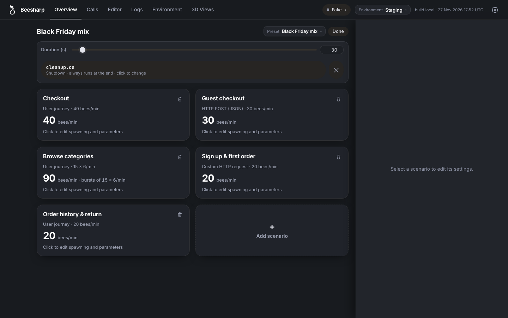 |

## L5: one mode menu
No picture: `document.querySelectorAll('.dd-menu').length` with the mode menu open was 2 before and is 1 after (checked at 1440 px and, through `layout-sizes.mjs`, at 1100, 900 and 390 px).
